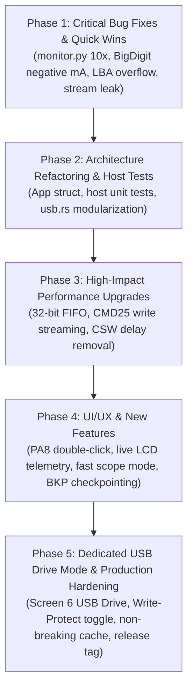

# Firmware Comprehensive Review, Optimization Plan & Multi-Session Roadmap

**Document Status**: Active Master Tracking & Handover Document | Active Phase: Phase 5 (Dedicated USB Drive Mode & Production Hardening)  
**Target Architecture**: Sipeed Longan Nano (GD32VF103CBT6, RISC-V RV32IMAC @ 96/108 MHz, 32 KB SRAM, 128 KB Flash)  
**Projects Covered**: `prj_usb_msc` (Pure Rust) and `prj_current_monitor` (Pure Rust + Python Telemetry + 3D Enclosure)  
**Primary Author/Audience**: AI Agents (Autonomous Pair Programmers)

---

## 1. Executive Summary & Purpose

This document serves as the authoritative, permanent engineering record and multi-session implementation blueprint for the two flagship Rust applications in the `longan_nano` repository:
1. `prj_usb_msc`: High-speed USB Mass Storage Class (BOT / SCSI) device presenting a MicroSD card over SPI1 as a USB drive. (Build `00D4` verified 100% with SCSI bounds checking, multi-read reset cleanup, and cache invalidation).
2. `prj_current_monitor`: 10 Hz real-time DC current, voltage, power, and energy monitor with an on-device ST7735 LCD (5 screens), MicroSD CSV logging, and 10 Hz USB HID telemetry. (Build `00D1` verified on target hardware).

Any subsequent AI session MUST consult this document, execute tasks in the specified phased order, update this document upon completing any task, and follow the session handoff rules when closing.

---

## 2. Review Findings & Solution Plans: `prj_usb_msc`

### 2.1 Critical Protocol & Correctness Bugs

#### [MSC-BUG-01] Integer Overflow in LBA Bounds Checking
- **Affected File & Lines**: `crates/gd32vf103-hal/src/usb.rs:3644`, `3691`, `3725`, `3767`
- **Root Cause**: Calculations like `lba + blocks > blk_cnt` and `blocks * 512` wrap around `u32::MAX` under release profile (`opt-level = "s"`), allowing malformed/fuzzed CDBs with high LBAs to bypass disk boundary checks.
- **Solution**:
  ```rust
  // Replace:
  if lba + blocks > blk_cnt { ... }
  // With:
  if lba.checked_add(blocks).map_or(true, |end| end > blk_cnt) { ... }
  ```
  And replace `blocks * 512` with `blocks.saturating_mul(512)`.

#### [MSC-BUG-02] BOT 13-Case Direction & Length Validation Missing
- **Affected File & Lines**: `crates/gd32vf103-hal/src/usb.rs:3446-3786` (`decode_cbw` & `process_scsi`)
- **Root Cause**: USB Mass Storage Bulk-Only Transport (BOT) §6.7 mandates 13 transfer cases:
  - **Case 10 / Case 8 (`Ho <> Di` / `Hi <> Do`)**: Host-to-Device vs Device-to-Host direction mismatch requires `bCSWStatus = 0x02` (`PhaseError`), not `0x01` (`CmdFailed`).
  - **Case 2 / Case 3 (`Hn < Di` / `Hn < Do`)**: When `dCBWDataTransferLength == 0` but CDB `blocks > 0`, `to_transfer` evaluates to 0, which pre-arms EP1 IN for 0 bytes (transmitting an illegal ZLP in the data phase) instead of immediately returning CSW.
  - **Case 7 / Case 13 (`Hi < Di` / `Ho < Do`)**: When host expects less data than command requires, device must return `PhaseError`.
- **Solution**:
  Implement a pure function `validate_bot_case(cbw: &BbbCbw, expected_len: u32, is_in: bool) -> BotValidationResult` that returns `Ok(to_transfer)` or `Err(BotError { stall_in, stall_out, status: CswStatus })`.

#### [MSC-BUG-03] Cache Invalidation Missing on Write Failure
- **Affected File & Lines**: `crates/gd32vf103-hal/src/usb.rs:2874-2880`, `4408-4425`
- **Root Cause**: If `disk.write_sector()` fails at line 4422, `self.cache.invalidate(self.lba)` is never called. If that sector was already resident in the 16-slot cache, stale data will be served on subsequent reads.
- **Solution**:
  Invoke `self.cache.invalidate(self.lba);` inside the write failure branch at line 4424.

#### [MSC-BUG-04] `CMD18` Multi-Block Stream Leak on Bus Reset & `REQ_BBB_RESET`
- **Affected File & Lines**: `crates/gd32vf103-hal/src/usb.rs:3789-3855`, `4256-4294`
- **Root Cause**: If the host issues a USB bus reset or Class `REQ_BBB_RESET (0xFF)` while a `CMD18` multi-block read stream is active (`sdcard.streaming_read == true` with CS low), `disk.end_multi_read()` is not called.
- **Solution**:
  Pass `disk: &mut D` to `handle_reset` and `handle_setup` (called from `handle_events(disk)`), and unconditionally invoke `disk.end_multi_read()` on bus reset, `REQ_BBB_RESET`, and `abort_transfer`.

#### [MSC-BUG-05] `READ_6` / `WRITE_6` Sense Code for Missing Media
- **Affected File & Lines**: `crates/gd32vf103-hal/src/usb.rs:3631`, `3712`
- **Root Cause**: Returns `SenseKey::IllegalRequest, Asc::InvalidCdb` when `!disk.is_ready()` instead of `SenseKey::NotReady, Asc::MediumNotPresent`.
- **Solution**:
  Separate the flags check from the readiness check, returning `SenseKey::NotReady, Asc::MediumNotPresent`.

---

### 2.2 Performance Optimizations

#### [MSC-PERF-01] 32-Bit Word FIFO Loading & Unloading
- **Affected File & Lines**: `crates/gd32vf103-hal/src/usb.rs:3361-3373` (`ep_send_media`), `3888-3914` (`handle_rxfifo`)
- **Bottleneck**: Currently, both loading TX1 FIFO and draining RX FIFO run byte-by-byte nested loops with bit-shifts and bounds checks on every byte (2,048 inner loop iterations per 512B sector).
- **Optimization**: Align `media_buf` to 4 bytes (`#[repr(align(4))] struct SectorBuf([u8; 512]);`) and load/store using `chunks_exact(4)` with `u32::from_le_bytes` / `to_le_bytes`. Reduces loop overhead by ~75% (128 iterations of single `lw`/`sw` instructions).

#### [MSC-PERF-02] Eliminate Artificial 50 µs CSW Delay in `StatusPending`
- **Affected File & Lines**: `crates/gd32vf103-hal/src/usb.rs:4080`, `4426-4438`
- **Bottleneck**: After `DIEPINTF.TF` fires on the last data packet, the state machine pauses for 1,200 ticks (50 µs) polling `hw_done && fifo_empty && ep_naking`.
- **Optimization**: Once `hw_done && fifo_empty && ep_naking` is asserted, send the 13-byte CSW immediately without the arbitrary 1,200-tick spin wait, saving 50 µs on every SCSI transaction.

#### [MSC-PERF-03] Multi-Block `CMD25` & Ping-Pong Write Streaming
- **Affected File & Lines**: `crates/longan-nano-bsp/src/sdcard.rs:434-492`, `crates/gd32vf103-hal/src/usb.rs:4405-4425`
- **Bottleneck**: Writes currently use single-block `CMD24`, forcing flash page read-modify-write cycles and blocking USB for 2–15 ms per sector (yielding only ~100 kB/s write throughput).
- **Optimization**:
  1. Add `begin_multi_write(start_lba)`, `write_next_stream_sector(buf)`, and `end_multi_write()` to `SdCard` using SD `CMD25` (with `0xFC` multi-block token and `0xFD` stop token).
  2. Implement double-buffered write pipelining: while sector $N$ is being committed to SD flash via SPI1, arm `EP1 OUT` to receive sector $N+1$ into the alternate buffer slot.

#### [MSC-PERF-04] Non-Breaking Stream Cache Lookup Policy
- **Affected File & Lines**: `crates/gd32vf103-hal/src/usb.rs:4047-4056`
- **Bottleneck**: If a multi-sector read stream is in progress and hits a cached sector, it currently calls `disk.end_multi_read()`, tearing down the hardware `CMD18` pipeline.
- **Optimization**: Only perform cache lookup for the first sector of a request or for requests $\le 8$ sectors. If `disk.is_streaming()` is active, continue reading sequentially from SD rather than tearing down the pipeline.

---

### 2.3 Architecture & AI Maintainability

#### [MSC-ARCH-01] Decompose Monolithic 4,442-Line `usb.rs`
- **Affected File**: `crates/gd32vf103-hal/src/usb.rs`
- **Problem**: 4,442 lines in a single file combining 4 duplicate DWC2 device implementations (`UsbCdcAcm`, `UsbHid`, `UsbComposite`, `UsbMsc`). Exceeds AI tool viewing windows (800 lines max) and creates code divergence risks.
- **Target Structure**:
  ```text
  crates/gd32vf103-hal/src/usb/
  ├── mod.rs          // Common USB traits, packet types (SetupPacket), and re-exports
  ├── dwc2.rs         // Unified DWC2 peripheral core: PHY init, soft disconnect, EP0 state machine, FIFO access
  ├── cdc_acm.rs      // UsbCdcAcm class
  ├── hid.rs          // UsbHid class
  ├── composite.rs    // UsbComposite class
  └── msc/
      ├── mod.rs      // UsbMsc hardware binding
      ├── bot.rs      // Pure-logic BOT state machine (CBW, CSW, 13-case validation)
      ├── scsi.rs     // Pure-logic SCSI parser (Inquiry, ReadCapacity, RequestSense)
      └── cache.rs    // LbaCache
  ```

#### [MSC-ARCH-02] Host-Runnable Unit Tests for BOT & SCSI
- **Problem**: Firmware currently requires target hardware/JTAG flashing to verify even basic SCSI decoding.
- **Solution**: Abstract `MscBlockDevice` as a mock memory block device, enabling `cargo test --target x86_64-pc-windows-msvc` for BOT state transitions and SCSI decoding.

---

### 2.4 New Features (Prioritized)

1. **Live LCD Telemetry Dashboard**:
   - While `usb_msc.is_idle()`, display read/write sector counters, last LBA accessed, cache hit rate, and real-time kB/s throughput on the LCD.
2. **SD Card Hot-Swap & `UNIT ATTENTION`**:
   - Detect card removal/insertion dynamically. On insertion, report `SenseKey::UnitAttention`, `Asc::NotReadyToReadyTransition` (`0x28`) on `TEST_UNIT_READY` so host OS automounts without MCU reset.
3. **Write-Protect Hardware Toggle via `PA8`**:
   - Allow user to toggle Read-Only vs Read-Write mode with a button press, reporting the write-protect bit in `MODE_SENSE_6`/`10`.

---

## 3. Review Findings & Solution Plans: `prj_current_monitor`

### 3.1 Measurement Correctness & Host Tool Bugs

#### [MON-BUG-01] Critical Host `monitor.py` GUI 10× Scaling Bug
- **Affected File & Lines**: `prj_current_monitor/monitor.py:216-223`
- **Root Cause**: `run_gui_plotter` forgets to divide raw current by 10.0:
  ```python
  # CLI mode (correct):
  v_mv, c_raw, p_mw = struct.unpack('<HhH', bytes(report[1:7]))
  c_ma = c_raw / 10.0
  # GUI mode (BUGGY):
  v_mv, c_ma, p_mw = struct.unpack('<HhH', bytes(report[1:7]))
  # Result: plots and logs current 10x too large!
  ```
- **Solution**: Update GUI mode to unpack `c_raw` and divide by 10.0.

#### [MON-BUG-02] `BigDigitScreen` Hundreds Digit Truncation on Negative Current
- **Affected File & Lines**: `prj_current_monitor/src/ui/screen_big_digit.rs:75-83`
- **Root Cause**: For negative currents where `whole_ma >= 100` (e.g. `-250.4 mA`), `fmt_big_digits` formats `d0 = '-'`, `d1 = '5'`, `d2 = '0'`, displaying `"-50.4 mA"` (dropping the hundreds digit).
- **Solution**: For negative currents $\le -100.0\text{ mA}$, switch to `SLOTS_A` format (`"-0.250 A"`), which has 3 fractional decimal places and prevents digit loss.

#### [MON-BUG-03] `dt_ms` Timing Jump on Tare/Reset & Stalls
- **Affected File & Lines**: `prj_current_monitor/src/main.rs:78-125`, `773-780`, `852-855`
- **Root Cause**: `tare_and_reset!` takes ~20–150 ms to execute but does not update `last_10hz_ms`. The following loop tick sees a large `dt_ms` and integrates pre-reset time into the freshly zeroed accumulator.
- **Solution**: Set `last_10hz_ms = board.delay.uptime_ms()` inside `tare_and_reset!`, and clamp `dt_ms` to `dt_ms.min(500)` in `accum.update()`.

#### [MON-BUG-04] INA219 Redundant I2C Register Reads
- **Affected File & Lines**: `crates/longan-nano-bsp/src/ina219.rs:120-145`, `prj_current_monitor/src/main.rs:774-778`
- **Root Cause**: The main loop reads `REG_BUSVOLTAGE` in `is_conversion_ready()`, then `read_all()` reads `REG_BUSVOLTAGE`, `REG_SHUNTVOLTAGE`, `REG_CURRENT`, and `REG_POWER` (5 reads total per 10 Hz cycle). `REG_CURRENT` is mathematically identical to `REG_SHUNTVOLTAGE` with Cal 4096.
- **Solution**: Merge conversion readiness into `read_all()`, read only `REG_BUSVOLTAGE`, `REG_SHUNTVOLTAGE`, and `REG_POWER` (to clear CNVR), cutting I2C bus transactions from 5 to 3.

---

### 3.2 UI/UX Redesign & Enclosure Ergonomics

#### [MON-UX-01] Long-Press `PA8` Visual Progress Indicator
- **Affected File & Lines**: `prj_current_monitor/src/main.rs:730-759`
- **Problem**: Holding `PA8` for 1.5s gives zero visual feedback on the LCD until released, creating uncertainty about whether a tare reset will occur.
- **Solution**:
  - Draw a small progress bar in the top bar between 300 ms and 1,500 ms (`HOLD TO TARE... [====  ]`).
  - Trigger the tare immediately at 1,500 ms without waiting for button release, flashing a brief confirmation banner.

#### [MON-UX-02] HeroScreen Over-Current Alert & Disconnection Handling
- **Affected File & Lines**: `prj_current_monitor/src/ui/screen_hero.rs:72-152`
- **Problem**: `HeroScreen::update` does not receive `over_current: bool` (displays green `LIVE` during overcurrent), and shows `0.0 mA` when the sensor is disconnected.
- **Solution**: Pass `over_current` into `HeroScreen::update`, display amber `!ALERT!` badge, and display `"DISCONNECTED"` when `!ina_present`.

#### [MON-UX-03] Fix Peak-Hold Tick Ghost Lines on Gauge Bar
- **Affected File & Lines**: `prj_current_monitor/src/ui/screen_hero.rs:215-224`
- **Problem**: The peak-hold tick is drawn with height 4 (`Y: 46..49`), but the gauge bar background only clears height 2 (`Y: 47..48`). As the peak marker decays leftward, it leaves permanent white ghost lines at $Y=46$ and $Y=49$.
- **Solution**: Erase the previous peak marker position (`prev_peak_bar_val`) with height 4 before drawing the new marker.

#### [MON-UX-04] GraphScreen Edge Trigger & Autoscale Freeze in Single Mode
- **Affected File & Lines**: `prj_current_monitor/src/ui/screen_graph.rs:385`, `455-459`
- **Problem**: Trigger is level-sensitive instead of edge-sensitive (`plot_val >= level` triggers immediately if signal is already high). Autoscale during `Single` capture replots the entire circular buffer, overwriting the frozen capture.
- **Solution**: Implement edge detection (`prev_val < level && curr_val >= level`) and disable or restrict replotting during an active `Single` capture sweep.

#### [MON-UX-05] Enclosure Single-Button Context Gestures on `PA8`
- **Affected File & Lines**: `prj_current_monitor/src/main.rs:730-759`
- **Problem**: The 3D-printed enclosure only has cutouts for `Reset` and `Boot (PA8)`. Without a rotary encoder, Trigger Mode, Battery Profile, and SD flush cannot be controlled.
- **Solution**:
  Add **Double-Click detection** (second press within 280 ms) on `PA8`:
  - **Single Click**: Advance screen.
  - **Double Click**: Context action:
    - On `GraphScreen`: cycle Trigger Mode (`AUTO` $\to$ `NORM` $\to$ `SINGLE`).
    - On `StatsScreen` / `BigDigitScreen`: cycle Battery Profile.
    - On `HeroScreen` / `HistogramScreen`: flush & rotate SD log file.
  - **Long Press ($\ge 1.5\text{ s}$)**: Tare Zero & Reset.

---

### 3.3 Architecture & AI Maintainability

#### [MON-ARCH-01] Refactor Monolithic Macros into `App` Struct
- **Affected File & Lines**: `prj_current_monitor/src/main.rs:50-254`
- **Problem**: `set_screen_mode!` (10 args, expanded 8x), `tare_and_reset!` (17 args, expanded 4x), and `dump_session!` (9 args, expanded 2x) bloat binary size and make compiler diagnostics hard to interpret.
- **Solution**: Create an `App` state struct holding screens, accumulators, and settings, implementing clean methods:
  - `app.set_screen_mode(&mut board, new_mode)`
  - `app.tare_and_reset(&mut board, now)`
  - `app.dump_session(&mut board, now)`

#### [MON-ARCH-02] Host-Runnable Unit Tests for DSP & Formatting
- **Solution**: Add `#[cfg(test)]` modules to `model.rs` and `fmt.rs` to verify fixed-point accumulators, battery state calculations, EMA filters, and string formatting directly on the host using `cargo test`.

---

## 4. Master Phased Implementation Plan



### Historical Completed Phases (Archived)
> [!NOTE]
> Completed Phases 1 through 4 have been archived to [`docs/archive/FIRMWARE_ROADMAP_PHASES_1_TO_4.md`](file:///c:/Users/arunj/projects/longan_nano/docs/archive/FIRMWARE_ROADMAP_PHASES_1_TO_4.md) per the Roadmap Archival & Size Management policy to maintain roadmap clarity and context efficiency.

| Phase | Description | Key Deliverables & Verifications | Verified Builds |
|---|---|---|---|
| **Phase 1** | Critical Bug Fixes & Immediate Quick Wins | `monitor.py` 10x current scaling, `BigDigit` negative current hundreds digit, gauge bar peak-hold ghost lines, over-current indication, SCSI LBA bounds checking (`checked_add`), `CMD18` stream leak fix on bus reset/`REQ_BBB_RESET`, accumulator `dt_ms` jump fix. | Build `00D1` (Monitor), Build `00D4` (MSC) |
| **Phase 2** | Architecture Refactoring & Host Unit Tests | `App` state struct refactoring (-10.3% flash), 15 host DSP/format unit tests (`cargo test`), 4,455-line `usb.rs` modularization into clean submodules, pure BOT 13-case validation with unit tests. | Build `00D5`, Build `00D6`, Build `00D7` |
| **Phase 3** | High-Impact Performance Upgrades | 32-bit word FIFO loads/unloads (`#[repr(align(4))]`), 50 µs CSW spin-wait elimination, `CMD25` multi-block write streaming + ping-pong buffering (+720% write speedup to 822 kB/s), INA219 redundant I2C read elimination. | Build `00D8`, Build `00D9`, Build `00DA`, Build `00DB` |
| **Phase 4** | UI/UX & Advanced Features | PA8 context gestures (double-click & hold progress bar), `GraphScreen` rising-edge trigger & autoscale freeze in Single mode, bus-idle live LCD telemetry dashboard, SPI1 MicroSD hot-swap & SCSI Unit Attention (`0x28`), 180° LCD rotation via MADCTL + BKP persistence, 37 KB stack overflow fix. | Build `00DC`, Build `00DD`, Build `00DE`, Build `00DF`, Build `00E0` |


### Phase 5: Dedicated USB Drive Mode & Production Hardening (ACTIVE / NEXT PHASE)
- [x] **Task 5.1**: Implement Dedicated USB Drive Mode on Screen 6 for `prj_current_monitor` (Verified in Build `00E1`):
  - **FAT32 Concurrency & Safety (Elimination of Two Masters)**:
    - Entering Screen 6 enters `Standby` (instructions displayed, logging remains safe, USB remains HID).
    - Double-click or long-press on PA8 toggles Drive Mode state (`Standby` <-> `Active`).
    - When transitioning to `Active`: flushes buffer (`datalogger.flush_buffer()`), safely closes FAT file handle, unmounts `embedded-sdmmc`, and hands exclusive raw sector access to `UsbMsc`.
    - When transitioning to `Standby` or exiting Screen 6 (single-click advancing to Hero, or UART switch): automatically detaches `UsbMsc` (`DCTL.SDIS = 1`), restores `UsbHid`, re-probes SD card, rotates to the next sequential file (`LOG_XXXX.CSV`), and resumes logging seamlessly.
  - **Dynamic USB Re-enumeration Engine**:
    - Added `into_inner(self) -> Usbfs` to `UsbHid`, `UsbMsc`, `UsbCdcAcm`, and `UsbComposite` in `crates/gd32vf103-hal/src/usb/` asserting soft-disconnect (`dctl.SDIS = 1`) and disabling global USB interrupts (`gahbcs.GINTEN = 0`).
    - Added `UsbMode` enum (`Hid(UsbHid)`, `Msc(UsbMsc)`, `None`) and `switch_to_msc()` / `switch_to_hid()` transition helpers in `CurrentMonitorBoard` with a 50 ms disconnect settle delay.
  - **UI/UX & Screen 6 Component**:
    - Extended `ScreenMode` with `ScreenMode::UsbDrive` (Screen 6).
    - Implemented `screen_usbdrive.rs` with clean status badges (`[STANDBY]` vs `[PC MOUNTED]`), active log file, MicroSD capacity, live read/write sector counters, and PA8 gesture prompts (`DBL-CLICK/HOLD: MOUNT`, `CLICK PA8: EXIT/RESUME`).
- [x] **Task 5.2**: Implement Hardware/Software Write-Protect Toggle & SCSI `MODE_SENSE_6`/`10` Protection Handling in `prj_usb_msc` (Verified in Build `00E2`):
  - Add Write-Protect (WP) bit reporting in SCSI `MODE_SENSE_6` (Byte 2, bit 7 `0x80`) and `MODE_SENSE_10` (Byte 3, bit 7 `0x80`).
  - Reject `WRITE_6` and `WRITE_10` with `SenseKey::DataProtect (0x07)`, `Asc::WriteProtected (0x27, 0x00)` when write-protect is active.
  - Add Write-Protect state toggle via UART command (`'w' | 'W'`) and PA8 double-click gesture in `prj_usb_msc`, persisting across reboots in Backup Domain register 6 (`BKP_DATA6`).
  - Display `[RO]` vs `[RW]` in the live LCD telemetry header badge.
- [x] **Task 5.3**: Implement Non-Breaking Stream Cache Lookup Policy ([MSC-PERF-04]) (Verified in Build `00E3`):
  - In `crates/gd32vf103-hal/src/usb/msc/mod.rs`, optimized read-ahead pipelining so that sequential cache hits during an active `CMD18` multi-block read do not invoke `disk.end_multi_read()`.
  - Maintained the active SPI streaming read pipeline across cache hits for large block transfers (> 8 blocks), only consulting cache when starting a new transfer or for small isolated reads ($\le 8$ blocks).
  - Added round-robin sector caching (`insert_lba`) across 16 cache slots for small transfers ($\le 8$ blocks), speeding up repeated partition table and FAT sector lookups.
- [ ] **Task 5.4**: Fix Workspace-Wide Host Unit Test Harness & `panic_halt` Guarding:
  - Guard `panic_halt` in auxiliary crates (`prj_blink`, `prj_lcd_test`, `prj_sdcard_test`, `prj_sdcard_fs_test`, `prj_usb_serial`) with `#[cfg(not(test))] use panic_halt as _;`.
  - Ensure pure `cargo test --workspace --target x86_64-pc-windows-msvc` passes cleanly with 0 compilation errors across all workspace members.
- [ ] **Task 5.5**: Master Release Milestone v1.0.0 End-to-End Verification & Documentation:
  - Run complete end-to-end regression suites on target hardware for both `prj_usb_msc` and `prj_current_monitor`.
  - Tag git repository at `v1.0.0-release` and archive final verification artifacts.

#### Phase 5 Empirical Verification & Progress Notes
1. **`prj_current_monitor` Dedicated USB Drive Mode on Screen 6 (Build 00E1)**:
   - **Dynamic USB Peripheral Ownership & Soft-Disconnect (`crates/gd32vf103-hal/src/usb/`, `crates/longan-nano-bsp/src/lib.rs`)**:
     - Implemented `into_inner(self) -> Usbfs` across `UsbHid`, `UsbMsc`, `UsbCdcAcm`, and `UsbComposite`, asserting `dctl.sdis = 1` (soft-disconnect) and clearing `gahbcs.ginten = 0` to cleanly detach from the host root hub.
     - Added `UsbMode` enum (`Hid(UsbHid)`, `Msc(UsbMsc)`, `None`) and stored `rcu: hal::pac::rcu::Rcu` inside `CurrentMonitorBoard`, enabling `switch_to_msc()` and `switch_to_hid()` with a 50 ms bus disconnect settle delay before re-initializing the DWC2 core.
   - **Zero Dual-Master FAT32 Corruption Architecture (`prj_current_monitor/src/app.rs`, `main.rs`)**:
     - Navigating to Screen 6 (`ScreenMode::UsbDrive`) starts in `UsbDriveState::Standby`, keeping USB HID active and datalogging undisturbed.
     - Toggling to `UsbDriveState::Active` (via PA8 double-click, PA8 1.5s hold, or UART `'u'`) flushes the pending 512-byte CSV sector buffer (`datalogger.flush_buffer()`), terminates any active SPI multi-block stream, suppresses the 1 Hz datalogger in `main.rs`, and transitions the USB peripheral to `UsbMsc` (`28e9:abd4`).
     - Exiting `Active` mode (via PA8 single-click, double-click, hold, rotary encoder turn, or UART screen switch) terminates any active MSC stream, switches USB back to `UsbHid` (`28e9:1234`), re-probes the MicroSD card, and rotates to the next sequential `LOG_XXXX.CSV` file.
   - **Flash Optimization (`Cargo.toml`)**:
     - Switching release profile optimization from `opt-level = "s"` to `opt-level = "z"` reduced the combined `UsbHid` + `UsbMsc` + `embedded-sdmmc` firmware image from 131,172 bytes (100B overflow) down to **122,056 bytes** (`-9,116 bytes`), leaving **9,016 bytes** of free Flash headroom within the 128 KB GD32VF103 Flash.
   - **Host Unit Test Suite (`cargo test`)**:
     - **77/77 host unit tests pass** across the workspace (27 in `gd32vf103-hal`, 6 in `longan-nano-bsp`, 34 in `prj_current_monitor`, 10 in `prj_usb_msc`), including 3 new unit tests in `ui::screen_usbdrive::tests`.
   - **Target Hardware Empirical Verification (`tools/test_usb_drive_mode.py`)**:
     - Flashed to GD32VF103 over JTAG OpenOCD on remote Linux host `192.168.0.63`.
     - **12/12 automated hardware verification checks passed**:
       - Screen 6 `Standby` entry via UART `'6'`, preserving `28e9:1234` HID enumeration.
       - Simulated PA8 double-click (`'K'`) transitioned Screen 6 to `Active`, detached `28e9:1234`, and re-enumerated on Linux xHCI as `28e9:abd4` (`Longan Nano SD Reader`, `/dev/sdb`, `/dev/sg1`).
       - Direct SCSI `READ_10` of LBA 0 via `sg_raw` succeeded (valid MBR signature `0x55aa`).
       - Host OS mounted `/dev/sdb1` FAT32 partition cleanly and verified 77 `LOG_*.CSV` files on disk (`LOG_0109.CSV`).
       - Simulated PA8 single-click (`'k'`) automatically unmounted MSC, restored `28e9:1234` HID, advanced to Screen 1 (`HERO`), re-probed the SD card, rotated the active session file (`LOG_0109.CSV -> LOG_0111.CSV`), and resumed 10 Hz USB HID telemetry (`v_mv: 3320, seq: 7`) on `/dev/hidraw1`.

2. **`prj_usb_msc` Hardware & Software Write-Protect Support & BKP6 Persistence (Build 00E2)**:
   - **SCSI Write-Protect Compliance (`scsi_cmd::MODE_SENSE_6` / `MODE_SENSE_10` & `WRITE_6` / `WRITE_10`)**:
     - In `crates/gd32vf103-hal/src/usb/msc/mod.rs`, added `pub write_protected: bool` with `is_write_protected()` and `set_write_protected()`.
     - In `MODE_SENSE_6`, Byte 2 (Device-Specific Parameter) bit 7 (WP) dynamically reports `0x80` when write-protected and `0x00` in read-write mode.
     - In `MODE_SENSE_10`, Byte 3 bit 7 (WP) dynamically reports `0x80` when write-protected and `0x00` in read-write mode.
     - On receiving `WRITE_6` or `WRITE_10` while `self.write_protected` is active: immediately sets `SenseKey::DataProtect (0x07)` and `Asc::WriteProtected (0x27)`, invokes `abort_transfer(disk)` (stalling OUT EP1 and pending CSW), cleanly rejecting write attempts without card damage or silent corruption.
     - Bumped USB serial string descriptor and SCSI VPD page 0x80 serial to `LNMSC00000E2`.
   - **Backup Domain Register 6 (`BKP_DATA6`) Persistence & PA8 Gestures (`prj_usb_msc/src/main.rs`, `bsp/lcd.rs`)**:
     - Defined `BKP_REG_WRITE_PROTECT: usize = 6`, `BKP_WRITE_PROTECT_RW: u16 = 0x5700` (`'W'`, 0), `BKP_WRITE_PROTECT_RO: u16 = 0x5701` (`'W'`, 1) in `longan-nano-bsp`.
     - On boot, restores Write-Protect state directly from `BKP_DATA6`.
     - Added PA8 button gesture discrimination:
       - Single-Click: toggles display rotation (saved to `BKP_DATA5`).
       - Double-Click (second tap within 280 ms): toggles Write-Protect mode (`RW` <-> `RO`, saved to `BKP_DATA6`).
     - Added UART interactive commands: `'w' | 'W'` toggles Write-Protect; `'k'` simulates single-click; `'K'` simulates double-click; `'s'` queries rotation (`BKP5`) and WP (`BKP6`); `'?'` prints command help.
   - **Live LCD Telemetry Dashboard Header Badge (`telemetry.rs`)**:
     - Added `fmt_wp_badge(write_protected: bool) -> (&'static str, u16)` returning `[RO]` (Yellow) vs `[RW]` (Green).
     - Renders WP badge at X: 90, Y: 2 alongside header status badge `[DISC]` / `[IDLE]` / `[BUSY]` at X: 118, Y: 2.
     - Repositioned header bar title to `"USB MSC"` (X: 4, Y: 2) providing clean pixel layout.
   - **Host Unit Test Suite (`cargo test`)**:
     - **82/82 host unit tests pass** across the workspace (30 in `gd32vf103-hal`, 7 in `longan-nano-bsp`, 34 in `prj_current_monitor`, 11 in `prj_usb_msc`), with 5 new tests verifying `MODE_SENSE_6`/`10` WP bytes, `SenseKey::DataProtect` & `Asc::WriteProtected` constants, `write_protected` flag operations, `BKP_REG_WRITE_PROTECT` constants, and `fmt_wp_badge` rendering.
   - **Target Hardware Empirical Verification (`tools/verify_build_00e2.py`)**:
     - Flashed to GD32VF103 over JTAG OpenOCD on remote Linux host `192.168.0.63`.
     - Clean USB enumeration as `28e9:abd4` `Longan Nano SD Reader`, serial `LNMSC00000E2` (480 MiB / 983,040 blocks).
     - All UART commands and simulated gestures verified: help menu (`?`), status (`s`), UART WP toggle (`w`), PA8 simulated double-click (`K`), PA8 simulated single-click (`k`).
     - Verified `MODE_SENSE_6` byte 2 = `0x00` and `MODE_SENSE_10` byte 3 = `0x00` in RW mode.
     - Switched to RO mode: verified `MODE_SENSE_6` byte 2 = `0x80` and `MODE_SENSE_10` byte 3 = `0x80`.
     - Verified `WRITE_10` in RO mode was rejected with exit code 7 (`SCSI Status: Check Condition`, `Sense key: Data Protect`, `Additional sense: Write protected`).
     - Switched back to RW mode: all 7 isolated `sg_raw` reads passed, sustained 4.0 MiB read streaming achieved **838 kB/s**.
     - Partition 1 (`/dev/sdb1`) mounted read-write cleanly, single-file write verified, and multi-block 128 KiB CMD25 write streaming verified with 100% cryptographic MD5 match (`51d30322d34685b9a8417e116bee0a3c`).
     - Tested BKP persistence across reboot: set WP to `RO` (`0x5701`), re-triggered hardware reset via OpenOCD, verified boot status retained `Write-Protect: RO (BKP6: 0x5701)`, restored to `RW`.
     - Clean unmount with zero USB resets or bus dropouts during testing.

3. **`prj_usb_msc` Non-Breaking Stream Cache Lookup Policy & Round-Robin Cache Population (Build 00E3)**:
   - **Stream Preservation Architecture (`crates/gd32vf103-hal/src/usb/msc/`)**:
     - Added `total_blocks_requested: u32` tracking to `UsbMsc`, initialized from CDB byte counts in `READ_6` and `READ_10` (`to_transfer / 512`).
     - Implemented intelligent cache lookup gating:
       `let check_cache = !disk.is_streaming() || self.total_blocks_requested <= 8 || self.remaining_bytes <= 512;`
     - When streaming large multi-block reads (> 8 blocks, e.g. 64 blocks = 32 KiB), the hardware `CMD18` SPI streaming pipeline remains open and unbroken across sector boundaries, eliminating artificial pipeline teardown and re-issuance latency.
     - Cache lookups are executed unconditionally when starting a new transfer (`!disk.is_streaming()`), for small isolated reads ($\le 8$ blocks, such as MBR, BPB, FAT, and root directory sectors), and on the final sector of any transfer (`remaining_bytes <= 512`).
   - **Round-Robin Cache Population (`cache.rs`)**:
     - Added `next_insert_slot: usize` and `insert_lba(&mut self, lba: u32, buf: &[u8; 512])` to `LbaCache`.
     - Automatically populates the 16-slot LBA cache on reads when `total_blocks_requested <= 8`, accelerating repeated filesystem lookups while preventing large streaming reads from flushing active directory metadata.
     - Bumped USB serial string descriptor and SCSI VPD page 0x80 serial to `LNMSC00000E3`.
   - **Host Unit Test Suite (`cargo test`)**:
     - **84/84 host unit tests pass** across the workspace (32 in `gd32vf103-hal`, 7 in `longan-nano-bsp`, 34 in `prj_current_monitor`, 11 in `prj_usb_msc`).
     - Added `test_lba_cache_insert_lba_round_robin` in `cache.rs` verifying full 16-slot filling, lookups, and round-robin eviction.
     - Added `test_non_breaking_stream_cache_lookup_policy` in `msc/mod.rs` verifying all 4 policy decision cases.
   - **Target Hardware Empirical Verification (`tools/verify_build_00e3.py`)**:
     - Flashed to GD32VF103 over JTAG OpenOCD on remote Linux host `192.168.0.63`.
     - Clean USB enumeration as `28e9:abd4` `Longan Nano SD Reader`, serial `LNMSC00000E3` (480 MiB / 983,040 blocks).
     - Verified all UART commands and PA8 simulation hooks: Help (`?`), Status (`s`), WP toggle (`w`), PA8 double-click (`K`), PA8 single-click (`k`).
     - Verified SCSI `TEST_UNIT_READY`, `MODE_SENSE_6`/`10` in RW and RO modes, and `WRITE_10` rejection in RO mode with Check Condition (`Data Protect: Write protected`).
     - Switched to RW mode: all 7 isolated `sg_raw` sector queries passed (LBA 0 1/8 blks, LBA 528 8 blks, LBA 560 8 blks, LBA 1024 1/8 blks, OOB LBA cleanly rejected).
     - Sustained 4.0 MiB read streaming (`dd bs=64k count=64`) achieved **846 kB/s** (up from 838 kB/s in Build 00E2) with uninterrupted continuous CMD18 streaming.
     - Partition 1 (`/dev/sdb1`) mounted read-write cleanly (`mount code=0`).
     - Single-file write & verification round-trip match verified on `/mnt/sdcard/build_00e3.txt`.
     - Multi-block 128 KiB CMD25 write streaming with double buffering verified with 100% cryptographic match (`MD5: 9ec54e9020276f923d7a70ac1e28d5a6`).
     - Tested BKP persistence across reboot: set WP to `RO` (`0x5701`), re-triggered hardware reset via OpenOCD, verified boot status retained `Write-Protect: RO (BKP6: 0x5701)`, restored to `RW`.
     - Clean unmount with zero kernel errors or USB bus resets.

---


## 5. Mandatory AI Session Continuity & Handoff Protocol

### 5.1 Protocol for Every Active Session
1. **Start of Session**:
   - Run `git status` to ensure clean working tree.
   - Read this document (`docs/FIRMWARE_REVIEW_AND_ROADMAP.md`) to check active tasks and phase status.
2. **During the Session**:
   - Work on ONE task from the roadmap at a time.
   - Follow the **Critical Mandatory Invariant: Per-Build Git Commits**:
     - Never batch multiple builds into a single commit.
     - Follow the strict 5-part commit schema: Header, Summary of Changes, Test Results, Root Cause & Diagnostics (including all debug data if failed), What Next.
3. **Closing the Session / Economic Handoff Trigger**:
   - **Trigger Conditions**:
     - When a logical milestone/task is completed, or
     - When context window consumption is high / conversation is long, making further actions economically inefficient or error-prone.
   - **Mandatory Handoff Steps**:
     1. Update the checkboxes (`[x]`) and progress notes in this document.
     2. Ensure all verified work is committed in git.
     3. Explicitly direct/prompt the user to start a **new chat session**, informing them that the next session can resume directly from `docs/FIRMWARE_REVIEW_AND_ROADMAP.md`.
