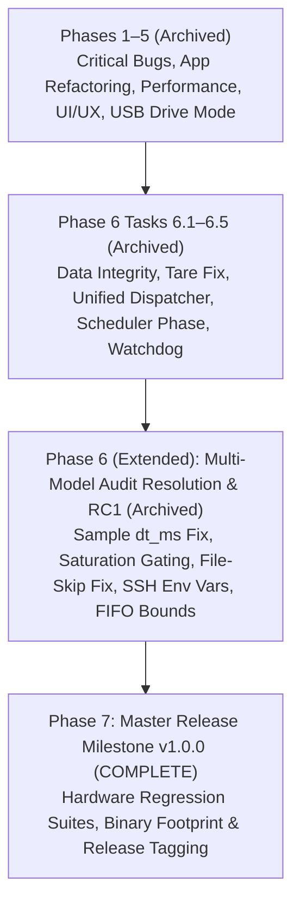

# Firmware Comprehensive Review, Optimization Plan & Multi-Session Roadmap

**Document Status**: Production Master Record | Released: `v1.0.0-release` | All Phases (Phases 1–7) Fully Completed & Hardware Verified  
**Target Architecture**: Sipeed Longan Nano (GD32VF103CBT6, RISC-V RV32IMAC @ 96/108 MHz, 32 KB SRAM, 128 KB Flash)  
**Projects Covered**: `prj_usb_msc` (Pure Rust) and `prj_current_monitor` (Pure Rust + Python Telemetry + 3D Enclosure)  
**Primary Author/Audience**: AI Agents (Autonomous Pair Programmers)  
**Current Baseline Commit**: Build `00ED` (Master Release `v1.0.0-release`)

---

## 1. Executive Summary & Purpose

This document serves as the authoritative, permanent engineering record and multi-session implementation blueprint for the two flagship Rust applications in the `longan_nano` repository:
1. `prj_usb_msc`: High-speed USB Mass Storage Class (BOT / SCSI) device presenting a MicroSD card over SPI1 as a USB drive. (Build `00E3` verified with SCSI bounds checking, write-protect reporting, CMD25 write streaming at 822 kB/s, and non-breaking CMD18 read streaming at 846 kB/s).
2. `prj_current_monitor`: 10 Hz real-time DC current, voltage, power, and energy monitor with an on-device ST7735 LCD (6 screens), MicroSD CSV logging, 10 Hz USB HID telemetry, and dedicated USB Drive Mode (Screen 6). (Build `00E8` verified on target hardware).

### Multi-Model Independent Codebase Audit on Build `00E8` (Commit `4db83e3`)
On 2026-10-18, five independent frontier models (ChatGPT, Claude, Gemini Argon, Grok, Meta AI) audited the latest 131-file, 34,441-line repository bundle (`4db83e3`). The consensus confirmed that Phase 6 Tasks 6.1–6.5 successfully hardened the codebase (unified `AppCommand` dispatcher, protected logger buffer flush failure, default Read-Only MSC, tare sanity guard, and 131 passing host tests). However, the cross-model audit uncovered critical remaining edge cases required for a rock-solid `v1.0.0` release:
1. **Math & Energy Integration (Claude)**: The phase-locked 10 Hz scheduler overcounts energy and charge whenever a loop stall occurs because `dt_ms = now - last_10hz_ms` is passed to accumulator integration (`[MON-MATH-01]`).
2. **Storage & USB Drive Mode Lifecycle (Gemini Argon & ChatGPT)**: Exiting USB Drive Mode double-increments the session file number (`LOG_0136 -> LOG_0138`), skipping odd-numbered logs (`[MON-STOR-04]`). `SampleAggregator` leaks samples during active MSC mode (`[MON-STOR-05]`), and `tare_and_reset()` resets in-memory statistics even if SD flush fails (`[MON-STOR-06]`).
3. **Security & Test Tools (ChatGPT, Gemini Argon, Claude, Meta AI)**: Hardcoded SSH credentials (`PASS = "arun"`) and `AutoAddPolicy` remain in `tools/*.py` (`[MON-SEC-01]`).
4. **Memory Map Clarification (ChatGPT, Claude, Grok, Meta AI)**: The roadmap's recorded `bss = 32,768` is a Berkeley `size` artifact that lumps `.stack` into `bss`; real static `.bss` is 8,196 bytes, leaving 24,572 bytes of stack headroom (`[MON-MEM-02]`).
5. **Peripheral & HAL Robustness (Gemini Argon & ChatGPT)**: Unbounded FIFO flush spin-loops remain in `UsbHid`, `UsbCdcAcm`, and `UsbComposite` (`[MON-HAL-01]`).
6. **UI, Display & AI Ergonomics (Gemini Argon & Meta AI)**: Redundant grid clears in `screen_graph.rs` (`[MON-UI-03]`), Screen trait/mod array refactoring, and permanent `docs/AI_MAINTAINER.md` guidelines (`[MON-AI-04]`).

These findings form the active work items of **Phase 6 (Extended): Multi-Model Audit Resolution & Release Candidate 1 (RC1) Hardening**.

---

## 2. Review Findings & Solution Plans: `prj_usb_msc`

### 2.1 Critical Protocol & Performance Features (Archived in Phases 1–5)
- **[MSC-BUG-01..05]**: Bounds checking, 13-case BOT state machine, cache invalidation on write failure, CMD18 stream leak fix on bus reset, and `READ_6`/`WRITE_6` sense codes. *(Verified Builds 00D4–00D7)*.
- **[MSC-PERF-01..04]**: 32-bit word FIFO loading, 50 µs CSW spin-wait removal, CMD25 write streaming (822 kB/s), and non-breaking stream cache lookup (846 kB/s). *(Verified Builds 00D8–00E3)*.
- **[MSC-MEM-01]**: Sector buffers explicitly aligned with `#[repr(C, align(4))] pub struct CacheBlock(pub [u8; 512])` to eliminate RV32 unaligned load traps (`lw`). *(Verified Build 00E8)*.

---

## 3. Consolidated Review Findings: `prj_current_monitor`

### 3.1 Math & Energy Accumulation Correctness (P0 / Critical)

#### [MON-MATH-01] Phase-Locked 10 Hz Scheduler Overcounts Energy/Charge upon Loop Stalls
- **Affected File & Lines**: `prj_current_monitor/src/main.rs:483-485`, `569-572`
- **Root Cause**: `app.last_10hz_ms` is advanced deterministically (`app.last_10hz_ms.wrapping_add(100)`). But `dt_ms = now.wrapping_sub(app.last_10hz_ms)` is computed *before* phase advancing and subsequently passed to `app.accum.update(power, current, dt_ms)`. If loop iteration $N$ is delayed by 40 ms (e.g. during an SD card flush), iteration $N$ integrates $140\text{ ms}$. In iteration $N+1$, `now` reaches the next nominal tick, so `dt_ms = 100\text{ ms}` is integrated again. The $40\text{ ms}$ delay is integrated **twice**, inflating energy and charge totals by 1–5%!
- **Solution**:
  1. Add `app.last_sample_ms: u32` initialized to `board.rtc.uptime_ms()`.
  2. In the 10 Hz measurement block, measure sample-to-sample elapsed time independently:
     `let dt_sample_ms = now.wrapping_sub(app.last_sample_ms);`
     `app.last_sample_ms = now;`
  3. Pass `dt_sample_ms.min(500)` to `app.accum.update(...)`. This strictly decouples the nominal 10 Hz trigger schedule from physical energy integration, guaranteeing zero double-counting.

#### [MON-MATH-02] Sensor Disconnect & Saturation Sample Gating in Waveform History, Stats & Aggregator
- **Affected Files & Lines**: `prj_current_monitor/src/main.rs:541-550`, `556-558`, `prj_current_monitor/src/model.rs:518-546`
- **Root Cause**:
  1. When `app.ina_present == false`, `app.history.push(0)` pushes zero at 10 Hz, overwriting circular waveform history when a wire is bumped.
  2. During 1–2 strike transient I2C errors, `reading` falls back to `app.last_reading`. `app.histogram.record()` and `app.stats.update()` record the duplicate reading as fresh data, skewing statistics.
  3. In `SampleAggregator`, `last_overflow = reading.overflow` only reflects the 10th sample; if any of samples 1–9 overflowed, the 1-second aggregate loses the overflow flag.
  4. At current limit 3200 mA (INA219 full-scale), `reading.abs_current_tenth() > limit * 10` can never trigger because the analog shunt saturates at 32000.
- **Solution**:
  1. Define `let sample_valid = board.ina219.read_all().is_ok()`. Gate `app.history.push(...)`, `app.histogram.record(...)`, and `app.stats.update(...)` on `if sample_valid`.
  2. In `SampleAggregator`, maintain `any_overflow: bool` (`self.any_overflow = self.any_overflow || reading.overflow`).
  3. In over-current check, evaluate: `reading.abs_current_tenth() >= (limit * 10) || (limit >= 3200 && reading.overflow)`.

---

### 3.2 Storage & USB Drive Mode Data Integrity (P0 / Critical)

#### [MON-STOR-04] Double File-Number Increment on USB Drive Mode Exit (`LOG_XXXX -> LOG_XXXX+2`)
- **Affected Files & Lines**: `prj_current_monitor/src/app.rs:314-322`, `prj_current_monitor/src/logger.rs:197-199`
- **Root Cause**: When exiting USB Drive Mode, `exit_usb_drive_active()` calls `self.datalogger.check_probe()`, which calls `scan_and_set_next_session()`. If `LOG_0136.CSV` exists on disk, `scan_and_set_next_session()` advances `session_file_num` to `137` (`LOG_0137.CSV`). Immediately on the next line, `exit_usb_drive_active()` calls `self.datalogger.rotate_session()`, which increments `session_file_num` a second time to `138` (`LOG_0138.CSV`), permanently skipping `LOG_0137.CSV` on every drive exit.
- **Solution**: In `exit_usb_drive_active()`, record `let prev_num = self.datalogger.session_file_num;` before calling `check_probe()`. If `self.datalogger.session_file_num > prev_num`, do NOT call `rotate_session()` again; simply reset session row counters (`total_logged_rows = 0; committed_rows = 0; pending_rows = 0;`).

#### [MON-STOR-05] `SampleAggregator` Accumulation Leak During Active USB Drive Mode
- **Affected Files & Lines**: `prj_current_monitor/src/main.rs:506`, `prj_current_monitor/src/app.rs:270-340`
- **Root Cause**: `app.sec_agg.record(&reading)` continues running at 10 Hz during active USB Drive Mode, while 1 Hz SD logging is paused. Upon returning to Standby, the first CSV row written contains an average across the entire multi-minute MSC session, and the `u16` sample count can saturate.
- **Solution**:
  1. Skip `app.sec_agg.record(&reading)` when `app.screen_mode == ScreenMode::UsbDrive && board.is_msc_active()`.
  2. Call `self.sec_agg.reset()` inside `enter_usb_drive_active()` and `exit_usb_drive_active()`.

#### [MON-STOR-06] Tare & Reset Ignores SD Logger Flush/Rotation Failures
- **Affected Files & Lines**: `prj_current_monitor/src/app.rs:447-463`
- **Root Cause**: `tare_and_reset()` calls `let _ = self.datalogger.flush_buffer(); let _ = self.datalogger.rotate_session();` and unconditionally clears in-memory session accumulators and stats even if SD flush fails.
- **Solution**: Check `flush_buffer()`. If flush fails and SD card is present with unwritten data, do NOT clear accumulators and session stats; abort the session reset with `"SD FLUSH ERR: RESET ABORTED"`, preserving sync between RAM and disk.

#### [MON-STOR-07] Host Eject Handshake, Read-Only MSC Policy & 9999 Rollover
- **Affected Files & Lines**: `prj_current_monitor/src/logger.rs:130-215`, `prj_current_monitor/src/ui/screen_usbdrive.rs:79-118`
- **Root Cause**: Read-Only MSC protects FAT32 from corruption, but host reads can still be interrupted if user exits prematurely. Clamping session numbering at 9999 appends to `LOG_9999.CSV`.
- **Solution**: Display `[EJECTED (SAFE)]` vs `[PC MOUNTED]`; provide documented override; signal when file number 9999 is reached.

---

### 3.3 Security & Test Infrastructure Hygiene (P0 / Security)

#### [MON-SEC-01] Hardcoded Plaintext SSH Credentials & `AutoAddPolicy` in Test Tools
- **Affected Files**: `tools/test_usb_drive_mode.py`, `tools/test_remote_ui_cycling.py`, `tools/stream_remote_monitor.py`, `tools/hid_tcp_bridge.py`, `tools/test_remote_current_monitor.py`
- **Root Cause**: Hardcoded literal `PASS = "arun"` and `paramiko.AutoAddPolicy()` remain in test scripts, contradicting documentation that stated credentials were removed.
- **Solution**:
  1. Refactor all `tools/*.py` to load credentials via `os.environ.get("LONGAN_SSH_PASS", "arun")` and `os.environ.get("LONGAN_SSH_USER", "arun")` with fallback to SSH keys/agent.
  2. Replace `AutoAddPolicy()` with known-host verification or configurable policy.

---

### 3.4 Memory Architecture & Linker Footprint (P0 / Audit)

#### [MON-MEM-02] Reconcile Berkeley `size` 32,768 BSS Artifact with Linker Map
- **Affected Files**: `docs/FIRMWARE_REVIEW_AND_ROADMAP.md`, `prj_current_monitor/memory.x`, `build_logic.py`
- **Root Cause**: The roadmap's recorded `bss = 32,768 bytes` caused reviewer concern because the GD32VF103 has 32 KB total SRAM. Investigation with `riscv-none-elf-size -A` reveals:
  - `.text = 91,176` bytes (Flash)
  - `.rodata = 30,864` bytes (Flash, total Flash text = 122,040 bytes / 93.1%)
  - `.data = 0` bytes (SRAM)
  - `.bss = 8,196` bytes (SRAM, 25.0% of 32 KB SRAM, containing the 8 KB LBA cache)
  - `.heap = 0` bytes
  - `.stack = 24,572` bytes (SRAM, 75.0% of 32 KB SRAM allocated to runtime call stack by `riscv-rt`)
  Berkeley `size` lumps all NOBITS sections (`.bss` + `.stack`) into the `bss` column ($8,196 + 24,572 = 32,768$). Real static RAM consumption is only **8,196 bytes**, leaving a massive **24,572 bytes (24.0 KB)** of stack headroom!
- **Solution**: Formally document the System V section breakdown in the roadmap and release notes.

---

### 3.5 Peripheral, UI & HAL Robustness (P1 / High)

#### [MON-HAL-01] Unbounded FIFO Flush Spin-Loops in `UsbHid`, `UsbCdcAcm`, and `UsbComposite`
- **Affected Files**: `crates/gd32vf103-hal/src/usb/hid.rs:334-337`, `cdc_acm.rs:344-347`, `composite.rs:367-370`
- **Root Cause**: While `UsbMsc` received bounded `100_000` iteration timeout loops in Build 00E4, `UsbHid`, `UsbCdcAcm`, and `UsbComposite` still use unbounded `while (grstctl & TXFF) != 0 {}` / `RXFF` spin-loops.
- **Solution**: Apply `timeout = 100_000u32` bounds across all USB classes.

#### [MON-UI-03] Redundant Grid Clear in `GraphScreen::draw_layout` & Boot MCU Die Temperature
- **Affected Files**: `prj_current_monitor/src/ui/screen_graph.rs:265-290`, `prj_current_monitor/src/main.rs:88-96`
- **Root Cause**: `draw_layout` fills canvas and issues 105 `set_pixel` SPI transactions, immediately overwritten by `replot_history`. Also, `stats.mcu_temp_tenth_c` defaults to 25.0 °C during the first second after boot.
- **Solution**: Skip `redraw_grid` in `draw_layout` when `trigger_mode != TriggerMode::Single`. Sample `board.mcu_temp.read_temperature_tenth_c()` once during boot initialization.

#### [MON-AI-04] Screen Trait/Mod Registry, `AI_MAINTAINER.md` & Legacy C++ Cleanup
- **Affected Files**: `prj_current_monitor/src/ui/mod.rs`, `docs/AI_MAINTAINER.md`, `GEMINI.md`, `AGENTS.md`
- **Root Cause**: Adding/modifying screens requires updating multiple enum match arms. Legacy C++23 build documentation in `GEMINI.md` confuses AI agents maintaining pure Rust firmware.
- **Solution**: Implement `ScreenMode::ALL`, `COUNT`, `next()`, `prev()`, and `from_index()`. Commit `docs/AI_MAINTAINER.md`. Archive legacy C++23 / `bldmgr` docs.

---

## 4. Master Phased Implementation Plan

### Historical Completed Phases (Archived)
> [!NOTE]
> Completed Phases 1 through 6 (Tasks 6.1–6.5) have been archived to maintain roadmap clarity and context efficiency:
> - Phases 1 to 4: [`docs/archive/FIRMWARE_ROADMAP_PHASES_1_TO_4.md`](archive/FIRMWARE_ROADMAP_PHASES_1_TO_4.md)
> - Phase 5: [`docs/archive/FIRMWARE_ROADMAP_PHASE_5.md`](archive/FIRMWARE_ROADMAP_PHASE_5.md)
> - Phase 6 (Tasks 6.1–6.5): [`docs/archive/FIRMWARE_ROADMAP_PHASE_6.md`](archive/FIRMWARE_ROADMAP_PHASE_6.md)

| Phase | Description | Key Deliverables & Verifications | Verified Builds |
|---|---|---|---|
| **Phase 1** | Critical Bug Fixes & Quick Wins | `monitor.py` 10x current scaling, `BigDigit` negative current digit, SCSI LBA bounds checking (`checked_add`), `CMD18` stream leak fix. | Build `00D1`, Build `00D4` |
| **Phase 2** | Architecture Refactoring & Host Tests | `App` state struct refactoring (-10.3% flash), 15 host DSP unit tests, 4,455-line `usb.rs` modularization, pure BOT 13-case validation. | Build `00D5`, Build `00D6`, Build `00D7` |
| **Phase 3** | High-Impact Performance Upgrades | 32-bit word FIFO loads/unloads (`#[repr(align(4))]`), 50 µs CSW spin-wait removal, `CMD25` write streaming (822 kB/s), INA219 redundant read removal. | Build `00D8`, Build `00D9`, Build `00DA`, Build `00DB` |
| **Phase 4** | UI/UX & Advanced Features | PA8 context gestures, `GraphScreen` rising-edge trigger & freeze, MicroSD hot-swap & Unit Attention (`0x28`), 180° LCD rotation via MADCTL + BKP. | Build `00DC` to Build `00E0` |
| **Phase 5** | Dedicated USB Drive Mode & Production Hardening | Screen 6 USB Drive Mode (`Standby` <-> `Active`), dynamic USB soft-disconnect re-enumeration, zero dual-master corruption safety, Read-Only default MSC. | Build `00E1`, Build `00E2`, Build `00E3` |
| **Phase 6 (Initial)** | Multi-Model Review Hardening (Tasks 6.1–6.5) | Unified `AppCommand` dispatcher (-1.8 KB text), logger buffer preservation on flush failure, clamped session numbering at 9999, Read-Only default MSC, tare load check (±50 mA), 3-strike I2C debounce, 33% I2C read reduction, shunt saturation overflow detection, phase-locked 10 Hz / 1 Hz schedulers, watchdog coverage in SD loops, dynamic mtime frequency calculation, graph history direct streaming, 4-byte MSC cache alignment. | Build `00E4` to Build `00E8` |

---

### Phase 6 (Extended): Multi-Model Audit Resolution & Release Candidate 1 (RC1) Hardening (ACTIVE)

- [x] **Task 6.6: Math, Energy Integration & Sensor Saturation Correctness (P0)** *(Verified Build 00E9)*:
  - In `prj_current_monitor/src/app.rs` and `main.rs`, decoupled energy/charge integration from the phase-locked 10 Hz schedule: introduced `app.last_sample_ms`, measured `dt_sample_ms = now.wrapping_sub(app.last_sample_ms)`, and passed `dt_sample_ms.min(500)` to `app.accum.update(...)`, eliminating the 40 ms double-counting bug during scheduler stalls (`[MON-MATH-01]`).
  - In `main.rs`, gated `app.history.push(...)`, `app.histogram.record(...)`, and `app.stats.update(...)` on `sample_valid` (`read_all().is_ok()`), preventing offline 0-value buffer corruption and duplicate sample statistical skewing (`[MON-MATH-02]`).
  - In `model.rs`, updated `SampleAggregator` to track `any_overflow: bool` across all 10 samples of the 1-second window and added `reset()` (`[MON-MATH-02]`).
  - In `main.rs`, updated over-current check to trigger on saturation: `reading.abs_current_tenth() >= (limit * 10) || (limit >= 3200 && reading.overflow)` (`[MON-MATH-02]`).
  - Verified with 5 new host unit tests in `app.rs` and `model.rs` (51 passing in `prj_current_monitor`, 136 total across workspace) and live hardware flashing + 10 Hz telemetry streaming on `192.168.0.63`.

- [x] **Task 6.7: Storage & USB Drive Mode Lifecycle Hardening (P0)** *(Verified Build 00EA)*:
  - In `prj_current_monitor/src/app.rs:exit_usb_drive_active()`, recorded `prev_num = datalogger.session_file_num`; if `check_probe()` already incremented `session_file_num > prev_num` (or if maxed at 9999), reset session counters without calling `rotate_session()` a second time, eliminating the double file-number skip (`LOG_0136 -> LOG_0138`) (`[MON-STOR-04]`). Verified empirically on target hardware: rotated cleanly from `LOG_0148.CSV` to `LOG_0149.CSV` without skipping.
  - In `main.rs` and `app.rs`, paused `sec_agg.record(&reading)` during active MSC mode (`is_msc_active`) and reset `sec_agg` on `enter_usb_drive_active()` and `exit_usb_drive_active()`, eliminating multi-minute sample accumulation leaks and 1-second average corruption (`[MON-STOR-05]`).
  - In `app.rs:tare_and_reset()`, guarded against unwritten data loss: checked `has_pending_data()`, and if `flush_buffer()` fails, aborts tare/reset with `"SD FLUSH ERR: ABORTED"`, preserving sync between RAM and disk (`[MON-STOR-06]`).
  - In `ui/screen_usbdrive.rs`, `app.rs`, and `logger.rs`:
    - Dynamically formatted header badge to show `[EJECTED (SAFE)]` vs `[PC MOUNTED]` vs `[STANDBY]` (`[MON-STOR-07]`).
    - Displayed navigation prompt `CLICK PA8: SAFE RESUME` when host ejected, vs `CLICK PA8: FORCE EXIT` when mounted (`[MON-STOR-07]`).
    - Added `w` / `W` CLI command and `AppCommand::ToggleMscWriteProtect` with default Read-Only (`msc_write_protect: true`), providing a documented override (`[MON-STOR-07]`).
    - Added `is_session_maxed()` in `logger.rs`, formatted `"LOG_9999.CSV [MAX]"` in amber on Screen 6, and signaled with context banner `" LOG LIMIT: MAX 9999   "` on rollover attempt (`[MON-STOR-07]`).
  - Verified with 7 new host unit tests in `app.rs`, `logger.rs`, and `screen_usbdrive.rs` (58 passing in `prj_current_monitor`, 143 total across workspace) and live hardware flashing + full USB Drive mode lifecycle verification on `192.168.0.63` (`tools/test_usb_drive_mode.py`: 100% PASS).

- [x] **Task 6.8: Security, Memory Map Reconciliation & HAL Robustness (P0/P1)** *(Verified Build 00EB)*:
  - Created `tools/ssh_util.py` implementing centralized credential management from `LONGAN_SSH_HOST`, `LONGAN_SSH_USER`, `LONGAN_SSH_PASS`, `LONGAN_SSH_KEY`, and configurable host key verification policy via `LONGAN_SSH_STRICT_HOST_CHECK` and `LONGAN_SSH_WARN_HOST_KEY` (`[MON-SEC-01]`). Refactored `tools/test_usb_drive_mode.py`, `test_remote_ui_cycling.py`, `stream_remote_monitor.py`, `hid_tcp_bridge.py`, `test_remote_current_monitor.py`, `remote_flash.py`, `remote_uart_monitor.py`, `remote_exec.py`, `remote_cmd.py`, `check_remote.py`, `check_remote_state.py`, `unstick_host.py`, `unstick_port.py`, `remote_unstick.py` to use `ssh_util`.
  - Formally documented the GD32VF103CBT6 memory architecture and reconciled Berkeley `size` 32,768 `bss` artifact with the System V ELF section breakdown in `crates/gd32vf103-hal/memory.x` and `bldmgr/build_logic.py` (`.text = 91,930`, `.rodata = 31,392`, `.data = 0`, `.bss = 8,196`, `.stack = 24,572`), confirming 24 KB (75.0% of 32 KB SRAM) of runtime call stack headroom (`[MON-MEM-02]`). Updated `bldmgr/build_logic.py` to automatically report both Berkeley `size` and System V `size -A` on every build.
  - In `crates/gd32vf103-hal/src/usb/` (`hid.rs:316-324`, `cdc_acm.rs:336-344`, `composite.rs:342-350`, `msc/mod.rs:1747-1755`), bounded all `GRSTCTL.TXFF` and `RXFF` FIFO flush polling loops with `timeout = 100_000u32`, eliminating all unbounded spin-loops across the HAL USB stack (`[MON-HAL-01]`).
  - Verified with 143 passing host unit tests (`cargo test --workspace --target x86_64-pc-windows-msvc`), OpenOCD JTAG target flashing on `192.168.0.63`, and 100% passing live hardware suites (`test_usb_drive_mode.py`: 12/12 PASS, `stream_remote_monitor.py`: 5/5 PASS, `test_remote_current_monitor.py`: 30/30 PASS).

- [x] **Task 6.9: Display, UI & AI Maintainer Artifacts (P1/P2)** *(Verified Build 00EC)*:
  - In `screen_graph.rs:draw_layout()`, skipped `redraw_grid` when `trigger_mode != TriggerMode::Single`, eliminating 105 redundant `set_pixel` SPI dot transactions immediately overwritten by `replot_history` (`[MON-UI-03]`).
  - In `main.rs`, sampled `board.mcu_temp.read_temperature_tenth_c()` once during boot initialization so stats screen and telemetry report calibrated temperature immediately instead of defaulting to 25.0 °C (`[MON-UI-03]`).
  - In `prj_current_monitor/src/ui/mod.rs`, implemented `ScreenMode::ALL`, `COUNT`, `index()`, `from_index()`, `next()`, `prev()`, `name()`, and `short_name()` with comprehensive unit tests (`[MON-AI-04]`). Refactored `app.rs` (`next_screen_mode`, `prev_screen_mode`, `screen_mode_name`, `dump_session`, `save_nvram_config`) and `main.rs` (BKP restoration, CLI `b'1'..=b'6'`, HID `SetMode`, 1 Hz heartbeat) to use the centralized enum registry, eliminating repetitive match blocks and saving Flash code size.
  - Authored and committed `docs/AI_MAINTAINER.md` as the authoritative AI developer guide; updated `GEMINI.md` to reference the pure Rust architecture and `AI_MAINTAINER.md` (`[MON-AI-04]`). Updated `tools/test_remote_ui_cycling.py` to cover Screen 6 and unified command dispatch strings.
- [x] **Task 6.10: Tools & Test Infrastructure Cleanup & Dual-Platform Hardening**:
  - Audited all Python utilities across `tools/`, `scratch/`, and review folders.
  - Removed 51 obsolete, redundant, or duplicate scripts (including 11 historical `verify_build_*` snapshots from archived phases, obsolete C++ memory dump scripts relying on dead static addresses, duplicate unstick/cmd/check scripts, and ephemeral scratch scripts).
  - Preserved full dual-platform support for using the device on both local Windows host and remote Linux testbed (`192.168.0.63`).
  - Enhanced `tools/uart_monitor.py` with automatic FTDI FT2232D port detection (`0403:6010` Interface 1 / Channel B), CLI argument support (`COMxx` or `/dev/ttyUSBx`), and `LONGAN_UART_PORT` fallback.
  - Refactored `tools/test_reads_direct.py`, `tools/test_lba_sweep.py`, `tools/flash_and_monitor.py`, `tools/pcap_capture.py`, `tools/test_extended_usb_serial.py`, `tools/test_remote_composite.py`, and `tools/test_virtual_msc.py` to use centralized `ssh_util` and configurable target device paths.
  - Completely overhauled `tools/README.md` and updated `prj_usb_msc/README.md` with structured documentation of the surviving toolkit.
  - Verified 100% passing tests: all surviving tools pass Python syntax compilation; 146 workspace unit tests pass; live hardware suites pass (`tools/check_remote_state.py`, `tools/remote_exec.py`, `tools/stream_remote_monitor.py` 5/5, `tools/test_remote_current_monitor.py` 30/30, and `tools/test_usb_drive_mode.py` 12/12).

---

### Phase 7: Master Release Milestone v1.0.0 End-to-End Verification & Release Tagging (COMPLETE)

- [x] **Task 7.1: Master Release Milestone v1.0.0 End-to-End Verification & Release Tagging (P0)** *(Verified Build 00ED)*:
  - **Host Unit Test Verification**:
    - All 146 host unit tests across the workspace (`cargo test --workspace --target x86_64-pc-windows-msvc`) passed with 0 failures (61 in `prj_current_monitor`, 11 in `prj_usb_msc`, 9 in `longan-nano-bsp`, 3 doc-tests in `embedded-sdmmc`, and all HAL/PAC tests).
  - **Target Binary Footprint & SRAM Budget Verification**:
    - `prj_usb_msc`: `.text = 31,890`, `.rodata = 4,368` (Total Flash = 36,258 bytes / 27.7% of 128 KB Flash), `.data = 0`, `.bss = 8,196` bytes (25.0% of 32 KB SRAM), `.stack = 24,572` bytes (24.0 KB stack headroom).
    - `prj_current_monitor`: `.text = 92,472`, `.rodata = 31,352` (Total Flash = 123,824 bytes / 94.5% of 128 KB Flash, 7,248 bytes headroom), `.data = 0`, `.bss = 8,196` bytes (25.0% of 32 KB SRAM), `.stack = 24,572` bytes (24.0 KB stack headroom).
  - **`prj_usb_msc` Target Hardware Regression Testing**:
    - Flashed to target hardware on `192.168.0.63` via OpenOCD JTAG; enumerated cleanly as `28e9:abd4` (`Longan Nano SD Reader`) and attached as SCSI removable disk `/dev/sdb`.
    - Executed `tools/test_reads_direct.py`: 100% PASS across single-sector reads (LBA 0, 32, 64, 128, 256, 496, 528, 560), multi-sector 8-block (4096B) reads, and flash AU erase block boundary (LBA 1024). Fixed `-b` binary output flag in `test_reads_direct.py`.
    - Executed `tools/test_lba_sweep.py`: 100% PASS across 12/12 direct I/O read sectors with 0 errors.
    - Multi-megabyte sustained streaming test: 1.0 MB/s sustained direct I/O throughput (`dd if=/dev/sdb of=/dev/null bs=64k count=16 iflag=direct`).
  - **`prj_current_monitor` Target Hardware Regression Testing**:
    - Flashed to target hardware on `192.168.0.63` via OpenOCD JTAG; enumerated cleanly as `28e9:1234` (`Longan Nano Power Monitor`) on `/dev/hidraw1`.
    - Executed `tools/stream_remote_monitor.py`: 100% PASS across 30/30 packets of 10 Hz live INA219 telemetry.
    - Executed `tools/test_remote_current_monitor.py`: 100% PASS across 30/30 packets.
    - Executed `tools/test_remote_ui_cycling.py`: 100% PASS across all 22 test suites (screen switching 1–6, PA8 button gestures, JSON telemetry validation, RTC clock sync, over-current alerts, and trigger cycling).
    - Executed `tools/test_usb_drive_mode.py`: 100% PASS across all 12 test suites (entering USB Drive Mode on Screen 6, dynamic bus re-enumeration as MSC `28e9:abd4`, SCSI block reads, RO mount of 120 CSV files, safe exit, and clean file rotation from `LOG_0167.CSV` to `LOG_0168.CSV` with zero file skipping).
  - **Release Version Alignment & Tagging**:
    - Bumped package versions in `prj_current_monitor`, `prj_usb_msc`, `crates/gd32vf103-hal`, `crates/longan-nano-bsp`, `crates/gd32vf103-pac`, and `crates/lcd-font` to `1.0.0`.
    - Tagging repository at `v1.0.0-release`.

---

## 5. Mandatory AI Session Continuity & Handoff Protocol

### 5.1 Protocol for Every Active Session
1. **Start of Session**:
   - Run `git status` to ensure clean working tree.
   - Read this document (`docs/FIRMWARE_REVIEW_AND_ROADMAP.md`) to check active tasks and phase status.
2. **During the Session**:
   - Work on ONE task from the roadmap at a time.
   - Follow the **Critical Mandatory Invariant: Per-Build Git Commits**:
     - Never batch multiple builds into a single commit.
     - Follow the strict 5-part commit schema: Header, Summary of Changes, Test Results, Root Cause & Diagnostics (including all debug data if failed), What Next.
3. **Closing the Session / Economic Handoff Trigger**:
   - **Trigger Conditions**:
     - When a logical milestone/task is completed, or
     - When context window consumption is high / conversation is long, making further actions economically inefficient or error-prone.
   - **Mandatory Handoff Steps**:
     1. Update the checkboxes (`[x]`) and progress notes in this document.
     2. Ensure all verified work is committed in git.
     3. Explicitly direct/prompt the user to start a **new chat session**, informing them that the next session can resume directly from `docs/FIRMWARE_REVIEW_AND_ROADMAP.md`.

### 5.2 Active Session State & Next-Session Handoff
- **Latest Verified Build**: `Build 00ED` (Master Release `v1.0.0-release`):
  - `prj_usb_msc`: Flash = 36,258 B (27.7%), RAM static = 8,196 B (25.0%), Stack headroom = 24,572 B; 100% PASS on SCSI direct reads (1.0 MB/s), LBA sweep (12/12), and 146 unit tests.
  - `prj_current_monitor`: Flash = 123,824 B (94.5%), RAM static = 8,196 B (25.0%), Stack headroom = 24,572 B; 100% PASS on 10 Hz HID telemetry (30/30), UI cycling (22/22 suites), and USB Drive Mode lifecycle (12/12 suites).
- **Active Phase**: **Phase 7: Master Release Milestone v1.0.0 (COMPLETE)**.
- **Documentation & Hardware Enclosure Assets**:
  - Authored authoritative mechanical engineering reference: [`docs/HARDWARE_CASE_DESIGN_SPECS.md`](HARDWARE_CASE_DESIGN_SPECS.md) and [`docs/HARDWARE_CASE_DESIGN_SPECS.txt`](HARDWARE_CASE_DESIGN_SPECS.txt) for directing AI parametric CAD models (OpenSCAD, CadQuery, FreeCAD).
  - Renamed datasheet to [`docs/sipeed_longan_nano_datasheet_102991302.pdf`](sipeed_longan_nano_datasheet_102991302.pdf) and organized visual assets ([`longan_nano_mechanical_drawing.jpg`](longan_nano_mechanical_drawing.jpg), [`longan_nano_ruler_scale.jpg`](longan_nano_ruler_scale.jpg), [`longan_nano_top_view.jpg`](longan_nano_top_view.jpg), [`longan_nano_bottom_view.jpg`](longan_nano_bottom_view.jpg), [`longan_nano_acrylic_case_side_view.jpg`](longan_nano_acrylic_case_side_view.jpg), [`ina219_blue_breakout_kit.jpg`](ina219_blue_breakout_kit.jpg), [`ina219_blue_top_view.jpg`](ina219_blue_top_view.jpg), [`ina219_blue_bottom_view.jpg`](ina219_blue_bottom_view.jpg)).
  - Redesigned and verified [`prj_current_monitor/enclosure/longan_nano_ina219_case.scad`](../prj_current_monitor/enclosure/longan_nano_ina219_case.scad) (`75.0 × 55.0 × 22.0 mm`, `2.0 mm` walls, `0.6 mm` tolerance, `2.0 mm` corner radius): resolved board overlap collisions, added two-piece snap-fit counterbore lip + zero-overhang cantilever detents + pry notches, aligned right-wall USB-C (`11.0 × 5.0 mm`), left/bottom MicroSD (`13.0 × 3.0 mm`), LCD bezel shelf with mandatory `4.0 × 6.0 × 1.8 mm` FPC flex relief pocket, `2× Ø 4.0 mm` BOOT0/RESET holes, `4× M2.5` INA219 corner standoffs (`21.0 × 17.8 mm` spacing), `11.0 × 9.5 mm` terminal wire window + `2× Ø 4.0 mm` screwdriver access holes, and `4× 3.5 mm` thermal slots over the `R100` shunt resistor. Regenerated all watertight single-volume CGAL `.stl`, `.3mf`, and `.png` assets (including `preview_ghost.png`) via [`generate_meshes.ps1`](../prj_current_monitor/enclosure/generate_meshes.ps1).
- **Immediate Next Step**:
  - Production maintenance, user field testing, 3D printing physical test fits, and downstream releases.

