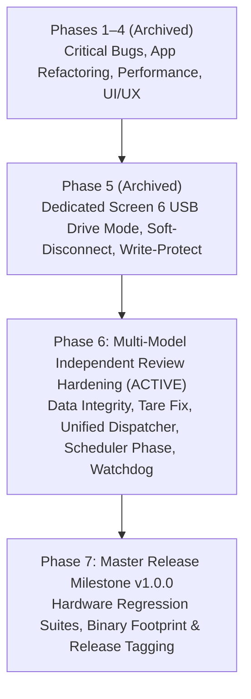

# Firmware Comprehensive Review, Optimization Plan & Multi-Session Roadmap

**Document Status**: Active Master Tracking & Handover Document | Active Phase: Phase 6 (Multi-Model Independent Review Hardening & Reliability Upgrades)  
**Target Architecture**: Sipeed Longan Nano (GD32VF103CBT6, RISC-V RV32IMAC @ 96/108 MHz, 32 KB SRAM, 128 KB Flash)  
**Projects Covered**: `prj_usb_msc` (Pure Rust) and `prj_current_monitor` (Pure Rust + Python Telemetry + 3D Enclosure)  
**Primary Author/Audience**: AI Agents (Autonomous Pair Programmers)

---

## 1. Executive Summary & Purpose

This document serves as the authoritative, permanent engineering record and multi-session implementation blueprint for the two flagship Rust applications in the `longan_nano` repository:
1. `prj_usb_msc`: High-speed USB Mass Storage Class (BOT / SCSI) device presenting a MicroSD card over SPI1 as a USB drive. (Build `00E3` verified with SCSI bounds checking, write-protect reporting, CMD25 write streaming at 822 kB/s, and non-breaking CMD18 read streaming at 846 kB/s).
2. `prj_current_monitor`: 10 Hz real-time DC current, voltage, power, and energy monitor with an on-device ST7735 LCD (6 screens), MicroSD CSV logging, 10 Hz USB HID telemetry, and dedicated USB Drive Mode (Screen 6). (Build `00E1` verified on target hardware).

### Multi-Model Independent Codebase Audit (2026-10-17)
Five independent frontier models (Claude, ChatGPT, Gemini Argon, Grok, Meta AI) conducted comprehensive audits of `prj_current_monitor`. The consensus confirms that core math, dirty-field graphics, and dynamic USB switching are fundamentally sound, but identified critical data integrity vulnerabilities at the SD-logger-to-USB-drive boundary, sensor averaging/tare timing anomalies, unhandled shunt saturation, command dispatch duplication across 4 input paths, and scheduler phase drift. These findings form the basis of **Phase 6: Multi-Model Independent Review Hardening & Reliability Upgrades**.

Any subsequent AI session MUST consult this document, execute tasks in the specified phased order, update this document upon completing any task, and follow the session handoff rules when closing.

---

## 2. Review Findings & Solution Plans: `prj_usb_msc`

### 2.1 Critical Protocol & Correctness Bugs (Archived / Resolved in Phases 1–5)
- **[MSC-BUG-01] Integer Overflow in LBA Bounds Checking**: Resolved via `lba.checked_add(blocks)` and `saturating_mul(512)`. *(Verified Build 00D4)*
- **[MSC-BUG-02] BOT 13-Case Direction & Length Validation**: Resolved via pure `validate_bot_case` state machine. *(Verified Build 00D7)*
- **[MSC-BUG-03] Cache Invalidation Missing on Write Failure**: Resolved via `self.cache.invalidate(self.lba)`. *(Verified Build 00D4)*
- **[MSC-BUG-04] `CMD18` Stream Leak on Bus Reset & `REQ_BBB_RESET`**: Resolved by unconditionally invoking `disk.end_multi_read()`. *(Verified Build 00D4)*
- **[MSC-BUG-05] `READ_6` / `WRITE_6` Sense Code for Missing Media**: Resolved returning `SenseKey::NotReady, Asc::MediumNotPresent`. *(Verified Build 00D4)*

### 2.2 Performance Optimizations (Archived / Resolved in Phases 1–5)
- **[MSC-PERF-01] 32-Bit Word FIFO Loading & Unloading**: Resolved using `chunks_exact(4)` with `#[repr(align(4))]`. *(Verified Build 00D8)*
- **[MSC-PERF-02] Eliminate 50 µs CSW Delay in `StatusPending`**: Resolved by removing 1,200-tick spin wait. *(Verified Build 00D9)*
- **[MSC-PERF-03] Multi-Block `CMD25` & Ping-Pong Write Streaming**: Resolved with double-buffered CMD25 (+720% speedup). *(Verified Build 00DA)*
- **[MSC-PERF-04] Non-Breaking Stream Cache Lookup Policy**: Resolved maintaining CMD18 streaming across hits for transfers > 8 blocks. *(Verified Build 00E3)*

### 2.3 Remaining Architecture & Memory Alignment Polish
- **[MSC-MEM-01] Cache Alignment & Static Mut Isolation**:
  - **Affected File**: `crates/gd32vf103-hal/src/usb/msc/cache.rs:10`
  - **Issue**: `CACHE_DATA: [[u8; 512]; 16]` is not explicitly annotated with `#[repr(align(4))]`. RV32IMAC traps on unaligned word loads (`lw`).
  - **Solution**: Wrap entries in `#[repr(align(4))] struct AlignedSector([u8; 512]);` and ensure test paths mirror production layout.

---

## 3. Consolidated Review Findings: `prj_current_monitor`

### 3.1 Storage & Filesystem Integrity Findings (P0 / Critical)

#### [MON-STOR-01] USB Drive Mode Transition Ignores Log Buffer Flush Failure
- **Affected File & Lines**: `prj_current_monitor/src/app.rs:231`, `prj_current_monitor/src/logger.rs:307-342`
- **Root Cause**: `enter_usb_drive_active()` calls `self.datalogger.flush_buffer()`, but `flush_buffer()` returns `()`. On write/flush failure, `self.buf_len` is retained and `status` is set to `WriteError`. `enter_usb_drive_active()` does not check result/status, proceeding to switch to USB MSC. Unwritten CSV records remain stranded in volatile RAM while the host OS accesses raw sectors, risking data loss on reboot or filesystem corruption.
- **Solution**:
  1. Change `flush_buffer(&mut self) -> Result<(), ()>`.
  2. In `enter_usb_drive_active()`, if `flush_buffer().is_err()` or `self.datalogger.buf_len > 0`, abort the transition, display an on-screen error banner (`"SD FLUSH FAILED - CANNOT MOUNT"`), and keep USB in HID mode.

#### [MON-STOR-02] Session Rotation Desyncs Filename on Failed Flush & Silent Row Discard
- **Affected File & Lines**: `prj_current_monitor/src/logger.rs:170-175`, `284-290`
- **Root Cause**:
  1. `rotate_session()` calls `flush_buffer()`. If flush fails, buffered rows from the old session remain in `self.buffer`, but `session_file_num` increments anyway. On the next successful flush, old-session rows are written to the new file (`LOG_XXXX+1.CSV`).
  2. In `log_sample()`, if the buffer fills and flush fails, `self.buf_len = 0` silently resets the buffer, dropping up to 512 bytes of telemetry without updating any lost-sample counter.
  3. `total_logged_rows` increments when a row is buffered in RAM, not when committed to SD.
- **Solution**:
  1. Only increment `session_file_num` if `self.buf_len == 0`.
  2. Never silently zero `self.buf_len` on flush failure; preserve buffer, set `SdStatus::WriteError`, drop subsequent incoming samples, and increment a `dropped_rows` counter.
  3. Track `committed_rows` separately from `buffered_rows`.

#### [MON-STOR-03] Host Eject Handshake & Default Read-Only Drive Mode
- **Affected File & Lines**: `crates/gd32vf103-hal/src/usb/msc/mod.rs`, `prj_current_monitor/src/app.rs:270-315`
- **Root Cause**: Exiting Screen 6 Active mode immediately detaches MSC, re-probes SD, and resumes FAT filesystem operations without verifying if the host OS safely ejected or is mid-write. In `UsbMsc`, SCSI `START_STOP_UNIT` and `PREVENT_ALLOW_MEDIUM_REMOVAL` return success but do not record host eject state.
- **Solution**:
  1. Default USB MSC in Screen 6 to Read-Only (`write_protected = true`) by default for safe log extraction without host OS filesystem modification.
  2. Track host eject status via `START_STOP_UNIT` (`START=0, LOEJ=1`) to display `[HOST EJECTED: SAFE]` vs `[HOST MOUNTED]` in Screen 6 UI.

---

### 3.2 Sensor DSP, Measurement & Telemetry Correctness (P1 / High)

#### [MON-SENS-01] INA219 Tare 8-Sample Calibration Read Stale Data (Averaging Timing Bug)
- **Affected File & Lines**: `prj_current_monitor/src/app.rs:344-369`
- **Root Cause**: `tare_and_reset` loops 8 times calling `read_all()` with `delay_ms(2)`. The INA219 is configured with 128-sample shunt averaging (68.10 ms) + 16-sample bus averaging (8.51 ms) = **76.6 ms conversion time**. An 8-iteration loop with 2 ms delay completes in 16 ms, reading the **exact same stale conversion register 8 times**. Additionally, reconstructing `true_raw` via `saturating_sub` can introduce offset clipping. There is also no check that load is near zero (taring under 2 A load zeroes the load).
- **Solution**:
  1. INA219 hardware already averages 128 ADC samples over 68.1 ms. Read uncompensated `REG_SHUNTVOLTAGE` directly once (`read_uncompensated_tenth_ma()`).
  2. Add load sanity guard: reject tare if `|raw_offset| > 500` (50.0 mA) to prevent calibrating while an active load is connected, displaying `"TARE REJECTED: LOAD DETECTED"`.

#### [MON-SENS-02] Sensor Disconnect Records Fake Zero Data
- **Affected File & Lines**: `prj_current_monitor/src/main.rs:677-732`
- **Root Cause**: When `!app.ina_present`, `InaReading::default()` (0 mV, 0 mA, 0 mW) is fed to `histogram.record(0)` (polluting the `<1 mA` sleep bin) and `stats.update(0, 0, 0)` (skewing session minimums and averages). Also, a single transient I2C read error immediately drops the sensor offline.
- **Solution**:
  1. Require 3 consecutive I2C read failures before declaring `ina_present = false`.
  2. Skip `histogram.record()` and `stats.update()` when `!app.ina_present`.

#### [MON-SENS-03] INA219 Shunt Saturation Clipping Unchecked by OVF Flag
- **Affected File & Lines**: `crates/longan-nano-bsp/src/ina219.rs:118-144`
- **Root Cause**: The INA219 `OVF` bit in `REG_BUSVOLTAGE` only flags math overflow in Current/Power register math. Because firmware reads `REG_SHUNTVOLTAGE` directly, analog shunt saturation at $\pm 320\text{ mV}$ (register values $\pm 32000$, i.e. $\pm 3.2\text{ A}$) does not set `OVF`.
- **Solution**: In `decode_raw`, flag overflow if `math_overflow || raw_c_tenth.unsigned_abs() >= 32000`.

#### [MON-SENS-04] Over-Current Alarm Ignores Reverse Current Magnitude
- **Affected File & Lines**: `prj_current_monitor/src/main.rs:735`
- **Root Cause**: `is_over_current = (reading.current_tenth_ma as i32) > (limit * 10)`. Large reverse currents (e.g. -2500 mA) evaluate to negative values and never trigger the alert.
- **Solution**: Check magnitude: `reading.abs_current_tenth() > (limit * 10)`.

#### [MON-SENS-05] Redundant I2C `REG_POWER` Read & Discarded Error
- **Affected File & Lines**: `crates/longan-nano-bsp/src/ina219.rs:153-160`
- **Root Cause**: `read_all()` reads `REG_POWER` (`0x03`) solely to clear `CNVR` (which is never read in `main.rs`). The read error is discarded with `let _ = ...; Ok(...)`.
- **Solution**: Remove `REG_POWER` read, reducing 10 Hz I2C bus transactions from 3 to 2 (cutting I2C time by 33%). Propagate all read errors.

#### [MON-SENS-06] HID Telemetry Power Clamping & Sequence Counter Gaps
- **Affected File & Lines**: `prj_current_monitor/src/telemetry.rs:48-66`
- **Root Cause**:
  1. `p_mw` clamps at 65535 mW without setting an overflow/saturation flag bit.
  2. Sequence counter `seq` only increments when `usb_hid.send_report()` succeeds. If reports are dropped or host is disconnected, `seq` does not advance, preventing host tools from detecting dropped reports.
- **Solution**:
  1. Increment `self.seq = self.seq.wrapping_add(1)` on every 10 Hz sample generation unconditionally.
  2. Set flag bit 2 (`overflow`) if `reading.power_tenth_mw > 655_350`.
  3. Validate HID OUT command packet length and report IDs to prevent truncated packet parser bugs.

---

### 3.3 Real-Time Scheduling, Latency & Watchdog Safety (P1 / High)

#### [MON-SCHED-01] 10 Hz & 1 Hz Scheduler Cumulative Phase Drift
- **Affected File & Lines**: `prj_current_monitor/src/main.rs:672`, `849`
- **Root Cause**: `last_10hz_ms = now` accumulates positive phase drift whenever loop latency exceeds 100 ms.
- **Solution**: Lock scheduler phase deterministically:
  `app.last_10hz_ms = if dt_ms >= 200 { now } else { app.last_10hz_ms.wrapping_add(100) };`
  Apply identical phase locking to the 1 Hz scheduler (`wrapping_add(1000)`).

#### [MON-SCHED-02] Blocking UART Heartbeat During Active USB Mass Storage Mode
- **Affected File & Lines**: `prj_current_monitor/src/main.rs:910-930`
- **Root Cause**: Polled UART0 TX at 115200 baud blocks CPU for ~15 ms per 170-byte heartbeat. During active USB Mass Storage transfers, a 15 ms CPU stall causes USB IN endpoint NAK stalls exceeding host xHCI split-transaction timeout thresholds (`EPROTO -71`).
- **Solution**: Silence 1 Hz UART heartbeat completely when `is_msc_active == true`.

#### [MON-SCHED-03] Watchdog (`FWDGT`) Coverage Gaps During Long SD & USB Operations
- **Affected File & Lines**: `crates/longan-nano-bsp/src/sdcard.rs`, `prj_current_monitor/src/logger.rs`
- **Root Cause**: 2.0s hardware watchdog is fed at the top of `main`'s loop and during USB mode switches, but not during SD card probing (`init` loops up to 1.5s on slow/unresponsive cards) or large directory scans.
- **Solution**: Add explicit watchdog feeds inside `SdCard::init()`, `iterate_dir()`, and `flush_buffer()`.

#### [MON-SCHED-04] Move Internal MCU Die Temperature ADC Read from 10 Hz to 1 Hz
- **Affected File & Lines**: `prj_current_monitor/src/main.rs:725`
- **Root Cause**: `read_temperature_tenth_c()` triggers two 239.5-cycle ADC conversions every 100 ms (~45 µs), but temperature is only displayed on the Stats screen and 1 Hz heartbeat.
- **Solution**: Move ADC temperature sampling into the 1 Hz periodic block.

#### [MON-SCHED-05] `SdCard::delay_ms_internal` Clock Assumption
- **Affected File & Lines**: `crates/longan-nano-bsp/src/sdcard.rs:141`
- **Root Cause**: Hardcodes `24_000` ticks/ms (assumes 96 MHz SYSCLK). At 108 MHz, mtime ticks run 11% fast.
- **Solution**: Compute ticks dynamically using `mtime_freq / 1000` or use `hal::delay::Delay`.

---

### 3.4 UI, Graphics & Display Performance (P2 / Polish)

#### [MON-UI-01] Oscilloscope `GraphScreen` Replot Redundancy on Autoscale Shift
- **Affected File & Lines**: `prj_current_monitor/src/ui/screen_graph.rs:430-460`
- **Root Cause**: `replot_history` currently calls `redraw_grid` (which does `fill_rect` + 105 individual `set_pixel` SPI transactions) and then immediately overwrites all 137 columns via `write_pixels`.
- **Solution**: Stream historical columns directly via `write_pixels` without pre-clearing with individual dot transactions.

#### [MON-UI-02] Logger Session Numbering 4-Digit Wrap Collision Risk
- **Affected File & Lines**: `prj_current_monitor/src/logger.rs:165-173`
- **Root Cause**: `session_file_num` maps decimal digits `% 10000`. At 10000 it aliases back to `LOG_0000.CSV`.
- **Solution**: Clamp at 9999 or handle wrap cleanly with collision check.

---

### 3.5 Memory, Linker & Hardware Safety (P2 / Architecture)

#### [MON-MEM-01] Backup Register (`BKP`) Centralized Registry (`BkpSlot`)
- **Affected Files**: `prj_current_monitor/src/app.rs`, `crates/longan-nano-bsp/src/lcd.rs`, `crates/gd32vf103-hal/src/rtc.rs`
- **Root Cause**: BKP register indices are scattered across crates (1..4 in `app.rs`, 5..6 in `lcd.rs`, 0 in `rtc.rs`). If an AI agent defines slot 5 for a new setting in `app.rs`, it silently overwrites display rotation.
- **Solution**: Define `#[repr(usize)] pub enum BkpSlot` in `longan-nano-bsp` covering `BKP_DATA0..9` as the authoritative single source of truth.

---

### 3.6 AI-Only Maintainability & Architecture (P1 / High)

#### [MON-AI-01] Unified `AppCommand` Enum & Centralized Action Dispatcher
- **Affected File & Lines**: `prj_current_monitor/src/main.rs:176-589`
- **Root Cause**: User/host actions (screen cycling, trigger adjustment, battery profile cycling, tare, log rotation, LCD rotation) are copy-pasted across 4 distinct input blocks: Rotary Encoder, UART0 CLI, USB HID OUT reports, and PA8 Button. Any AI edit to screen logic risks updating 2-3 places and missing the rest.
- **Solution**:
  1. Define `pub enum AppCommand` covering all system events.
  2. Implement `App::execute_command(&mut self, board: &mut CurrentMonitorBoard, cmd: AppCommand, now: u32)`.
  3. Simplify `main.rs` input sections to map raw events into `Option<AppCommand>`, shrinking `main.rs` by ~300 lines.

#### [MON-AI-02] Documentation Cleanup & Stale Artifact Removal
- **Affected Files**: `GEMINI.md`, `AGENTS.md`, `prj_current_monitor/config.py`, `lib/system/GD32VF103xB.lds`
- **Root Cause**: `GEMINI.md` and `AGENTS.md` describe legacy C/C++ builds (FatFs, `bldmgr`, `usbd_enum.cpp`), hardcoded absolute Windows paths (`file:///c:/Users/arunj/...`), and plaintext SSH credentials. `config.py` and `GD32VF103xB.lds` reference a 2 KB stack that does not apply to the Rust `riscv-rt` build.
- **Solution**: Clean up docs, remove plaintext passwords, use relative links, mark legacy C/C++ files clearly.

#### [MON-AI-03] Expanded Host Unit Test Coverage for State Transitions & Failure Paths
- **Solution**: Add host unit tests (`cargo test`) covering `AppCommand` dispatching, logger buffer-full / flush failure retention, session rotation desync prevention, tare load sanity guards, and HID telemetry sequence wrap.

---

## 4. Master Phased Implementation Plan

### Historical Completed Phases (Archived)
> [!NOTE]
> Completed Phases 1 through 5 have been archived to maintain roadmap clarity and context efficiency:
> - Phases 1 to 4: [`docs/archive/FIRMWARE_ROADMAP_PHASES_1_TO_4.md`](archive/FIRMWARE_ROADMAP_PHASES_1_TO_4.md)
> - Phase 5: [`docs/archive/FIRMWARE_ROADMAP_PHASE_5.md`](archive/FIRMWARE_ROADMAP_PHASE_5.md)

| Phase | Description | Key Deliverables & Verifications | Verified Builds |
|---|---|---|---|
| **Phase 1** | Critical Bug Fixes & Immediate Quick Wins | `monitor.py` 10x current scaling, `BigDigit` negative current hundreds digit, gauge bar peak-hold ghost lines, over-current indication, SCSI LBA bounds checking (`checked_add`), `CMD18` stream leak fix on bus reset/`REQ_BBB_RESET`, accumulator `dt_ms` jump fix. | Build `00D1` (Monitor), Build `00D4` (MSC) |
| **Phase 2** | Architecture Refactoring & Host Unit Tests | `App` state struct refactoring (-10.3% flash), 15 host DSP/format unit tests (`cargo test`), 4,455-line `usb.rs` modularization into clean submodules, pure BOT 13-case validation with unit tests. | Build `00D5`, Build `00D6`, Build `00D7` |
| **Phase 3** | High-Impact Performance Upgrades | 32-bit word FIFO loads/unloads (`#[repr(align(4))]`), 50 µs CSW spin-wait elimination, `CMD25` multi-block write streaming + ping-pong buffering (+720% write speedup to 822 kB/s), INA219 redundant I2C read elimination. | Build `00D8`, Build `00D9`, Build `00DA`, Build `00DB` |
| **Phase 4** | UI/UX & Advanced Features | PA8 context gestures (double-click & hold progress bar), `GraphScreen` rising-edge trigger & autoscale freeze in Single mode, bus-idle live LCD telemetry dashboard, SPI1 MicroSD hot-swap & SCSI Unit Attention (`0x28`), 180° LCD rotation via MADCTL + BKP persistence, 37 KB stack overflow fix. | Build `00DC`, Build `00DD`, Build `00DE`, Build `00DF`, Build `00E0` |
| **Phase 5** | Dedicated USB Drive Mode & Production Hardening | Screen 6 USB Drive Mode (`Standby` <-> `Active`), dynamic USB soft-disconnect re-enumeration engine (`UsbMode::into_inner`), zero dual-master FAT32 corruption safety, hardware/software Write-Protect toggle & SCSI `MODE_SENSE_6`/`10` protection, BKP6 persistence, non-breaking stream cache lookup policy (CMD18 read throughput 846 kB/s), workspace-wide host unit test harness (`cargo test` passes 92 tests). | Build `00E1` (Drive Mode), Build `00E2` (Write Protect), Build `00E3` (Cache Policy) |

---

### Phase 6: Multi-Model Independent Review Hardening & Reliability Upgrades (ACTIVE)

- [ ] **Task 6.1: Storage & Filesystem Data Integrity (P0)**:
  - In `logger.rs`, change `flush_buffer(&mut self) -> Result<(), ()>`.
  - In `app.rs`, verify `flush_buffer()` success before mounting MSC in `enter_usb_drive_active()`; abort and alert if flush fails or `buf_len > 0` (`[MON-STOR-01]`).
  - In `logger.rs`, prevent `rotate_session()` from advancing `session_file_num` when `buf_len > 0`; prevent silent buffer clearing in `log_sample()` and track `dropped_rows` (`[MON-STOR-02]`).
  - In `crates/gd32vf103-hal/src/usb/msc/mod.rs` and `app.rs`, default Screen 6 MSC to Read-Only mode for log extraction safety; track host eject state via SCSI `START_STOP_UNIT` (`[MON-STOR-03]`).

- [ ] **Task 6.2: Sensor DSP, Tare Calibration & Telemetry Correctness (P1)**:
  - In `ina219.rs` and `app.rs`, remove 8-read tare loop; read `REG_SHUNTVOLTAGE` directly once (`read_uncompensated_tenth_ma()`, hardware 128-sample average); add load sanity check rejecting tare if `|offset| > 50.0 mA` (`[MON-SENS-01]`).
  - In `main.rs`, require 3 consecutive I2C errors before setting `ina_present = false`; skip `histogram.record()` and `stats.update()` when offline (`[MON-SENS-02]`).
  - In `ina219.rs`, flag `overflow` if `math_overflow || raw_c_tenth.unsigned_abs() >= 32000` (`[MON-SENS-03]`).
  - In `main.rs`, evaluate over-current alert using current magnitude `reading.abs_current_tenth()` (`[MON-SENS-04]`).
  - In `ina219.rs`, remove redundant `REG_POWER` read from `read_all()` and propagate all I2C read errors (`[MON-SENS-05]`).
  - In `telemetry.rs`, increment sequence counter `seq` unconditionally on every sample; flag power saturation in HID reports; validate incoming HID OUT command packet lengths (`[MON-SENS-06]`).

- [ ] **Task 6.3: AI Maintainability & Unified Command Dispatcher (P1)**:
  - Define `#[repr(usize)] pub enum BkpSlot` in `longan-nano-bsp` covering `BKP_DATA0..9` as the central NVRAM register authority (`[MON-MEM-01]`).
  - Define `pub enum AppCommand` in `app.rs` and implement `App::execute_command(&mut self, board, cmd, now)` (`[MON-AI-01]`).
  - Refactor `main.rs` to route Rotary Encoder, ButtonController, UART CLI, and HID OUT reports into `AppCommand` and invoke `execute_command`, eliminating duplicate logic.

- [ ] **Task 6.4: Real-Time Scheduling, Latency & Watchdog Safety (P1)**:
  - Lock 10 Hz and 1 Hz scheduler phases deterministically (`wrapping_add(100)` / `wrapping_add(1000)`) (`[MON-SCHED-01]`).
  - Silence 1 Hz UART heartbeat during MSC Active mode to eliminate xHCI USB NAK timeout stalls (`[MON-SCHED-02]`).
  - Add explicit FWDGT watchdog feeds in long SD card operations (`init`, `iterate_dir`, `flush_buffer`) (`[MON-SCHED-03]`).
  - Move ADC internal MCU die temperature reading from 10 Hz block to 1 Hz block (`[MON-SCHED-04]`).
  - Fix `sdcard.rs` `delay_ms_internal` to use dynamic clock frequency rather than hardcoded 24,000 ticks/ms (`[MON-SCHED-05]`).

- [ ] **Task 6.5: UI Performance, Memory Alignment & Documentation Integrity (P2)**:
  - In `screen_graph.rs`, stream historical columns directly via `write_pixels` in `replot_history` without redundant dot pre-clearing (`[MON-UI-01]`).
  - Clamp session numbering at 9999 or handle wrap cleanly (`[MON-UI-02]`).
  - In `crates/gd32vf103-hal/src/usb/msc/cache.rs`, wrap cache entries with `#[repr(align(4))]` (`[MSC-MEM-01]`).
  - Clean up documentation: remove legacy C/C++ references, replace absolute paths with relative paths, remove plaintext credentials (`[MON-AI-02]`).
  - Add host unit tests (`cargo test`) covering command dispatcher, logger failure paths, and tare sanity checks (`[MON-AI-03]`).

---

### Phase 7: Master Release Milestone v1.0.0 End-to-End Verification & Release Tagging (UPCOMING)

- [ ] **Task 7.1**: Master Release Milestone v1.0.0 End-to-End Verification & Documentation:
  - Run complete end-to-end regression suites on target hardware for both `prj_usb_msc` and `prj_current_monitor`.
  - Verify Flash and SRAM footprints against device budgets (Flash < 128 KB, RAM < 32 KB).
  - Tag git repository at `v1.0.0-release` and archive final verification artifacts.

---

## 5. Mandatory AI Session Continuity & Handoff Protocol

### 5.1 Protocol for Every Active Session
1. **Start of Session**:
   - Run `git status` to ensure clean working tree.
   - Read this document (`docs/FIRMWARE_REVIEW_AND_ROADMAP.md`) to check active tasks and phase status.
2. **During the Session**:
   - Work on ONE task from the roadmap at a time.
   - Follow the **Critical Mandatory Invariant: Per-Build Git Commits**:
     - Never batch multiple builds into a single commit.
     - Follow the strict 5-part commit schema: Header, Summary of Changes, Test Results, Root Cause & Diagnostics (including all debug data if failed), What Next.
3. **Closing the Session / Economic Handoff Trigger**:
   - **Trigger Conditions**:
     - When a logical milestone/task is completed, or
     - When context window consumption is high / conversation is long, making further actions economically inefficient or error-prone.
   - **Mandatory Handoff Steps**:
     1. Update the checkboxes (`[x]`) and progress notes in this document.
     2. Ensure all verified work is committed in git.
     3. Explicitly direct/prompt the user to start a **new chat session**, informing them that the next session can resume directly from `docs/FIRMWARE_REVIEW_AND_ROADMAP.md`.
