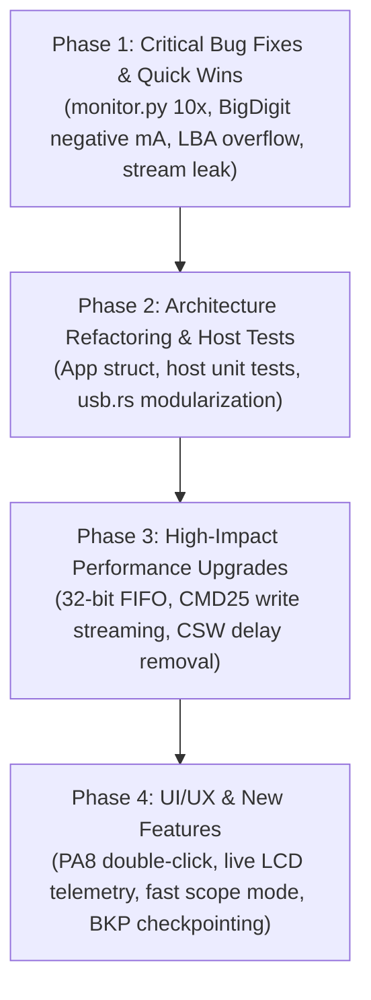

# Firmware Comprehensive Review, Optimization Plan & Multi-Session Roadmap

**Document Status**: Active Master Tracking & Handover Document | Active Phase: Phase 3 (High-Impact Performance Upgrades)  
**Target Architecture**: Sipeed Longan Nano (GD32VF103CBT6, RISC-V RV32IMAC @ 96/108 MHz, 32 KB SRAM, 128 KB Flash)  
**Projects Covered**: `prj_usb_msc` (Pure Rust) and `prj_current_monitor` (Pure Rust + Python Telemetry + 3D Enclosure)  
**Primary Author/Audience**: AI Agents (Autonomous Pair Programmers)

---

## 1. Executive Summary & Purpose

This document serves as the authoritative, permanent engineering record and multi-session implementation blueprint for the two flagship Rust applications in the `longan_nano` repository:
1. `prj_usb_msc`: High-speed USB Mass Storage Class (BOT / SCSI) device presenting a MicroSD card over SPI1 as a USB drive. (Build `00D4` verified 100% with SCSI bounds checking, multi-read reset cleanup, and cache invalidation).
2. `prj_current_monitor`: 10 Hz real-time DC current, voltage, power, and energy monitor with an on-device ST7735 LCD (5 screens), MicroSD CSV logging, and 10 Hz USB HID telemetry. (Build `00D1` verified on target hardware).

Any subsequent AI session MUST consult this document, execute tasks in the specified phased order, update this document upon completing any task, and follow the session handoff rules when closing.

---

## 2. Review Findings & Solution Plans: `prj_usb_msc`

### 2.1 Critical Protocol & Correctness Bugs

#### [MSC-BUG-01] Integer Overflow in LBA Bounds Checking
- **Affected File & Lines**: `crates/gd32vf103-hal/src/usb.rs:3644`, `3691`, `3725`, `3767`
- **Root Cause**: Calculations like `lba + blocks > blk_cnt` and `blocks * 512` wrap around `u32::MAX` under release profile (`opt-level = "s"`), allowing malformed/fuzzed CDBs with high LBAs to bypass disk boundary checks.
- **Solution**:
  ```rust
  // Replace:
  if lba + blocks > blk_cnt { ... }
  // With:
  if lba.checked_add(blocks).map_or(true, |end| end > blk_cnt) { ... }
  ```
  And replace `blocks * 512` with `blocks.saturating_mul(512)`.

#### [MSC-BUG-02] BOT 13-Case Direction & Length Validation Missing
- **Affected File & Lines**: `crates/gd32vf103-hal/src/usb.rs:3446-3786` (`decode_cbw` & `process_scsi`)
- **Root Cause**: USB Mass Storage Bulk-Only Transport (BOT) §6.7 mandates 13 transfer cases:
  - **Case 10 / Case 8 (`Ho <> Di` / `Hi <> Do`)**: Host-to-Device vs Device-to-Host direction mismatch requires `bCSWStatus = 0x02` (`PhaseError`), not `0x01` (`CmdFailed`).
  - **Case 2 / Case 3 (`Hn < Di` / `Hn < Do`)**: When `dCBWDataTransferLength == 0` but CDB `blocks > 0`, `to_transfer` evaluates to 0, which pre-arms EP1 IN for 0 bytes (transmitting an illegal ZLP in the data phase) instead of immediately returning CSW.
  - **Case 7 / Case 13 (`Hi < Di` / `Ho < Do`)**: When host expects less data than command requires, device must return `PhaseError`.
- **Solution**:
  Implement a pure function `validate_bot_case(cbw: &BbbCbw, expected_len: u32, is_in: bool) -> BotValidationResult` that returns `Ok(to_transfer)` or `Err(BotError { stall_in, stall_out, status: CswStatus })`.

#### [MSC-BUG-03] Cache Invalidation Missing on Write Failure
- **Affected File & Lines**: `crates/gd32vf103-hal/src/usb.rs:2874-2880`, `4408-4425`
- **Root Cause**: If `disk.write_sector()` fails at line 4422, `self.cache.invalidate(self.lba)` is never called. If that sector was already resident in the 16-slot cache, stale data will be served on subsequent reads.
- **Solution**:
  Invoke `self.cache.invalidate(self.lba);` inside the write failure branch at line 4424.

#### [MSC-BUG-04] `CMD18` Multi-Block Stream Leak on Bus Reset & `REQ_BBB_RESET`
- **Affected File & Lines**: `crates/gd32vf103-hal/src/usb.rs:3789-3855`, `4256-4294`
- **Root Cause**: If the host issues a USB bus reset or Class `REQ_BBB_RESET (0xFF)` while a `CMD18` multi-block read stream is active (`sdcard.streaming_read == true` with CS low), `disk.end_multi_read()` is not called.
- **Solution**:
  Pass `disk: &mut D` to `handle_reset` and `handle_setup` (called from `handle_events(disk)`), and unconditionally invoke `disk.end_multi_read()` on bus reset, `REQ_BBB_RESET`, and `abort_transfer`.

#### [MSC-BUG-05] `READ_6` / `WRITE_6` Sense Code for Missing Media
- **Affected File & Lines**: `crates/gd32vf103-hal/src/usb.rs:3631`, `3712`
- **Root Cause**: Returns `SenseKey::IllegalRequest, Asc::InvalidCdb` when `!disk.is_ready()` instead of `SenseKey::NotReady, Asc::MediumNotPresent`.
- **Solution**:
  Separate the flags check from the readiness check, returning `SenseKey::NotReady, Asc::MediumNotPresent`.

---

### 2.2 Performance Optimizations

#### [MSC-PERF-01] 32-Bit Word FIFO Loading & Unloading
- **Affected File & Lines**: `crates/gd32vf103-hal/src/usb.rs:3361-3373` (`ep_send_media`), `3888-3914` (`handle_rxfifo`)
- **Bottleneck**: Currently, both loading TX1 FIFO and draining RX FIFO run byte-by-byte nested loops with bit-shifts and bounds checks on every byte (2,048 inner loop iterations per 512B sector).
- **Optimization**: Align `media_buf` to 4 bytes (`#[repr(align(4))] struct SectorBuf([u8; 512]);`) and load/store using `chunks_exact(4)` with `u32::from_le_bytes` / `to_le_bytes`. Reduces loop overhead by ~75% (128 iterations of single `lw`/`sw` instructions).

#### [MSC-PERF-02] Eliminate Artificial 50 µs CSW Delay in `StatusPending`
- **Affected File & Lines**: `crates/gd32vf103-hal/src/usb.rs:4080`, `4426-4438`
- **Bottleneck**: After `DIEPINTF.TF` fires on the last data packet, the state machine pauses for 1,200 ticks (50 µs) polling `hw_done && fifo_empty && ep_naking`.
- **Optimization**: Once `hw_done && fifo_empty && ep_naking` is asserted, send the 13-byte CSW immediately without the arbitrary 1,200-tick spin wait, saving 50 µs on every SCSI transaction.

#### [MSC-PERF-03] Multi-Block `CMD25` & Ping-Pong Write Streaming
- **Affected File & Lines**: `crates/longan-nano-bsp/src/sdcard.rs:434-492`, `crates/gd32vf103-hal/src/usb.rs:4405-4425`
- **Bottleneck**: Writes currently use single-block `CMD24`, forcing flash page read-modify-write cycles and blocking USB for 2–15 ms per sector (yielding only ~100 kB/s write throughput).
- **Optimization**:
  1. Add `begin_multi_write(start_lba)`, `write_next_stream_sector(buf)`, and `end_multi_write()` to `SdCard` using SD `CMD25` (with `0xFC` multi-block token and `0xFD` stop token).
  2. Implement double-buffered write pipelining: while sector $N$ is being committed to SD flash via SPI1, arm `EP1 OUT` to receive sector $N+1$ into the alternate buffer slot.

#### [MSC-PERF-04] Non-Breaking Stream Cache Lookup Policy
- **Affected File & Lines**: `crates/gd32vf103-hal/src/usb.rs:4047-4056`
- **Bottleneck**: If a multi-sector read stream is in progress and hits a cached sector, it currently calls `disk.end_multi_read()`, tearing down the hardware `CMD18` pipeline.
- **Optimization**: Only perform cache lookup for the first sector of a request or for requests $\le 8$ sectors. If `disk.is_streaming()` is active, continue reading sequentially from SD rather than tearing down the pipeline.

---

### 2.3 Architecture & AI Maintainability

#### [MSC-ARCH-01] Decompose Monolithic 4,442-Line `usb.rs`
- **Affected File**: `crates/gd32vf103-hal/src/usb.rs`
- **Problem**: 4,442 lines in a single file combining 4 duplicate DWC2 device implementations (`UsbCdcAcm`, `UsbHid`, `UsbComposite`, `UsbMsc`). Exceeds AI tool viewing windows (800 lines max) and creates code divergence risks.
- **Target Structure**:
  ```text
  crates/gd32vf103-hal/src/usb/
  ├── mod.rs          // Common USB traits, packet types (SetupPacket), and re-exports
  ├── dwc2.rs         // Unified DWC2 peripheral core: PHY init, soft disconnect, EP0 state machine, FIFO access
  ├── cdc_acm.rs      // UsbCdcAcm class
  ├── hid.rs          // UsbHid class
  ├── composite.rs    // UsbComposite class
  └── msc/
      ├── mod.rs      // UsbMsc hardware binding
      ├── bot.rs      // Pure-logic BOT state machine (CBW, CSW, 13-case validation)
      ├── scsi.rs     // Pure-logic SCSI parser (Inquiry, ReadCapacity, RequestSense)
      └── cache.rs    // LbaCache
  ```

#### [MSC-ARCH-02] Host-Runnable Unit Tests for BOT & SCSI
- **Problem**: Firmware currently requires target hardware/JTAG flashing to verify even basic SCSI decoding.
- **Solution**: Abstract `MscBlockDevice` as a mock memory block device, enabling `cargo test --target x86_64-pc-windows-msvc` for BOT state transitions and SCSI decoding.

---

### 2.4 New Features (Prioritized)

1. **Live LCD Telemetry Dashboard**:
   - While `usb_msc.is_idle()`, display read/write sector counters, last LBA accessed, cache hit rate, and real-time kB/s throughput on the LCD.
2. **SD Card Hot-Swap & `UNIT ATTENTION`**:
   - Detect card removal/insertion dynamically. On insertion, report `SenseKey::UnitAttention`, `Asc::NotReadyToReadyTransition` (`0x28`) on `TEST_UNIT_READY` so host OS automounts without MCU reset.
3. **Write-Protect Hardware Toggle via `PA8`**:
   - Allow user to toggle Read-Only vs Read-Write mode with a button press, reporting the write-protect bit in `MODE_SENSE_6`/`10`.

---

## 3. Review Findings & Solution Plans: `prj_current_monitor`

### 3.1 Measurement Correctness & Host Tool Bugs

#### [MON-BUG-01] Critical Host `monitor.py` GUI 10× Scaling Bug
- **Affected File & Lines**: `prj_current_monitor/monitor.py:216-223`
- **Root Cause**: `run_gui_plotter` forgets to divide raw current by 10.0:
  ```python
  # CLI mode (correct):
  v_mv, c_raw, p_mw = struct.unpack('<HhH', bytes(report[1:7]))
  c_ma = c_raw / 10.0
  # GUI mode (BUGGY):
  v_mv, c_ma, p_mw = struct.unpack('<HhH', bytes(report[1:7]))
  # Result: plots and logs current 10x too large!
  ```
- **Solution**: Update GUI mode to unpack `c_raw` and divide by 10.0.

#### [MON-BUG-02] `BigDigitScreen` Hundreds Digit Truncation on Negative Current
- **Affected File & Lines**: `prj_current_monitor/src/ui/screen_big_digit.rs:75-83`
- **Root Cause**: For negative currents where `whole_ma >= 100` (e.g. `-250.4 mA`), `fmt_big_digits` formats `d0 = '-'`, `d1 = '5'`, `d2 = '0'`, displaying `"-50.4 mA"` (dropping the hundreds digit).
- **Solution**: For negative currents $\le -100.0\text{ mA}$, switch to `SLOTS_A` format (`"-0.250 A"`), which has 3 fractional decimal places and prevents digit loss.

#### [MON-BUG-03] `dt_ms` Timing Jump on Tare/Reset & Stalls
- **Affected File & Lines**: `prj_current_monitor/src/main.rs:78-125`, `773-780`, `852-855`
- **Root Cause**: `tare_and_reset!` takes ~20–150 ms to execute but does not update `last_10hz_ms`. The following loop tick sees a large `dt_ms` and integrates pre-reset time into the freshly zeroed accumulator.
- **Solution**: Set `last_10hz_ms = board.delay.uptime_ms()` inside `tare_and_reset!`, and clamp `dt_ms` to `dt_ms.min(500)` in `accum.update()`.

#### [MON-BUG-04] INA219 Redundant I2C Register Reads
- **Affected File & Lines**: `crates/longan-nano-bsp/src/ina219.rs:120-145`, `prj_current_monitor/src/main.rs:774-778`
- **Root Cause**: The main loop reads `REG_BUSVOLTAGE` in `is_conversion_ready()`, then `read_all()` reads `REG_BUSVOLTAGE`, `REG_SHUNTVOLTAGE`, `REG_CURRENT`, and `REG_POWER` (5 reads total per 10 Hz cycle). `REG_CURRENT` is mathematically identical to `REG_SHUNTVOLTAGE` with Cal 4096.
- **Solution**: Merge conversion readiness into `read_all()`, read only `REG_BUSVOLTAGE`, `REG_SHUNTVOLTAGE`, and `REG_POWER` (to clear CNVR), cutting I2C bus transactions from 5 to 3.

---

### 3.2 UI/UX Redesign & Enclosure Ergonomics

#### [MON-UX-01] Long-Press `PA8` Visual Progress Indicator
- **Affected File & Lines**: `prj_current_monitor/src/main.rs:730-759`
- **Problem**: Holding `PA8` for 1.5s gives zero visual feedback on the LCD until released, creating uncertainty about whether a tare reset will occur.
- **Solution**:
  - Draw a small progress bar in the top bar between 300 ms and 1,500 ms (`HOLD TO TARE... [====  ]`).
  - Trigger the tare immediately at 1,500 ms without waiting for button release, flashing a brief confirmation banner.

#### [MON-UX-02] HeroScreen Over-Current Alert & Disconnection Handling
- **Affected File & Lines**: `prj_current_monitor/src/ui/screen_hero.rs:72-152`
- **Problem**: `HeroScreen::update` does not receive `over_current: bool` (displays green `LIVE` during overcurrent), and shows `0.0 mA` when the sensor is disconnected.
- **Solution**: Pass `over_current` into `HeroScreen::update`, display amber `!ALERT!` badge, and display `"DISCONNECTED"` when `!ina_present`.

#### [MON-UX-03] Fix Peak-Hold Tick Ghost Lines on Gauge Bar
- **Affected File & Lines**: `prj_current_monitor/src/ui/screen_hero.rs:215-224`
- **Problem**: The peak-hold tick is drawn with height 4 (`Y: 46..49`), but the gauge bar background only clears height 2 (`Y: 47..48`). As the peak marker decays leftward, it leaves permanent white ghost lines at $Y=46$ and $Y=49$.
- **Solution**: Erase the previous peak marker position (`prev_peak_bar_val`) with height 4 before drawing the new marker.

#### [MON-UX-04] GraphScreen Edge Trigger & Autoscale Freeze in Single Mode
- **Affected File & Lines**: `prj_current_monitor/src/ui/screen_graph.rs:385`, `455-459`
- **Problem**: Trigger is level-sensitive instead of edge-sensitive (`plot_val >= level` triggers immediately if signal is already high). Autoscale during `Single` capture replots the entire circular buffer, overwriting the frozen capture.
- **Solution**: Implement edge detection (`prev_val < level && curr_val >= level`) and disable or restrict replotting during an active `Single` capture sweep.

#### [MON-UX-05] Enclosure Single-Button Context Gestures on `PA8`
- **Affected File & Lines**: `prj_current_monitor/src/main.rs:730-759`
- **Problem**: The 3D-printed enclosure only has cutouts for `Reset` and `Boot (PA8)`. Without a rotary encoder, Trigger Mode, Battery Profile, and SD flush cannot be controlled.
- **Solution**:
  Add **Double-Click detection** (second press within 280 ms) on `PA8`:
  - **Single Click**: Advance screen.
  - **Double Click**: Context action:
    - On `GraphScreen`: cycle Trigger Mode (`AUTO` $\to$ `NORM` $\to$ `SINGLE`).
    - On `StatsScreen` / `BigDigitScreen`: cycle Battery Profile.
    - On `HeroScreen` / `HistogramScreen`: flush & rotate SD log file.
  - **Long Press ($\ge 1.5\text{ s}$)**: Tare Zero & Reset.

---

### 3.3 Architecture & AI Maintainability

#### [MON-ARCH-01] Refactor Monolithic Macros into `App` Struct
- **Affected File & Lines**: `prj_current_monitor/src/main.rs:50-254`
- **Problem**: `set_screen_mode!` (10 args, expanded 8x), `tare_and_reset!` (17 args, expanded 4x), and `dump_session!` (9 args, expanded 2x) bloat binary size and make compiler diagnostics hard to interpret.
- **Solution**: Create an `App` state struct holding screens, accumulators, and settings, implementing clean methods:
  - `app.set_screen_mode(&mut board, new_mode)`
  - `app.tare_and_reset(&mut board, now)`
  - `app.dump_session(&mut board, now)`

#### [MON-ARCH-02] Host-Runnable Unit Tests for DSP & Formatting
- **Solution**: Add `#[cfg(test)]` modules to `model.rs` and `fmt.rs` to verify fixed-point accumulators, battery state calculations, EMA filters, and string formatting directly on the host using `cargo test`.

---

## 4. Master Phased Implementation Plan



### Phase 1: Critical Bug Fixes & Immediate Quick Wins (COMPLETED)
- [x] **Task 1.1**: Fix `monitor.py` GUI mode current scaling (`c_raw / 10.0`). *(Verified in Build 00D1)*
- [x] **Task 1.2**: Fix `screen_big_digit.rs` negative hundreds digit drop by switching to `-0.XXX A` below $-100.0\text{ mA}$. *(Verified in Build 00D1)*
- [x] **Task 1.3**: Fix `screen_hero.rs` gauge bar peak-hold marker ghost lines by erasing previous height 4 tick. *(Verified in Build 00D1)*
- [x] **Task 1.4**: Add `over_current` and disconnect indication to `HeroScreen`. *(Verified in Build 00D1)*
- [x] **Task 1.5**: Add `checked_add` and bounds clamping to `usb.rs` SCSI LBA validation (`READ_6`, `READ_10`, `WRITE_6`, `WRITE_10`). *(Verified in Build 00D4)*
- [x] **Task 1.6**: Ensure `disk.end_multi_read()` is called on bus reset, `REQ_BBB_RESET`, and `abort_transfer`. *(Verified in Build 00D4)*
- [x] **Task 1.7**: Fix `last_10hz_ms` update inside `tare_and_reset!` to prevent `dt_ms` accumulator jump. *(Verified in Build 00D1)*

#### Phase 1 Empirical Verification Summary:
1. **`prj_current_monitor` (Build 00D1, Commit `69edad7`)**:
   - **Host & GUI**: Fixed `monitor.py` GUI mode unpacking `c_raw / 10.0` matching CLI mode.
   - **BigDigit Display**: Switched to `SLOTS_A` (`-.XXX A`) for negative currents $\le -100.0\text{ mA}$, preventing dropped hundreds digits.
   - **Hero Display**: Erased previous height 4 peak-hold marker before redrawing gauge bar, eliminating ghost pixels at Y=46 and Y=49. Added `!ALERT` badge for `over_current` and `DISCONNECTED` banner when `!ina_present`.
   - **Tare & Accumulator**: Passed `last_10hz_ms` to `tare_and_reset!` macro, refreshing time to `uptime_ms()` after tare zero calibration and file rotation; clamped `dt_ms` to `dt_ms.min(500)` in `Accumulators::update()`.
   - **Hardware Verification**: Target flashed and verified via OpenOCD JTAG; USB HID enumerated as `28e9:1234 Longan Nano Power Monitor`; interactive console commands verified (`'1'` switched to HERO screen; `'t'` calibrated tare offset `0.1 mA` and rotated to `LOG_0072.CSV` with immediate smooth resumption of 10Hz logging).

2. **`prj_usb_msc` (Build 00D4, Commit `a711454`)**:
   - **SCSI Bounds Checking**: `READ_6`, `READ_10`, `WRITE_6`, and `WRITE_10` now use `lba.checked_add(blocks).map_or(true, |end| end > blk_cnt)` and `blocks.saturating_mul(512)`.
   - **Missing Media Sense**: Separated flags and readiness in `READ_6` and `WRITE_6`, returning `SenseKey::NotReady, Asc::MediumNotPresent`.
   - **Stream Leak Elimination**: Passed `disk` to `handle_setup` and invoked `disk.end_multi_read()` on `REQ_BBB_RESET` (`0xFF`) and bus reset (`gintf::RST`).
   - **Cache Invalidation**: Invoked `self.cache.invalidate(self.lba)` on write failure.
   - **Hardware Verification (`tools/verify_build_00d4.py`)**:
     - Enumerated cleanly as `28e9:abd4` (`LNMSC00000D4`), 480 MiB (983,040 blocks).
     - Isolated `sg_raw` passed on LBA 0 (512B & 4096B), LBA 528 (4096B), LBA 560 (4096B), LBA 1024 (512B & 4096B).
     - Out-of-bounds fuzzed CDB (`LBA 0xFFFFFFF0` + 32 blocks) was cleanly rejected with `Check Condition`, `Sense key: Illegal Request`, `Logical block address out of range` (`exit_code=22`).
     - Sustained 4.0 MiB read streamed at 713 kB/s with zero USB resets.
     - Partition 1 (`/dev/sdb1`) mounted read-only (`mount code=0`), all SD files listed cleanly, and unmounted with zero kernel errors.

### Phase 2: Architecture Refactoring & Host Tests (COMPLETED)
- [x] **Task 2.1**: Refactor `main.rs` macros in `prj_current_monitor` into an `App` struct. *(Verified in Build 00D5: 15/15 remote tests PASS, -12,322 bytes flash reduction)*
- [x] **Task 2.2**: Add host unit tests (`cargo test`) to `model.rs` and `fmt.rs`. *(Verified in Build 00D6: 15/15 host tests PASS on x86_64)*
- [x] **Task 2.3**: Split `crates/gd32vf103-hal/src/usb.rs` into modular submodules (`usb/{mod, cdc_acm, hid, composite, msc/{mod, bot, scsi, cache}}`). *(Verified in Build 00D7: 4,455-line monolithic file decomposed into clean decoupled modules, all USB projects compile, 15/15 host tests + 15/15 target tests PASS)*
- [x] **Task 2.4**: Implement pure-logic BOT 13-case validation in `msc/bot.rs` with unit tests. *(Verified in Build 00D7: 15/15 host unit tests PASS covering all 13 BOT cases and CBW validation)*

#### Phase 2 Empirical Verification Summary:
1. **`prj_current_monitor` (Build 00D5)**:
   - **App Struct Refactoring (`app.rs`)**: Replaced 4 monolithic macro families (`set_screen_mode!`, `tare_and_reset!`, `dump_session!`, `print_help!`) with structured `App` state methods (`set_screen_mode`, `tare_and_reset`, `dump_session`, `print_help`, `cycle_screen_mode`).
   - **Flash Optimization**: Decreased text section size from 119,940 bytes to 107,618 bytes (-12,322 bytes, **-10.3% flash reduction**), eliminating repetitive macro expansion bloat.
   - **BSP Ownership Refactoring**: Converted `CurrentMonitorBoard.sdcard` to `Option<SdCard>` so it can be extracted without partially moving `board`, preserving clean reference borrowing.
   - **Hardware Verification (`tools/test_remote_ui_cycling.py`)**: All 15 automated remote test suites passed (Help menu, 5 screen modes + cycling, battery profiles, session dump + JSON parse, SD flush, SD file rotation `LOG_0073.CSV` -> `LOG_0074.CSV`, zero-tare offset calibration, USB HID telemetry streaming, HID OUT commands for SetMode, SetBatteryProfile, SetEpoch, SetCurrentLimit).

2. **`prj_current_monitor` Host Unit Tests (Build 00D6)**:
   - **Host Harness (`cargo test`)**: Enabled conditional compilation (`#![cfg_attr(not(test), no_std)]`, `#[cfg(not(test))] use panic_halt as _`) allowing unit tests to run natively on the development host (`x86_64-pc-windows-msvc`).
   - **Formatting & Model Test Suites (`fmt.rs`, `model.rs`)**: Implemented 15 comprehensive unit tests covering:
     - `BufferCursor` string formatting and truncation bounds.
     - `DirtyField` cache invalidation and redraw suppression.
     - Auto-ranging current (`mA` vs `A`), voltage (`mV`), power (`mW` vs `W`), energy (`uWh`, `mWh`, `Wh`), resistance (`R`, `kR`), and time.
     - `WaveformHistory` 137-sample circular buffer index wrapping and chronological retrieval.
     - `Accumulators` drift-free integer millisecond energy and bidirectional charge integration (including 500 ms `dt_ms` clamping).
     - `SessionStats` min/max/average tracking and load resistance estimation ($R = V/I$).
     - `BatteryState` fuel gauge and SoC decay calculations.
     - `HistogramData` 7-bin logarithmic current distribution.
     - `EmaFilter` truncation-free convergence and step-jump bypass.
     - `SampleAggregator` multi-sample arithmetic averaging for 1-second MicroSD logging.
   - **Empirical Host Results**: `cargo test --target x86_64-pc-windows-msvc -p prj_current_monitor`: 15 passed, 0 failed. Target RISC-V release build retained zero bloat (107,618 bytes text).

3. **USB Stack Modularization & BOT 13-Case Verification (Build 00D7)**:
   - **Modular USB Subsystems (`usb/`)**: Decomposed monolithic 4,455-line `crates/gd32vf103-hal/src/usb.rs` into modular submodules:
     - `usb/mod.rs`: Common control state, setup packets, and string descriptors (`STR_LANG_ID`, `STR_MANUFACTURER`, `STR_SERIAL`).
     - `usb/cdc_acm.rs`: CDC-ACM driver with ring buffers.
     - `usb/hid.rs`: Custom HID driver with 64-byte IN/OUT reports.
     - `usb/composite.rs`: Composite HID (Standard Keyboard/Mouse + Custom Telemetry HID).
     - `usb/msc/mod.rs`: Mass Storage BOT transport controller and endpoint ISR handlers.
     - `usb/msc/bot.rs`: Pure-logic Bulk-Only Transport state machine, CBW/CSW parsing, and 13-case transfer validation matrix.
     - `usb/msc/scsi.rs`: SCSI transparent command set definitions, ASC/ASCQ constants, and inquiry response.
     - `usb/msc/cache.rs`: 4-slot LRU LBA sector writeback/read cache.
   - **Host Unit Tests (`bot.rs`)**: 15 host unit tests running via `cargo test --target x86_64-pc-windows-msvc -p gd32vf103-hal`:
     - Full CBW validity validation (signature `0x43425355`, zero reserved flags, valid LUN, CDB length 1..16).
     - Full coverage of all 13 USB BOT transfer cases (§6.7: Cases 1–13 verifying residue, direction mismatch, stalling, and PhaseError detection).
     - CBW / CSW serialization round-trip verification.
   - **Empirical Hardware Verification (`tools/verify_build_00d4.py`)**:
     - Remote hardware flashed and tested on target GD32VF103 over SSH OpenOCD JTAG (`192.168.0.63`).
     - Host Linux `lsusb` and `dmesg` confirmed clean enumeration as `28e9:abd4` `Longan Nano SD Reader` (480 MiB / 983,040 blocks).
     - All 6 isolated `sg_raw` sector tests passed (LBA 0 1 blk & 8 blks, LBA 528 8 blks, LBA 560 8 blks, LBA 1024 1 blk & 8 blks).
     - Out-of-bounds fuzzed CDB (`LBA 0xFFFFFFF0` + 32 blocks) cleanly rejected with `Check Condition`, `Illegal Request: Logical block address out of range` (`exit_code=22`).
     - Single-block `dd bs=512 count=1` (77.3 kB/s) and multi-block `dd bs=4096 count=1` (811 kB/s) verified.
     - Sustained 4.0 MiB read streamed at **738 kB/s** with zero USB transaction errors or resets.
     - Partition 1 (`/dev/sdb1`) mounted cleanly (`mount code=0`), listed directory contents, and cleanly unmounted.

### Phase 3: Performance & Driver Enhancements
- [x] **Task 3.1**: Convert USB FIFO read/write in `usb_msc` to 32-bit word transfers (`#[repr(align(4))]`). *(Verified in Build 00D8: 18/18 host tests PASS, 780 kB/s read streaming, read/write round-trip verified)*
- [ ] **Task 3.2**: Remove artificial 1,200-tick spin wait before sending CSW in `StatusPending`.
- [ ] **Task 3.3**: Implement multi-block write streaming (`CMD25`) in `sdcard.rs` with double-buffered write pipelining.
- [ ] **Task 3.4**: Optimize INA219 I2C transactions in `read_all()` (eliminate redundant `REG_CURRENT` read).

#### Phase 3 Empirical Verification Summary:
1. **`prj_usb_msc` 32-Bit Word FIFO Optimization (Build 00D8, Commit `ded0b77`)**:
   - **4-Byte Aligned `SectorBuf`**:
     - Introduced `#[repr(C, align(4))] pub struct SectorBuf(pub [u8; 512]);` with `Deref<Target = [u8; 512]>`, `DerefMut`, `as_words(&self) -> &[u32; 128]`, and `as_mut_words(&mut self) -> &mut [u32; 128]`.
     - Statically enforces 4-byte alignment on `UsbMsc.media_buf`, avoiding RV32IMAC unaligned memory trap exceptions and eliminating 2,048 byte-by-byte inner loop iterations per 512-byte sector.
   - **Optimized TX1 FIFO Media Load (`ep_send_media`)**:
     - Loads 128 contiguous 32-bit words via single `lw`/`sw` assembly instructions directly into `DFIFO[1]`, with clean trailing remainder handling.
   - **Optimized RX FIFO Bulk-OUT Unload (`handle_rxfifo`)**:
     - Drains 64-byte OUT packets directly into `media_buf[0].as_mut_words()` as 32-bit words with single `lw`/`sw` pairs when aligned, with fallback byte handling for unaligned packets.
   - **Optimized Control/Command TX FIFO (`write_fifo`)**:
     - Uses `chunks_exact(4)` with `u32::from_le_bytes` and remainder word packing.
   - **Host Unit Test Suite (`cargo test -p gd32vf103-hal`)**:
     - 18/18 tests pass (15 pure-logic BOT cases + 3 `SectorBuf` alignment, size, word-access, and byte-ordering tests).
   - **Target Hardware Empirical Verification (`tools/verify_build_00d8.py`)**:
     - Flashed to GD32VF103 over JTAG OpenOCD; enumerated cleanly on Linux host (`28e9:abd4`, serial `LNMSC00000D8`).
     - All 7 isolated `sg_raw` sector queries passed (LBA 0 1/8 blks, LBA 528 8 blks, LBA 560 8 blks, LBA 1024 1/8 blks, and fuzzed OOB LBA cleanly rejected with `Check Condition`).
     - Single-block `dd bs=512 count=1` achieved **519 kB/s** (0.000986 s).
     - Sustained 4.0 MiB read streaming (`dd bs=64k count=64`) achieved **780 kB/s** (up from 738 kB/s in Build 00D7 and 713 kB/s in Build 00D4) with zero USB resets.
     - Partition 1 (`/dev/sdb1`) mounted read-write (`mount -t vfat /dev/sdb1 /mnt/sdcard`).
     - Written test payload to `/mnt/sdcard/build_00d8.txt` through the new 32-bit FIFO write path; `cat` read back 100% matched, verified, deleted, and unmounted with zero kernel or dmesg errors.


### Phase 4: UI/UX & Advanced Features
- [ ] **Task 4.1**: Implement `PA8` button double-click context actions and long-press visual progress bar.
- [ ] **Task 4.2**: Implement edge-triggered capture on `GraphScreen` and fix `Single` mode autoscale replotting.
- [ ] **Task 4.3**: Add live LCD telemetry to `prj_usb_msc` during bus idle.
- [ ] **Task 4.4**: Add SD card hot-swap detection and `SenseKey::UnitAttention` handling.
- [ ] **Task 4.5**: Add display 180° rotation toggle via `MADCTL` persisted in `BKP` register.

---

## 5. Mandatory AI Session Continuity & Handoff Protocol

### 5.1 Protocol for Every Active Session
1. **Start of Session**:
   - Run `git status` to ensure clean working tree.
   - Read this document (`docs/FIRMWARE_REVIEW_AND_ROADMAP.md`) to check active tasks and phase status.
2. **During the Session**:
   - Work on ONE task from the roadmap at a time.
   - Follow the **Critical Mandatory Invariant: Per-Build Git Commits**:
     - Never batch multiple builds into a single commit.
     - Follow the strict 5-part commit schema: Header, Summary of Changes, Test Results, Root Cause & Diagnostics (including all debug data if failed), What Next.
3. **Closing the Session / Economic Handoff Trigger**:
   - **Trigger Conditions**:
     - When a logical milestone/task is completed, or
     - When context window consumption is high / conversation is long, making further actions economically inefficient or error-prone.
   - **Mandatory Handoff Steps**:
     1. Update the checkboxes (`[x]`) and progress notes in this document.
     2. Ensure all verified work is committed in git.
     3. Explicitly direct/prompt the user to start a **new chat session**, informing them that the next session can resume directly from `docs/FIRMWARE_REVIEW_AND_ROADMAP.md`.
