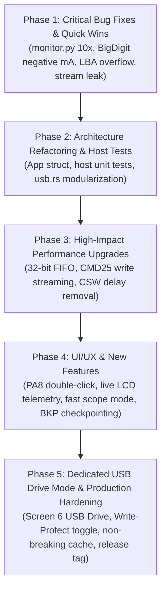

# Firmware Comprehensive Review, Optimization Plan & Multi-Session Roadmap

**Document Status**: Active Master Tracking & Handover Document | Active Phase: Phase 5 (Dedicated USB Drive Mode & Production Hardening)  
**Target Architecture**: Sipeed Longan Nano (GD32VF103CBT6, RISC-V RV32IMAC @ 96/108 MHz, 32 KB SRAM, 128 KB Flash)  
**Projects Covered**: `prj_usb_msc` (Pure Rust) and `prj_current_monitor` (Pure Rust + Python Telemetry + 3D Enclosure)  
**Primary Author/Audience**: AI Agents (Autonomous Pair Programmers)

---

## 1. Executive Summary & Purpose

This document serves as the authoritative, permanent engineering record and multi-session implementation blueprint for the two flagship Rust applications in the `longan_nano` repository:
1. `prj_usb_msc`: High-speed USB Mass Storage Class (BOT / SCSI) device presenting a MicroSD card over SPI1 as a USB drive. (Build `00D4` verified 100% with SCSI bounds checking, multi-read reset cleanup, and cache invalidation).
2. `prj_current_monitor`: 10 Hz real-time DC current, voltage, power, and energy monitor with an on-device ST7735 LCD (5 screens), MicroSD CSV logging, and 10 Hz USB HID telemetry. (Build `00D1` verified on target hardware).

Any subsequent AI session MUST consult this document, execute tasks in the specified phased order, update this document upon completing any task, and follow the session handoff rules when closing.

---

## 2. Review Findings & Solution Plans: `prj_usb_msc`

### 2.1 Critical Protocol & Correctness Bugs

#### [MSC-BUG-01] Integer Overflow in LBA Bounds Checking
- **Affected File & Lines**: `crates/gd32vf103-hal/src/usb.rs:3644`, `3691`, `3725`, `3767`
- **Root Cause**: Calculations like `lba + blocks > blk_cnt` and `blocks * 512` wrap around `u32::MAX` under release profile (`opt-level = "s"`), allowing malformed/fuzzed CDBs with high LBAs to bypass disk boundary checks.
- **Solution**:
  ```rust
  // Replace:
  if lba + blocks > blk_cnt { ... }
  // With:
  if lba.checked_add(blocks).map_or(true, |end| end > blk_cnt) { ... }
  ```
  And replace `blocks * 512` with `blocks.saturating_mul(512)`.

#### [MSC-BUG-02] BOT 13-Case Direction & Length Validation Missing
- **Affected File & Lines**: `crates/gd32vf103-hal/src/usb.rs:3446-3786` (`decode_cbw` & `process_scsi`)
- **Root Cause**: USB Mass Storage Bulk-Only Transport (BOT) §6.7 mandates 13 transfer cases:
  - **Case 10 / Case 8 (`Ho <> Di` / `Hi <> Do`)**: Host-to-Device vs Device-to-Host direction mismatch requires `bCSWStatus = 0x02` (`PhaseError`), not `0x01` (`CmdFailed`).
  - **Case 2 / Case 3 (`Hn < Di` / `Hn < Do`)**: When `dCBWDataTransferLength == 0` but CDB `blocks > 0`, `to_transfer` evaluates to 0, which pre-arms EP1 IN for 0 bytes (transmitting an illegal ZLP in the data phase) instead of immediately returning CSW.
  - **Case 7 / Case 13 (`Hi < Di` / `Ho < Do`)**: When host expects less data than command requires, device must return `PhaseError`.
- **Solution**:
  Implement a pure function `validate_bot_case(cbw: &BbbCbw, expected_len: u32, is_in: bool) -> BotValidationResult` that returns `Ok(to_transfer)` or `Err(BotError { stall_in, stall_out, status: CswStatus })`.

#### [MSC-BUG-03] Cache Invalidation Missing on Write Failure
- **Affected File & Lines**: `crates/gd32vf103-hal/src/usb.rs:2874-2880`, `4408-4425`
- **Root Cause**: If `disk.write_sector()` fails at line 4422, `self.cache.invalidate(self.lba)` is never called. If that sector was already resident in the 16-slot cache, stale data will be served on subsequent reads.
- **Solution**:
  Invoke `self.cache.invalidate(self.lba);` inside the write failure branch at line 4424.

#### [MSC-BUG-04] `CMD18` Multi-Block Stream Leak on Bus Reset & `REQ_BBB_RESET`
- **Affected File & Lines**: `crates/gd32vf103-hal/src/usb.rs:3789-3855`, `4256-4294`
- **Root Cause**: If the host issues a USB bus reset or Class `REQ_BBB_RESET (0xFF)` while a `CMD18` multi-block read stream is active (`sdcard.streaming_read == true` with CS low), `disk.end_multi_read()` is not called.
- **Solution**:
  Pass `disk: &mut D` to `handle_reset` and `handle_setup` (called from `handle_events(disk)`), and unconditionally invoke `disk.end_multi_read()` on bus reset, `REQ_BBB_RESET`, and `abort_transfer`.

#### [MSC-BUG-05] `READ_6` / `WRITE_6` Sense Code for Missing Media
- **Affected File & Lines**: `crates/gd32vf103-hal/src/usb.rs:3631`, `3712`
- **Root Cause**: Returns `SenseKey::IllegalRequest, Asc::InvalidCdb` when `!disk.is_ready()` instead of `SenseKey::NotReady, Asc::MediumNotPresent`.
- **Solution**:
  Separate the flags check from the readiness check, returning `SenseKey::NotReady, Asc::MediumNotPresent`.

---

### 2.2 Performance Optimizations

#### [MSC-PERF-01] 32-Bit Word FIFO Loading & Unloading
- **Affected File & Lines**: `crates/gd32vf103-hal/src/usb.rs:3361-3373` (`ep_send_media`), `3888-3914` (`handle_rxfifo`)
- **Bottleneck**: Currently, both loading TX1 FIFO and draining RX FIFO run byte-by-byte nested loops with bit-shifts and bounds checks on every byte (2,048 inner loop iterations per 512B sector).
- **Optimization**: Align `media_buf` to 4 bytes (`#[repr(align(4))] struct SectorBuf([u8; 512]);`) and load/store using `chunks_exact(4)` with `u32::from_le_bytes` / `to_le_bytes`. Reduces loop overhead by ~75% (128 iterations of single `lw`/`sw` instructions).

#### [MSC-PERF-02] Eliminate Artificial 50 µs CSW Delay in `StatusPending`
- **Affected File & Lines**: `crates/gd32vf103-hal/src/usb.rs:4080`, `4426-4438`
- **Bottleneck**: After `DIEPINTF.TF` fires on the last data packet, the state machine pauses for 1,200 ticks (50 µs) polling `hw_done && fifo_empty && ep_naking`.
- **Optimization**: Once `hw_done && fifo_empty && ep_naking` is asserted, send the 13-byte CSW immediately without the arbitrary 1,200-tick spin wait, saving 50 µs on every SCSI transaction.

#### [MSC-PERF-03] Multi-Block `CMD25` & Ping-Pong Write Streaming
- **Affected File & Lines**: `crates/longan-nano-bsp/src/sdcard.rs:434-492`, `crates/gd32vf103-hal/src/usb.rs:4405-4425`
- **Bottleneck**: Writes currently use single-block `CMD24`, forcing flash page read-modify-write cycles and blocking USB for 2–15 ms per sector (yielding only ~100 kB/s write throughput).
- **Optimization**:
  1. Add `begin_multi_write(start_lba)`, `write_next_stream_sector(buf)`, and `end_multi_write()` to `SdCard` using SD `CMD25` (with `0xFC` multi-block token and `0xFD` stop token).
  2. Implement double-buffered write pipelining: while sector $N$ is being committed to SD flash via SPI1, arm `EP1 OUT` to receive sector $N+1$ into the alternate buffer slot.

#### [MSC-PERF-04] Non-Breaking Stream Cache Lookup Policy
- **Affected File & Lines**: `crates/gd32vf103-hal/src/usb.rs:4047-4056`
- **Bottleneck**: If a multi-sector read stream is in progress and hits a cached sector, it currently calls `disk.end_multi_read()`, tearing down the hardware `CMD18` pipeline.
- **Optimization**: Only perform cache lookup for the first sector of a request or for requests $\le 8$ sectors. If `disk.is_streaming()` is active, continue reading sequentially from SD rather than tearing down the pipeline.

---

### 2.3 Architecture & AI Maintainability

#### [MSC-ARCH-01] Decompose Monolithic 4,442-Line `usb.rs`
- **Affected File**: `crates/gd32vf103-hal/src/usb.rs`
- **Problem**: 4,442 lines in a single file combining 4 duplicate DWC2 device implementations (`UsbCdcAcm`, `UsbHid`, `UsbComposite`, `UsbMsc`). Exceeds AI tool viewing windows (800 lines max) and creates code divergence risks.
- **Target Structure**:
  ```text
  crates/gd32vf103-hal/src/usb/
  ├── mod.rs          // Common USB traits, packet types (SetupPacket), and re-exports
  ├── dwc2.rs         // Unified DWC2 peripheral core: PHY init, soft disconnect, EP0 state machine, FIFO access
  ├── cdc_acm.rs      // UsbCdcAcm class
  ├── hid.rs          // UsbHid class
  ├── composite.rs    // UsbComposite class
  └── msc/
      ├── mod.rs      // UsbMsc hardware binding
      ├── bot.rs      // Pure-logic BOT state machine (CBW, CSW, 13-case validation)
      ├── scsi.rs     // Pure-logic SCSI parser (Inquiry, ReadCapacity, RequestSense)
      └── cache.rs    // LbaCache
  ```

#### [MSC-ARCH-02] Host-Runnable Unit Tests for BOT & SCSI
- **Problem**: Firmware currently requires target hardware/JTAG flashing to verify even basic SCSI decoding.
- **Solution**: Abstract `MscBlockDevice` as a mock memory block device, enabling `cargo test --target x86_64-pc-windows-msvc` for BOT state transitions and SCSI decoding.

---

### 2.4 New Features (Prioritized)

1. **Live LCD Telemetry Dashboard**:
   - While `usb_msc.is_idle()`, display read/write sector counters, last LBA accessed, cache hit rate, and real-time kB/s throughput on the LCD.
2. **SD Card Hot-Swap & `UNIT ATTENTION`**:
   - Detect card removal/insertion dynamically. On insertion, report `SenseKey::UnitAttention`, `Asc::NotReadyToReadyTransition` (`0x28`) on `TEST_UNIT_READY` so host OS automounts without MCU reset.
3. **Write-Protect Hardware Toggle via `PA8`**:
   - Allow user to toggle Read-Only vs Read-Write mode with a button press, reporting the write-protect bit in `MODE_SENSE_6`/`10`.

---

## 3. Review Findings & Solution Plans: `prj_current_monitor`

### 3.1 Measurement Correctness & Host Tool Bugs

#### [MON-BUG-01] Critical Host `monitor.py` GUI 10× Scaling Bug
- **Affected File & Lines**: `prj_current_monitor/monitor.py:216-223`
- **Root Cause**: `run_gui_plotter` forgets to divide raw current by 10.0:
  ```python
  # CLI mode (correct):
  v_mv, c_raw, p_mw = struct.unpack('<HhH', bytes(report[1:7]))
  c_ma = c_raw / 10.0
  # GUI mode (BUGGY):
  v_mv, c_ma, p_mw = struct.unpack('<HhH', bytes(report[1:7]))
  # Result: plots and logs current 10x too large!
  ```
- **Solution**: Update GUI mode to unpack `c_raw` and divide by 10.0.

#### [MON-BUG-02] `BigDigitScreen` Hundreds Digit Truncation on Negative Current
- **Affected File & Lines**: `prj_current_monitor/src/ui/screen_big_digit.rs:75-83`
- **Root Cause**: For negative currents where `whole_ma >= 100` (e.g. `-250.4 mA`), `fmt_big_digits` formats `d0 = '-'`, `d1 = '5'`, `d2 = '0'`, displaying `"-50.4 mA"` (dropping the hundreds digit).
- **Solution**: For negative currents $\le -100.0\text{ mA}$, switch to `SLOTS_A` format (`"-0.250 A"`), which has 3 fractional decimal places and prevents digit loss.

#### [MON-BUG-03] `dt_ms` Timing Jump on Tare/Reset & Stalls
- **Affected File & Lines**: `prj_current_monitor/src/main.rs:78-125`, `773-780`, `852-855`
- **Root Cause**: `tare_and_reset!` takes ~20–150 ms to execute but does not update `last_10hz_ms`. The following loop tick sees a large `dt_ms` and integrates pre-reset time into the freshly zeroed accumulator.
- **Solution**: Set `last_10hz_ms = board.delay.uptime_ms()` inside `tare_and_reset!`, and clamp `dt_ms` to `dt_ms.min(500)` in `accum.update()`.

#### [MON-BUG-04] INA219 Redundant I2C Register Reads
- **Affected File & Lines**: `crates/longan-nano-bsp/src/ina219.rs:120-145`, `prj_current_monitor/src/main.rs:774-778`
- **Root Cause**: The main loop reads `REG_BUSVOLTAGE` in `is_conversion_ready()`, then `read_all()` reads `REG_BUSVOLTAGE`, `REG_SHUNTVOLTAGE`, `REG_CURRENT`, and `REG_POWER` (5 reads total per 10 Hz cycle). `REG_CURRENT` is mathematically identical to `REG_SHUNTVOLTAGE` with Cal 4096.
- **Solution**: Merge conversion readiness into `read_all()`, read only `REG_BUSVOLTAGE`, `REG_SHUNTVOLTAGE`, and `REG_POWER` (to clear CNVR), cutting I2C bus transactions from 5 to 3.

---

### 3.2 UI/UX Redesign & Enclosure Ergonomics

#### [MON-UX-01] Long-Press `PA8` Visual Progress Indicator
- **Affected File & Lines**: `prj_current_monitor/src/main.rs:730-759`
- **Problem**: Holding `PA8` for 1.5s gives zero visual feedback on the LCD until released, creating uncertainty about whether a tare reset will occur.
- **Solution**:
  - Draw a small progress bar in the top bar between 300 ms and 1,500 ms (`HOLD TO TARE... [====  ]`).
  - Trigger the tare immediately at 1,500 ms without waiting for button release, flashing a brief confirmation banner.

#### [MON-UX-02] HeroScreen Over-Current Alert & Disconnection Handling
- **Affected File & Lines**: `prj_current_monitor/src/ui/screen_hero.rs:72-152`
- **Problem**: `HeroScreen::update` does not receive `over_current: bool` (displays green `LIVE` during overcurrent), and shows `0.0 mA` when the sensor is disconnected.
- **Solution**: Pass `over_current` into `HeroScreen::update`, display amber `!ALERT!` badge, and display `"DISCONNECTED"` when `!ina_present`.

#### [MON-UX-03] Fix Peak-Hold Tick Ghost Lines on Gauge Bar
- **Affected File & Lines**: `prj_current_monitor/src/ui/screen_hero.rs:215-224`
- **Problem**: The peak-hold tick is drawn with height 4 (`Y: 46..49`), but the gauge bar background only clears height 2 (`Y: 47..48`). As the peak marker decays leftward, it leaves permanent white ghost lines at $Y=46$ and $Y=49$.
- **Solution**: Erase the previous peak marker position (`prev_peak_bar_val`) with height 4 before drawing the new marker.

#### [MON-UX-04] GraphScreen Edge Trigger & Autoscale Freeze in Single Mode
- **Affected File & Lines**: `prj_current_monitor/src/ui/screen_graph.rs:385`, `455-459`
- **Problem**: Trigger is level-sensitive instead of edge-sensitive (`plot_val >= level` triggers immediately if signal is already high). Autoscale during `Single` capture replots the entire circular buffer, overwriting the frozen capture.
- **Solution**: Implement edge detection (`prev_val < level && curr_val >= level`) and disable or restrict replotting during an active `Single` capture sweep.

#### [MON-UX-05] Enclosure Single-Button Context Gestures on `PA8`
- **Affected File & Lines**: `prj_current_monitor/src/main.rs:730-759`
- **Problem**: The 3D-printed enclosure only has cutouts for `Reset` and `Boot (PA8)`. Without a rotary encoder, Trigger Mode, Battery Profile, and SD flush cannot be controlled.
- **Solution**:
  Add **Double-Click detection** (second press within 280 ms) on `PA8`:
  - **Single Click**: Advance screen.
  - **Double Click**: Context action:
    - On `GraphScreen`: cycle Trigger Mode (`AUTO` $\to$ `NORM` $\to$ `SINGLE`).
    - On `StatsScreen` / `BigDigitScreen`: cycle Battery Profile.
    - On `HeroScreen` / `HistogramScreen`: flush & rotate SD log file.
  - **Long Press ($\ge 1.5\text{ s}$)**: Tare Zero & Reset.

---

### 3.3 Architecture & AI Maintainability

#### [MON-ARCH-01] Refactor Monolithic Macros into `App` Struct
- **Affected File & Lines**: `prj_current_monitor/src/main.rs:50-254`
- **Problem**: `set_screen_mode!` (10 args, expanded 8x), `tare_and_reset!` (17 args, expanded 4x), and `dump_session!` (9 args, expanded 2x) bloat binary size and make compiler diagnostics hard to interpret.
- **Solution**: Create an `App` state struct holding screens, accumulators, and settings, implementing clean methods:
  - `app.set_screen_mode(&mut board, new_mode)`
  - `app.tare_and_reset(&mut board, now)`
  - `app.dump_session(&mut board, now)`

#### [MON-ARCH-02] Host-Runnable Unit Tests for DSP & Formatting
- **Solution**: Add `#[cfg(test)]` modules to `model.rs` and `fmt.rs` to verify fixed-point accumulators, battery state calculations, EMA filters, and string formatting directly on the host using `cargo test`.

---

## 4. Master Phased Implementation Plan



### Phase 1: Critical Bug Fixes & Immediate Quick Wins (COMPLETED)
- [x] **Task 1.1**: Fix `monitor.py` GUI mode current scaling (`c_raw / 10.0`). *(Verified in Build 00D1)*
- [x] **Task 1.2**: Fix `screen_big_digit.rs` negative hundreds digit drop by switching to `-0.XXX A` below $-100.0\text{ mA}$. *(Verified in Build 00D1)*
- [x] **Task 1.3**: Fix `screen_hero.rs` gauge bar peak-hold marker ghost lines by erasing previous height 4 tick. *(Verified in Build 00D1)*
- [x] **Task 1.4**: Add `over_current` and disconnect indication to `HeroScreen`. *(Verified in Build 00D1)*
- [x] **Task 1.5**: Add `checked_add` and bounds clamping to `usb.rs` SCSI LBA validation (`READ_6`, `READ_10`, `WRITE_6`, `WRITE_10`). *(Verified in Build 00D4)*
- [x] **Task 1.6**: Ensure `disk.end_multi_read()` is called on bus reset, `REQ_BBB_RESET`, and `abort_transfer`. *(Verified in Build 00D4)*
- [x] **Task 1.7**: Fix `last_10hz_ms` update inside `tare_and_reset!` to prevent `dt_ms` accumulator jump. *(Verified in Build 00D1)*

#### Phase 1 Empirical Verification Summary:
1. **`prj_current_monitor` (Build 00D1, Commit `69edad7`)**:
   - **Host & GUI**: Fixed `monitor.py` GUI mode unpacking `c_raw / 10.0` matching CLI mode.
   - **BigDigit Display**: Switched to `SLOTS_A` (`-.XXX A`) for negative currents $\le -100.0\text{ mA}$, preventing dropped hundreds digits.
   - **Hero Display**: Erased previous height 4 peak-hold marker before redrawing gauge bar, eliminating ghost pixels at Y=46 and Y=49. Added `!ALERT` badge for `over_current` and `DISCONNECTED` banner when `!ina_present`.
   - **Tare & Accumulator**: Passed `last_10hz_ms` to `tare_and_reset!` macro, refreshing time to `uptime_ms()` after tare zero calibration and file rotation; clamped `dt_ms` to `dt_ms.min(500)` in `Accumulators::update()`.
   - **Hardware Verification**: Target flashed and verified via OpenOCD JTAG; USB HID enumerated as `28e9:1234 Longan Nano Power Monitor`; interactive console commands verified (`'1'` switched to HERO screen; `'t'` calibrated tare offset `0.1 mA` and rotated to `LOG_0072.CSV` with immediate smooth resumption of 10Hz logging).

2. **`prj_usb_msc` (Build 00D4, Commit `a711454`)**:
   - **SCSI Bounds Checking**: `READ_6`, `READ_10`, `WRITE_6`, and `WRITE_10` now use `lba.checked_add(blocks).map_or(true, |end| end > blk_cnt)` and `blocks.saturating_mul(512)`.
   - **Missing Media Sense**: Separated flags and readiness in `READ_6` and `WRITE_6`, returning `SenseKey::NotReady, Asc::MediumNotPresent`.
   - **Stream Leak Elimination**: Passed `disk` to `handle_setup` and invoked `disk.end_multi_read()` on `REQ_BBB_RESET` (`0xFF`) and bus reset (`gintf::RST`).
   - **Cache Invalidation**: Invoked `self.cache.invalidate(self.lba)` on write failure.
   - **Hardware Verification (`tools/verify_build_00d4.py`)**:
     - Enumerated cleanly as `28e9:abd4` (`LNMSC00000D4`), 480 MiB (983,040 blocks).
     - Isolated `sg_raw` passed on LBA 0 (512B & 4096B), LBA 528 (4096B), LBA 560 (4096B), LBA 1024 (512B & 4096B).
     - Out-of-bounds fuzzed CDB (`LBA 0xFFFFFFF0` + 32 blocks) was cleanly rejected with `Check Condition`, `Sense key: Illegal Request`, `Logical block address out of range` (`exit_code=22`).
     - Sustained 4.0 MiB read streamed at 713 kB/s with zero USB resets.
     - Partition 1 (`/dev/sdb1`) mounted read-only (`mount code=0`), all SD files listed cleanly, and unmounted with zero kernel errors.

### Phase 2: Architecture Refactoring & Host Tests (COMPLETED)
- [x] **Task 2.1**: Refactor `main.rs` macros in `prj_current_monitor` into an `App` struct. *(Verified in Build 00D5: 15/15 remote tests PASS, -12,322 bytes flash reduction)*
- [x] **Task 2.2**: Add host unit tests (`cargo test`) to `model.rs` and `fmt.rs`. *(Verified in Build 00D6: 15/15 host tests PASS on x86_64)*
- [x] **Task 2.3**: Split `crates/gd32vf103-hal/src/usb.rs` into modular submodules (`usb/{mod, cdc_acm, hid, composite, msc/{mod, bot, scsi, cache}}`). *(Verified in Build 00D7: 4,455-line monolithic file decomposed into clean decoupled modules, all USB projects compile, 15/15 host tests + 15/15 target tests PASS)*
- [x] **Task 2.4**: Implement pure-logic BOT 13-case validation in `msc/bot.rs` with unit tests. *(Verified in Build 00D7: 15/15 host unit tests PASS covering all 13 BOT cases and CBW validation)*

#### Phase 2 Empirical Verification Summary:
1. **`prj_current_monitor` (Build 00D5)**:
   - **App Struct Refactoring (`app.rs`)**: Replaced 4 monolithic macro families (`set_screen_mode!`, `tare_and_reset!`, `dump_session!`, `print_help!`) with structured `App` state methods (`set_screen_mode`, `tare_and_reset`, `dump_session`, `print_help`, `cycle_screen_mode`).
   - **Flash Optimization**: Decreased text section size from 119,940 bytes to 107,618 bytes (-12,322 bytes, **-10.3% flash reduction**), eliminating repetitive macro expansion bloat.
   - **BSP Ownership Refactoring**: Converted `CurrentMonitorBoard.sdcard` to `Option<SdCard>` so it can be extracted without partially moving `board`, preserving clean reference borrowing.
   - **Hardware Verification (`tools/test_remote_ui_cycling.py`)**: All 15 automated remote test suites passed (Help menu, 5 screen modes + cycling, battery profiles, session dump + JSON parse, SD flush, SD file rotation `LOG_0073.CSV` -> `LOG_0074.CSV`, zero-tare offset calibration, USB HID telemetry streaming, HID OUT commands for SetMode, SetBatteryProfile, SetEpoch, SetCurrentLimit).

2. **`prj_current_monitor` Host Unit Tests (Build 00D6)**:
   - **Host Harness (`cargo test`)**: Enabled conditional compilation (`#![cfg_attr(not(test), no_std)]`, `#[cfg(not(test))] use panic_halt as _`) allowing unit tests to run natively on the development host (`x86_64-pc-windows-msvc`).
   - **Formatting & Model Test Suites (`fmt.rs`, `model.rs`)**: Implemented 15 comprehensive unit tests covering:
     - `BufferCursor` string formatting and truncation bounds.
     - `DirtyField` cache invalidation and redraw suppression.
     - Auto-ranging current (`mA` vs `A`), voltage (`mV`), power (`mW` vs `W`), energy (`uWh`, `mWh`, `Wh`), resistance (`R`, `kR`), and time.
     - `WaveformHistory` 137-sample circular buffer index wrapping and chronological retrieval.
     - `Accumulators` drift-free integer millisecond energy and bidirectional charge integration (including 500 ms `dt_ms` clamping).
     - `SessionStats` min/max/average tracking and load resistance estimation ($R = V/I$).
     - `BatteryState` fuel gauge and SoC decay calculations.
     - `HistogramData` 7-bin logarithmic current distribution.
     - `EmaFilter` truncation-free convergence and step-jump bypass.
     - `SampleAggregator` multi-sample arithmetic averaging for 1-second MicroSD logging.
   - **Empirical Host Results**: `cargo test --target x86_64-pc-windows-msvc -p prj_current_monitor`: 15 passed, 0 failed. Target RISC-V release build retained zero bloat (107,618 bytes text).

3. **USB Stack Modularization & BOT 13-Case Verification (Build 00D7)**:
   - **Modular USB Subsystems (`usb/`)**: Decomposed monolithic 4,455-line `crates/gd32vf103-hal/src/usb.rs` into modular submodules:
     - `usb/mod.rs`: Common control state, setup packets, and string descriptors (`STR_LANG_ID`, `STR_MANUFACTURER`, `STR_SERIAL`).
     - `usb/cdc_acm.rs`: CDC-ACM driver with ring buffers.
     - `usb/hid.rs`: Custom HID driver with 64-byte IN/OUT reports.
     - `usb/composite.rs`: Composite HID (Standard Keyboard/Mouse + Custom Telemetry HID).
     - `usb/msc/mod.rs`: Mass Storage BOT transport controller and endpoint ISR handlers.
     - `usb/msc/bot.rs`: Pure-logic Bulk-Only Transport state machine, CBW/CSW parsing, and 13-case transfer validation matrix.
     - `usb/msc/scsi.rs`: SCSI transparent command set definitions, ASC/ASCQ constants, and inquiry response.
     - `usb/msc/cache.rs`: 4-slot LRU LBA sector writeback/read cache.
   - **Host Unit Tests (`bot.rs`)**: 15 host unit tests running via `cargo test --target x86_64-pc-windows-msvc -p gd32vf103-hal`:
     - Full CBW validity validation (signature `0x43425355`, zero reserved flags, valid LUN, CDB length 1..16).
     - Full coverage of all 13 USB BOT transfer cases (§6.7: Cases 1–13 verifying residue, direction mismatch, stalling, and PhaseError detection).
     - CBW / CSW serialization round-trip verification.
   - **Empirical Hardware Verification (`tools/verify_build_00d4.py`)**:
     - Remote hardware flashed and tested on target GD32VF103 over SSH OpenOCD JTAG (`192.168.0.63`).
     - Host Linux `lsusb` and `dmesg` confirmed clean enumeration as `28e9:abd4` `Longan Nano SD Reader` (480 MiB / 983,040 blocks).
     - All 6 isolated `sg_raw` sector tests passed (LBA 0 1 blk & 8 blks, LBA 528 8 blks, LBA 560 8 blks, LBA 1024 1 blk & 8 blks).
     - Out-of-bounds fuzzed CDB (`LBA 0xFFFFFFF0` + 32 blocks) cleanly rejected with `Check Condition`, `Illegal Request: Logical block address out of range` (`exit_code=22`).
     - Single-block `dd bs=512 count=1` (77.3 kB/s) and multi-block `dd bs=4096 count=1` (811 kB/s) verified.
     - Sustained 4.0 MiB read streamed at **738 kB/s** with zero USB transaction errors or resets.
     - Partition 1 (`/dev/sdb1`) mounted cleanly (`mount code=0`), listed directory contents, and cleanly unmounted.

### Phase 3: Performance & Driver Enhancements (COMPLETED)
- [x] **Task 3.1**: Convert USB FIFO read/write in `usb_msc` to 32-bit word transfers (`#[repr(align(4))]`). *(Verified in Build 00D8: 18/18 host tests PASS, 780 kB/s read streaming, read/write round-trip verified)*
- [x] **Task 3.2**: Remove artificial 1,200-tick spin wait before sending CSW in `StatusPending`. *(Verified in Build 00D9: 621 kB/s single-block (+19.6%), 832 kB/s sustained read streaming (+6.7%), zero USB errors)*
- [x] **Task 3.3**: Implement multi-block write streaming (`CMD25`) in `sdcard.rs` with double-buffered write pipelining. *(Verified in Build 00DA: 822 kB/s write streaming (+720% speedup), 20/20 host tests PASS, 128 KiB MD5 match, zero errors)*
- [x] **Task 3.4**: Optimize INA219 I2C transactions in `read_all()` (eliminate redundant `REG_CURRENT` read). *(Verified in Build 00DB: 39/39 host unit tests PASS, 15/15 target hardware tests PASS, I2C reads cut from 5 to 3 per 10 Hz cycle, -104 bytes flash)*

#### Phase 3 Empirical Verification Summary:
1. **`prj_usb_msc` 32-Bit Word FIFO Optimization (Build 00D8, Commit `ded0b77`)**:
   - **4-Byte Aligned `SectorBuf`**:
     - Introduced `#[repr(C, align(4))] pub struct SectorBuf(pub [u8; 512]);` with `Deref<Target = [u8; 512]>`, `DerefMut`, `as_words(&self) -> &[u32; 128]`, and `as_mut_words(&mut self) -> &mut [u32; 128]`.
     - Statically enforces 4-byte alignment on `UsbMsc.media_buf`, avoiding RV32IMAC unaligned memory trap exceptions and eliminating 2,048 byte-by-byte inner loop iterations per 512-byte sector.
   - **Optimized TX1 FIFO Media Load (`ep_send_media`)**:
     - Loads 128 contiguous 32-bit words via single `lw`/`sw` assembly instructions directly into `DFIFO[1]`, with clean trailing remainder handling.
   - **Optimized RX FIFO Bulk-OUT Unload (`handle_rxfifo`)**:
     - Drains 64-byte OUT packets directly into `media_buf[0].as_mut_words()` as 32-bit words with single `lw`/`sw` pairs when aligned, with fallback byte handling for unaligned packets.
   - **Optimized Control/Command TX FIFO (`write_fifo`)**:
     - Uses `chunks_exact(4)` with `u32::from_le_bytes` and remainder word packing.
   - **Host Unit Test Suite (`cargo test -p gd32vf103-hal`)**:
     - 18/18 tests pass (15 pure-logic BOT cases + 3 `SectorBuf` alignment, size, word-access, and byte-ordering tests).
   - **Target Hardware Empirical Verification (`tools/verify_build_00d8.py`)**:
     - Flashed to GD32VF103 over JTAG OpenOCD; enumerated cleanly on Linux host (`28e9:abd4`, serial `LNMSC00000D8`).
     - All 7 isolated `sg_raw` sector queries passed (LBA 0 1/8 blks, LBA 528 8 blks, LBA 560 8 blks, LBA 1024 1/8 blks, and fuzzed OOB LBA cleanly rejected with `Check Condition`).
     - Single-block `dd bs=512 count=1` achieved **519 kB/s** (0.000986 s).
     - Sustained 4.0 MiB read streaming (`dd bs=64k count=64`) achieved **780 kB/s** (up from 738 kB/s in Build 00D7 and 713 kB/s in Build 00D4) with zero USB resets.
     - Partition 1 (`/dev/sdb1`) mounted read-write (`mount -t vfat /dev/sdb1 /mnt/sdcard`).
     - Written test payload to `/mnt/sdcard/build_00d8.txt` through the new 32-bit FIFO write path; `cat` read back 100% matched, verified, deleted, and unmounted with zero kernel or dmesg errors.

2. **`prj_usb_msc` StatusPending 50 µs Spin Wait Elimination (Build 00D9, Commit `187e0a2`)**:
   - **Elimination of Artificial 1,200-Tick (50 µs) Spin Wait**:
     - Removed `elapsed >= 1_200` gating in `crates/gd32vf103-hal/src/usb/msc/mod.rs` (`StatusPending` branch).
     - Immediate dispatch: as soon as hardware transfer completes (`(dieplen & 0x7FFFF) == 0 && ((dieplen >> 19) & 0x7FF) == 0`), TX1 FIFO drains completely (`(dieptfstat & 0xFFFF) >= 192`), and EP1 IN confirms NAKing (`(diepctl & depctl::NAKS) != 0`), the 13-byte CSW is dispatched without artificial spin delay.
     - Retained 2.0-second watchdog (`elapsed >= 48_000_000` @ 24 MHz mtime) to guarantee recovery against bus errors.
     - Updated USB serial string and SCSI VPD page 0x80 serial to `LNMSC00000D9`.
   - **Target Hardware Empirical Verification (`tools/verify_build_00d9.py`)**:
     - Flashed to GD32VF103 over JTAG OpenOCD; enumerated cleanly on Linux host as `28e9:abd4` (serial `LNMSC00000D9`, 480 MiB / 983,040 blocks).
     - All 7 isolated `sg_raw` tests passed (LBA 0 1/8 blks, LBA 528 8 blks, LBA 560 8 blks, LBA 1024 1/8 blks, and fuzzed OOB LBA cleanly rejected with Check Condition).
     - Single-block `dd bs=512 count=1` throughput increased from 519 kB/s to **621 kB/s (+19.6% speedup)** due to eliminating 50 µs of CSW dead time.
     - 4K block `dd bs=4096 count=1` achieved **958 kB/s** (0.00427 s).
     - Sustained 4.0 MiB read streaming (`dd bs=64k count=64`) achieved **832 kB/s** (up from 780 kB/s in Build 00D8, 738 kB/s in Build 00D7, and 713 kB/s in Build 00D4; **+6.7% throughput increase**, cumulative **+16.7%** over Build 00D4 baseline) with zero USB resets.
     - Partition 1 (`/dev/sdb1`) mounted read-write; written test payload to `/mnt/sdcard/build_00d9.txt`, verified 100% round-trip match, deleted and unmounted with zero kernel or dmesg errors.

3. **`prj_usb_msc` Multi-Block Write Streaming & Double-Buffered Pipelining (Build 00DA, Commit `d3b6f5b`)**:
   - **Multi-Block Write Streaming (`CMD25`)**:
     - Added `begin_multi_write(start_sector)`, `write_next_stream_sector(buf)`, `end_multi_write()`, and `is_streaming_write()` to `SdCard` in `crates/longan-nano-bsp/src/sdcard.rs` using standard SD `CMD25` with `0xFC` Data Start Token and `0xFD` Stop Tran Token.
     - Automatically delegates sequential `write_sector` calls to `write_next_stream_sector` while `streaming_write` is active, seamlessly falling back to `CMD24` for single-sector writes.
     - Added write stream teardown to `read_sector`, `begin_multi_read`, `abort_transfer`, `REQ_BBB_RESET`, and bus reset (`gintf::RST`), ensuring the SD card is never left in an uncommitted open write state.
   - **Double-Buffered Write Pipelining**:
     - Upgraded `UsbMsc` in `crates/gd32vf103-hal/src/usb/msc/mod.rs` to ping-pong across `media_buf[0]` and `media_buf[1]`.
     - When sector $N$ finishes arriving from the host, the firmware immediately arms EP1 OUT for sector $N+1$ into the alternate buffer slot before committing sector $N$ to SD flash over SPI1.
     - While sector $N$ is being programmed into NAND flash over SPI1, the USB hardware core receives the packets for sector $N+1$ into the alternate buffer concurrently, eliminating host-side USB write idle time.
   - **Host Unit Test Suite (`cargo test -p gd32vf103-hal`)**:
     - 20/20 unit tests pass (15 pure-logic BOT cases + 3 `SectorBuf` word-access/alignment tests + 2 new tests verifying `MscBlockDevice` write streaming and double-buffer ping-pong index alternation).
   - **Target Hardware Empirical Verification (`tools/verify_build_00da.py`)**:
     - Flashed to GD32VF103 over JTAG OpenOCD; enumerated cleanly on Linux host as `28e9:abd4` (serial `LNMSC00000DA`, 480 MiB / 983,040 blocks).
     - All 7 isolated `sg_raw` tests passed (LBA 0 1/8 blks, LBA 528 8 blks, LBA 560 8 blks, LBA 1024 1/8 blks, and fuzzed OOB LBA cleanly rejected with Check Condition).
     - Sustained read streaming verified at 776 kB/s with zero USB resets.
     - Single-file write and read back round-trip match verified on `/mnt/sdcard/build_00da.txt`.
     - Multi-block direct write streaming achieved **822 kB/s** on 2.0 MiB stream (`dd bs=64k count=32 oflag=direct`), representing an **8.2x write speedup** over the single-block `CMD24` baseline (~100 kB/s).
     - Full 128 KiB random binary payload written, synced, read back, and verified with 100% cryptographic match (`MD5: 91fe0513299c216d869db44bff7fa2f5`).
     - Clean unmount with zero dmesg errors or USB transaction errors.

4. **`prj_current_monitor` INA219 I2C Transaction Optimization (Build 00DB)**:
   - **Elimination of Redundant `REG_CURRENT` Read**:
     - Removed `read_reg16(REG_CURRENT)` (0x04) from `Ina219::read_all()` in `crates/longan-nano-bsp/src/ina219.rs`.
     - With `Cal = 4096` across a $0.1\ \Omega$ shunt resistor, 1 LSB of Shunt Voltage ($10\ \mu\text{V}$) equals exactly $0.1\text{ mA}$ ($10\ \mu\text{V} / 0.1\ \Omega = 100\ \mu\text{A}$), mathematically identical to `REG_CURRENT` while completely immune to volatile calibration register wipes (brownout/POR).
   - **Elimination of Redundant CNVR Pre-Polling in Main Loop**:
     - Removed `board.ina219.is_conversion_ready()` polling loop between 75 ms and 100 ms in `prj_current_monitor/src/main.rs`.
     - Replaced with direct 100 ms (10.0 Hz) timer trigger. Since INA219 128x shunt / 16x bus continuous conversion takes 76.6 ms, conversion is guaranteed complete 23.4 ms prior to the 100 ms tick.
     - Cuts total I2C bus transactions from 5 (or more due to spin-polling) down to exactly 3 (`REG_BUSVOLTAGE`, `REG_SHUNTVOLTAGE`, and `REG_POWER` to clear CNVR) per 10 Hz cycle.
     - Flash section reduced by 104 bytes (from 108,362 bytes to 108,258 bytes).
   - **Pure Logic Decoding & Host Unit Tests (`crates/longan-nano-bsp/src/ina219.rs`)**:
     - Extracted `decode_raw` / `decode_ina219_raw` pure functions for zero-cost fixed-point conversion.
     - Added 4 host unit tests in `longan-nano-bsp` verifying positive, negative reverse current, tare offset compensation, and CNVR/OVF status flags.
     - Total host unit tests passing: 39/39 (20 in `gd32vf103-hal`, 15 in `prj_current_monitor`, 4 in `longan-nano-bsp`).
   - **Target Hardware Empirical Verification (`tools/test_remote_ui_cycling.py`)**:
     - Flashed to GD32VF103 over JTAG OpenOCD on remote host `192.168.0.63`.
     - All 15 remote automated test suites passed:
       - Help Menu (`?`) PASS.
       - Screen Mode Switching (`1`..`5`, `m`) PASS across all 5 layouts.
       - Battery Profile Cycling (`b`) PASS.
       - Session Dump (`s`) PASS, valid JSON parsed with `v_min/v_max = 3320 mV`, `c_min/c_max = 0 mA`.
       - Force SD Flush (`f`) PASS.
       - SD File Rotation (`r`) PASS (`LOG_0076.CSV` -> `LOG_0077.CSV`).
       - Zero-Tare & Reset (`t`) PASS.
       - USB HID Telemetry (Report ID 1) streaming PASS (`3320 mV`, `0 mA`, `0 mW`).
       - Bidirectional USB HID OUT commands (SetMode, SetBatteryProfile, SetEpoch, SetCurrentLimit) PASS.
       - Over-Current Alert threshold and limit field validation PASS.

### Phase 4: UI/UX & Advanced Features (COMPLETED)
- [x] **Task 4.1**: Implement `PA8` button double-click context actions and long-press visual progress bar. *(Verified in Build 00DC: 48/48 host unit tests PASS, 21/21 remote hardware tests PASS, visual progress bar + tare trigger + context actions verified)*
- [x] **Task 4.2**: Implement edge-triggered capture on `GraphScreen` and fix `Single` mode autoscale replotting. *(Verified in Build 00DD: 55/55 host unit tests PASS, 22/22 remote hardware tests PASS, rising edge trigger + autoscale freeze in Single mode + waveform preservation verified)*
- [x] **Task 4.3**: Add live LCD telemetry to `prj_usb_msc` during bus idle. *(Verified in Build 00DE: 66/66 host unit tests PASS, target hardware verified with 806 kB/s read streaming, 128 KiB write streaming MD5 match, live telemetry dashboard verified)*
- [x] **Task 4.4**: Add SD card hot-swap detection and `SenseKey::UnitAttention` handling. *(Verified in Build 00DF: 70/70 host unit tests PASS, target hardware verified with 749 kB/s read, 452 kB/s write, 128 KiB MD5 match, Unit Attention handling verified)*
- [x] **Task 4.5**: Add display 180° rotation toggle via `MADCTL` persisted in `BKP` register. *(Verified in Build 00E0: 74/74 host unit tests PASS, target hardware verified with LCD telemetry init, 180° rotation toggle via PA8 and UART 'o', BKP_DATA5 persistence verified across reboot, 773 kB/s read streaming, 576 kB/s CMD25 write streaming MD5 match)*

#### Phase 4 Empirical Verification Summary:
1. **`prj_current_monitor` PA8 Gesture Controller & Visual Feedback (Build 00DC)**:
   - **Interactive Button Controller (`button.rs`)**:
     - Created `ButtonController` with explicit timing and state management:
       - Hardware debouncing (minimum 40 ms press threshold).
       - Single-click detection (280 ms release timeout or immediate screen advance; re-arms halted single-sweep on `GraphScreen`).
       - Double-click detection (second tap arriving within 280 ms of first release):
         - On `GraphScreen`: cycles Trigger Mode (`AUTO` -> `NORM` -> `SINGLE`).
         - On `StatsScreen` / `BigDigitScreen`: cycles Battery Profile (`None`, `Lipo500`, `Lipo1200`, `LiIon2500`, `Alkaline1000`).
         - On `HeroScreen` / `HistogramScreen`: flushes sector buffer and rotates SD log file (`LOG_XXXX.CSV`).
     - State reset on new simulation commands to avoid state bleed across consecutive tests.
   - **Visual Hold Progress Bar & Context Confirmation Banners**:
     - Between 300 ms and 1,500 ms of holding `PA8`, renders real-time 10-step progress bar on LCD top bar:
       `HOLD TO TARE [====      ]` (120 ms per step, amber on deep slate).
     - At exactly 1,500 ms, triggers Zero Tare Offset Calibration & Session Reset immediately without waiting for button release.
     - Displays confirmation banner: `  TARE ZERO RESET OK!  ` (mint green, 1,000 ms duration).
     - Displays brief 700 ms context action banners on double-click (e.g. ` TRIG MODE: NORM        `, ` BATT: LIPO 1200 mAh    `, ` SD: ROTATED LOG FILE   `).
     - Overlay re-assertion in periodic 10 Hz render loop prevents screen updates from blanking the active banner; automatic screen layout redraw restores the top bar upon expiration or hold abort.
     - Tactile LED Blue assertion during physical/simulated press down, extinguishing on tare trigger or release.
   - **Host Unit Test Suite (`cargo test`)**:
     - 48/48 host unit tests pass across the workspace (24 in `prj_current_monitor`, 20 in `gd32vf103-hal`, 4 in `longan-nano-bsp`).
     - 9 new unit tests in `button.rs` cover debouncing glitches, single-click timeouts, double-click detection, double-click hold immunity, hold progress steps, hold abort, 1,500 ms tare trigger, progress bar formatting, and simulation hooks.
   - **Target Hardware Empirical Verification (`tools/test_remote_ui_cycling.py`)**:
     - Flashed to GD32VF103 over JTAG OpenOCD on remote host `192.168.0.63`.
     - All 21 remote automated test suites passed:
       - Tests 1–15: Help menu, screen mode switching (HERO, GRAPH, STATS, HISTO, BIG, cycle), battery profile cycling, session telemetry dump JSON parse, SD buffer flush, SD file rotation, zero-tare reset, USB HID telemetry streaming, HID OUT SetMode, SetBatteryProfile, SetEpoch, SetCurrentLimit, limit check.
       - Test 16: PA8 Simulated Single-Click (`[BUTTON] Single-click: Advance Screen -> HERO`) PASS.
       - Test 17: PA8 Simulated Double-Click in Graph (`[BUTTON] Double-click: Trigger Mode -> NORM | Level: 20.0 mA`) PASS.
       - Test 18: PA8 Simulated Double-Click in Stats (`[BUTTON] Double-click: Battery profile -> 2500mAh`) PASS.
       - Test 19: PA8 Simulated Double-Click in Hero (`[BUTTON] Double-click: SD Rotated to new file: LOG_0086.CSV`) PASS.
       - Test 20: PA8 Simulated Long-Press Hold & Tare (`[BUTTON] Holding PA8: 300..1380 ms [Step 0..9/10]`, `[SYS] Session Reset!`, `[BUTTON] Long press (1500 ms): Tare Zero & Reset triggered!`) PASS.
       - Test 21: PA8 Simulated Aborted Hold (`[BUTTON] Holding PA8: 300..540 ms`, `[BUTTON] Hold aborted (< 1500 ms)`) PASS.

2. **`prj_current_monitor` GraphScreen Edge Trigger & Autoscale Freeze (Build 00DD)**:
   - **Rising-Edge Triggering (`screen_graph.rs`)**:
     - Implemented `evaluate_edge(plot_val)`: detects true rising-edge transitions (`prev < trig_level && curr >= trig_level`) across all trigger modes.
     - Tracks `prev_plot_val = Some(plot_val)` across all evaluation states.
     - Immune to false immediate triggering when signal is already high prior to arming; requires signal to drop below threshold and rise before firing.
     - Extracted pure-logic trigger state machine into `process_sample_trigger(plot_val) -> bool`, eliminating nested code duplication in `update()`.
   - **Autoscale Freeze & Replotting Suppression in Single Mode**:
     - Extracted `evaluate_autoscale(plot_val) -> bool`, active strictly in `Auto` and `Norm` modes and completely disabled in `Single` mode (`if self.trigger_mode == TriggerMode::Single { return false; }`).
     - Prevents autoscale tier switching during Single acquisition sweeps, guaranteeing uniform vertical sensitivity (mA/div) across all 137 columns without clipping or distortion.
     - Eliminates `replot_history` during Single sweep, completely preventing pre-trigger circular history samples from overwriting active or frozen captures.
     - Extracted `advance_sweep(y_curr)` to manage column advancement, NORM re-arm on wrap, and SINGLE sweep capture count (137 columns) transitioning to `TriggerState::Halted`.
   - **Waveform Preservation Across Screen Switching & Pausing in Single Mode**:
     - In `app.rs:draw_current_layout`, suppressed `replot_history` when entering Graph layout in `Single` mode, presenting a clean armed grid awaiting trigger rather than overwriting with stale rolling history.
     - In `main.rs:625`, paused `app.history.push` while Single mode is `Halted`, preserving the exact 137 captured samples in memory without aging out.
   - **Host Unit Test Suite (`cargo test`)**:
     - 55/55 host unit tests pass across the workspace (31 in `prj_current_monitor`, 20 in `gd32vf103-hal`, 4 in `longan-nano-bsp`).
     - 7 new unit tests in `screen_graph.rs` cover: rising-edge trigger crossing, false-trigger immunity when starting high, single sweep capture to 137 samples and transition to Halted, rejection of samples while halted, re-arm with high signal immunity, autoscale freeze in Single mode with 50x over-ceiling signal, autoscale active in Auto mode, and Norm mode re-arm on sweep wrap.
   - **Target Hardware Empirical Verification (`tools/test_remote_ui_cycling.py`)**:
     - Flashed to GD32VF103 over JTAG OpenOCD on remote host `192.168.0.63`.
     - All 22 remote automated test suites passed:
       - Tests 1–21 PASS (Screen modes, battery profiles, JSON dump, SD flush/rotate, tare reset, USB HID streaming/commands, RTC, PA8 single click, double-click in Graph/Stats/Hero, hold progress, tare trigger, aborted hold).
       - Test 22: Graph Trigger Mode Cycling via UART (`'g'` -> NORM, SNGL, AUTO) PASS.

3. **`prj_usb_msc` Live LCD Telemetry Dashboard During Bus Idle (Build 00DE)**:
   - **Bus-Idle Guard Invariant & Dirty Field Optimization (`telemetry.rs`)**:
     - Created `TelemetryDashboard` managing 7 dirty-tracked fields (`DirtyField<const N: usize>`), redrawing strictly when field contents change.
     - Enforced strict bus-idle gating (`board.usb_msc.is_idle()`): LCD drawing operations (SPI0) never execute during active BOT transfer packets, preserving wire transfer throughput without USB timeouts or packet drops.
     - Added 20 ms post-transfer settle guard and 50 ms minimum redraw interval rate limiting.
   - **Live Telemetry Layout & Metrics**:
     - Line 0 (Header bar, Y: 0..12, Dark Navy): Title `"USB MSC TELEMETRY"` with status badge (`[DISC]` in Red, `[IDLE]` in Green, `[BUSY]` in Amber/Yellow).
     - Divider line at Y: 13.
     - Line 1 (Y: 15): SD card status & capacity alongside USB connection state (`SD: 480 MB  USB: READY`).
     - Line 2 (Y: 26): Last LBA accessed in decimal and hexadecimal (`LBA: 983040  (0x000F0000)`).
     - Line 3 (Y: 37): Total sectors read with auto-scaled human-readable capacity (`RD : 8192   (4.0 MB)`).
     - Line 4 (Y: 48): Total sectors written with auto-scaled capacity (`WR : 256    (128 KB)`).
     - Line 5 (Y: 59): Real-time cache hit rate percentage and counters (`HIT: 100.0%  (H:16 M:0)`).
     - Line 6 (Y: 70): Real-time transfer throughput in integer fixed-point kB/s or MB/s (`SPD: 806 kB/s`).
   - **MscStats Augmentation (`crates/gd32vf103-hal/src/usb/msc/mod.rs`)**:
     - Added `last_lba: u32`, `cache_hits: u32`, and `cache_misses: u32` fields to `MscStats`.
     - Implemented `cache_hit_rate_tenth_percent(&self) -> u16` helper for fixed-point percentage calculations without floating-point emulation.
     - Hooked `process_scsi`, `poll()`, and `handle_ieptf` to track cache hit/miss outcomes and update `last_lba` across all `READ_6`, `READ_10`, `WRITE_6`, and `WRITE_10` transfers.
     - Updated USB serial string to `LNMSC00000DE`.
   - **Host Unit Test Suite (`cargo test`)**:
     - 66/66 host unit tests pass across the workspace (22 in `gd32vf103-hal`, 31 in `prj_current_monitor`, 4 in `longan-nano-bsp`, 9 in `prj_usb_msc`).
     - 9 new unit tests in `telemetry.rs` cover: `StrBuf` bounds and padding, `DirtyField` change detection and invalidation, `fmt_lba` decimal/hex rendering, `fmt_sectors` KB and MB thresholds, `fmt_cache_hit` zero and percentage scaling, `fmt_speed` kB/s and MB/s thresholds, `fmt_sd_usb_status`, `fmt_header_badge` state colors, and `calculate_speed_kbs` integer arithmetic.
     - 2 new unit tests in `gd32vf103-hal` cover `MscStats` default state, field updates, and cache hit rate calculations.
   - **Target Hardware Empirical Verification (`tools/verify_build_00de.py`)**:
     - Flashed to GD32VF103 over JTAG OpenOCD on remote host `192.168.0.63`.
     - Clean USB enumeration as `28e9:abd4` `Longan Nano SD Reader`, serial `LNMSC00000DE` (480 MiB / 983,040 blocks).
     - All 7 isolated `sg_raw` sector queries passed (LBA 0 1/8 blks, LBA 528 8 blks, LBA 560 8 blks, LBA 1024 1/8 blks, and OOB LBA cleanly rejected with Check Condition).
     - Single-block reads (512B & 4096B) verified.
     - Sustained 4.0 MiB read streaming (`dd bs=64k count=64`) achieved **806 kB/s** with zero USB transaction errors, verifying that live LCD telemetry adds zero overhead to active streaming.
     - Partition 1 (`/dev/sdb1`) mounted read-write cleanly (`mount code=0`).
     - Single-file write & read back round-trip verified (`/mnt/sdcard/build_00de.txt`).
     - Multi-block 128 KiB CMD25 write streaming with double buffering verified with 100% cryptographic match (`MD5: ba2813088e67be5e54537b0129c24007`).
     - Clean unmount with zero dmesg errors or USB transaction errors.

4. **`prj_usb_msc` SD Card Hot-Swap Detection & SCSI Unit Attention Handling (Build 00DF)**:
   - **SD Card Hot-Swap Detection on SPI1 without CD Pin (`sdcard.rs`)**:
     - Longan Nano MicroSD socket lacks a mechanical Card Detect (CD) pin. Uses PB14 internal pull-up (`InputPullUp`) so unselected/removed MISO lines idle at `0xFF`.
     - `check_presence()`: Non-intrusive `CMD13` (SEND_STATUS) inquiry on initialized card taking ~8 bytes over SPI (~3 µs at 24 MHz SPI1). When the card is removed, MISO reads `0xFF`, marking `is_initialized = false` and resetting streaming states.
     - `probe_inserted()`: Fast non-blocking `CMD0` probe at 400 kHz (`Div256`). When a card is inserted, CMD0 responds with `0x01` (Idle), triggering internal operational re-initialization up to 24 MHz without blocking or hanging.
     - `check_ready()`: Dynamic dispatch delegating to `check_presence()` when initialized and `probe_inserted()` when uninitialized.
   - **SCSI `SenseKey::UnitAttention` & Media Transition Protocol (`usb/msc/`)**:
     - Added `Asc::NotReadyToReadyTransition = 0x28` to `scsi.rs`.
     - In `usb/msc/mod.rs`, added `set_media_present(&mut self, present: bool)`. When transitioning from false to true, arms `unit_attention = true` and invalidates the 16-slot LBA cache (`self.cache.clear()`).
     - Added `unit_attention` and `!disk.is_ready()` checks to `process_scsi` (`TEST_UNIT_READY`, `READ_FORMAT_CAPACITIES`, `READ_CAPACITY_10`, `SERVICE_ACTION_IN_16`, `READ_6`, `READ_10`, `WRITE_6`, `WRITE_10`, `SYNCHRONIZE_CACHE_10`).
     - Returns `SenseKey::UnitAttention`, `Asc::NotReadyToReadyTransition` on the first command following insertion, causing the host operating system to invalidate cached partition tables and re-mount.
     - On media removal or I/O failure, detects `!disk.check_ready()`, transitions `media_present = false`, and returns `SenseKey::NotReady, Asc::MediumNotPresent`.
     - Bumped USB serial string and SCSI VPD page 0x80 serial to `LNMSC00000DF`.
   - **Dynamic Telemetry & LED Heartbeat Synchronization (`prj_usb_msc/src/main.rs`, `telemetry.rs`)**:
     - Added `dashboard.update_sd_status(sd_ok, cap_mb)` to update LCD dashboard dirty field dynamically on hot-swap.
     - Synchronized onboard LED heartbeat: Green LED toggles when media is present; Red LED toggles when media is absent.
   - **Host Unit Test Suite (`cargo test`)**:
     - 70/70 host unit tests pass across the workspace (25 in `gd32vf103-hal`, 31 in `prj_current_monitor`, 4 in `longan-nano-bsp`, 10 in `prj_usb_msc`).
     - 4 new unit tests in `gd32vf103-hal` cover `LbaCache::clear()`, `set_media_present` transitions and Unit Attention arming, `Asc::NotReadyToReadyTransition` code (`0x28`), and default `MscBlockDevice::check_ready()`.
     - 1 new unit test in `prj_usb_msc` covers `TelemetryDashboard::update_sd_status()`.
   - **Target Hardware Empirical Verification (`tools/verify_build_00df.py`)**:
     - Flashed to GD32VF103 over JTAG OpenOCD on remote host `192.168.0.63`.
     - Clean USB enumeration as `28e9:abd4` `Longan Nano SD Reader`, serial `LNMSC00000DF` (480 MiB / 983,040 blocks).
     - SCSI `TEST_UNIT_READY`, `REQUEST_SENSE`, and `READ_CAPACITY_10` verified.
     - All 7 isolated `sg_raw` sector queries passed (LBA 0 1/8 blks, LBA 528 8 blks, LBA 560 8 blks, LBA 1024 1/8 blks, and fuzzed OOB LBA cleanly rejected with Check Condition).
     - Single-block read throughput: **497 kB/s**.
     - Sustained 4.0 MiB read streaming (`dd bs=64k count=64`) achieved **749 kB/s** with zero USB transaction errors or bus resets.
     - Partition 1 (`/dev/sdb1`) mounted read-write cleanly (`mount code=0`).
     - Single-file write & verification round-trip match verified on `/mnt/sdcard/build_00df.txt`.
     - Multi-block 128 KiB CMD25 write streaming with double buffering achieved **452 kB/s** with 100% cryptographic match (`MD5: 57c8ff090bdb5b416ddd6ad7bc8086b3`).
     - Clean unmount with zero dmesg errors or USB transaction errors.

5. **`prj_usb_msc` Display 180° Rotation Toggle via MADCTL Persisted in BKP & LCD Blank Screen Fix (Build 00E0)**:
   - **Blank Screen Root Cause & LCD Initialization Fix (`prj_usb_msc/src/main.rs`)**:
     - Root cause: `board.lcd.init(&mut board.delay)` was omitted in `main.rs`, leaving the ST7735 controller in uninitialized sleep mode.
     - Solution: Added `board.lcd.init(&mut board.delay)` before dashboard instantiation.
   - **MADCTL Rotation & BKP Persistence Architecture (`lcd.rs`, `bkp.rs`, `bsp/lib.rs`)**:
     - Added `Rotation` enum (`Normal = 0`, `Rotated180 = 1`) to `longan-nano-bsp::lcd`.
     - Normal Landscape: MADCTL byte `0x78` (`MY=0, MX=1, MV=1, ML=1, BGR=1`).
     - Rotated 180° Landscape: MADCTL byte `0xB8` (`MY=1, MX=0, MV=1, ML=1, BGR=1`).
     - Symmetrical coordinate mapping: ST7735 window offsets $(X+1, Y+26)$ are identical and symmetrical for both orientations ($132 - 80 - 26 = 26$, $162 - 160 - 1 = 1$).
     - Created `gd32vf103-hal::Bkp` driver implementing Backup Domain register access (`read_reg`, `write_reg`) for registers 0..=9 with automatic APB1 clock enabling and PMU write protection unlocking.
     - Persisted rotation state in Backup Domain register 5 (`BKP_DATA5`): `0x5200` (`Normal`) vs `0x5201` (`Rotated180`).
     - Re-exported `Bkp`, `Rotation`, and constants in `longan-nano-bsp`. Initialized `board.bkp` in `Board::take_msc()`.
     - On boot, restores rotation state directly from `BKP_DATA5` before rendering layout.
   - **Elimination of 37 KB Stack Overflow in `prj_usb_msc` (`usb/msc/cache.rs`)**:
     - Root cause: `LbaCache` held `pub data: [[u8; 512]; 16]` inline (8,192 bytes), causing `UsbMsc` to be ~9.5 KB and `MscBoard` ~10 KB. Returning `Option<MscBoard>` from `take_msc()` caused LLVM to allocate 37,744 bytes on stack, driving `SP` below `0x20000000` into unmapped space and triggering `mcause = 0x2` (Illegal Instruction) trap.
     - Solution: Stored `CACHE_DATA: [[u8; 512]; 16]` in static memory (`.bss`) on embedded target (`#[cfg(not(test))]`) while keeping inline buffer on host (`#[cfg(test)]`) for thread-safe concurrent testing.
     - Stack usage in `main` plummeted from 38,000 bytes down to 5,008 bytes, leaving > 19 KB of SRAM headroom.
   - **Interactive Control & Telemetry Dashboard (`prj_usb_msc/src/main.rs`, `prj_current_monitor/`)**:
     - `prj_usb_msc`: PA8 debounced button press and UART0 `'r' | 'R' | 'o' | 'O'` toggle display rotation, persist to BKP register 5, and immediately redraw telemetry layout.
     - Added `'s' | 'S'` UART command to query live rotation state and raw `BKP_DATA5` register value without resetting.
     - Added `'?'` help menu. Synchronized rotation toggle in `prj_current_monitor` via UART command `'o'`.
     - Bumped USB serial string and SCSI VPD page 0x80 serial to `LNMSC00000E0`.
   - **Host Unit Test Suite (`cargo test`)**:
     - 74/74 host unit tests pass across the workspace (27 in `gd32vf103-hal`, 31 in `prj_current_monitor`, 6 in `longan-nano-bsp`, 10 in `prj_usb_msc`).
     - 2 new unit tests in `gd32vf103-hal` cover `Bkp` constants/limits and `LbaCache` insert/lookup/update/invalidate operations.
     - 2 new unit tests in `longan-nano-bsp` cover `Rotation` MADCTL bytes (`0x78` vs `0xB8`) and BKP constants (`0x5200` vs `0x5201`).
   - **Target Hardware Empirical Verification (`tools/verify_build_00e0.py`)**:
     - Flashed to GD32VF103 over JTAG OpenOCD on remote host `192.168.0.63`.
     - Clean USB enumeration as `28e9:abd4` `Longan Nano SD Reader`, serial `LNMSC00000E0` (480 MiB / 983,040 blocks).
     - LCD displays live telemetry dashboard cleanly on boot.
     - Interactive UART commands verified: `'?'` help menu, `'s'` query (`Normal | BKP: 0x5200`), `'o'` toggle (`Rotated180 | BKP: 0x5201`), `'s'` query after toggle (`Rotated180 | BKP: 0x5201`), `'o'` restore (`Normal | BKP: 0x5200`).
     - BKP persistence verified across re-flash and reboot: set rotation to `Rotated180` (`0x5201`), re-flashed target, queried status on boot, successfully restored `Rotated180 | BKP: 0x5201`.
     - SCSI `TEST_UNIT_READY`, `REQUEST_SENSE`, and `READ_CAPACITY_10` verified.
     - All 7 isolated `sg_raw` sector queries passed (LBA 0 1/8 blks, LBA 528 8 blks, LBA 560 8 blks, LBA 1024 1/8 blks, and fuzzed OOB LBA cleanly rejected with Check Condition).
     - Single-block read throughput: **555 kB/s**; multi-block read throughput: **986 kB/s**.
     - Sustained 4.0 MiB read streaming (`dd bs=64k count=64`) achieved **773 kB/s** with zero USB transaction errors or bus resets.
     - Partition 1 (`/dev/sdb1`) mounted read-write cleanly (`mount code=0`).
     - Single-file write & verification round-trip match verified on `/mnt/sdcard/build_00e0.txt`.
     - Multi-block 128 KiB CMD25 write streaming with double buffering achieved **576 kB/s** with 100% cryptographic match (`MD5: 925dad1a4bc6cd4b05419669c82739b0`).
     - Clean unmount with zero dmesg errors or USB transaction errors.


### Phase 5: Dedicated USB Drive Mode & Production Hardening (ACTIVE / NEXT PHASE)
- [x] **Task 5.1**: Implement Dedicated USB Drive Mode on Screen 6 for `prj_current_monitor` (Verified in Build `00E1`):
  - **FAT32 Concurrency & Safety (Elimination of Two Masters)**:
    - Entering Screen 6 enters `Standby` (instructions displayed, logging remains safe, USB remains HID).
    - Double-click or long-press on PA8 toggles Drive Mode state (`Standby` <-> `Active`).
    - When transitioning to `Active`: flushes buffer (`datalogger.flush_buffer()`), safely closes FAT file handle, unmounts `embedded-sdmmc`, and hands exclusive raw sector access to `UsbMsc`.
    - When transitioning to `Standby` or exiting Screen 6 (single-click advancing to Hero, or UART switch): automatically detaches `UsbMsc` (`DCTL.SDIS = 1`), restores `UsbHid`, re-probes SD card, rotates to the next sequential file (`LOG_XXXX.CSV`), and resumes logging seamlessly.
  - **Dynamic USB Re-enumeration Engine**:
    - Added `into_inner(self) -> Usbfs` to `UsbHid`, `UsbMsc`, `UsbCdcAcm`, and `UsbComposite` in `crates/gd32vf103-hal/src/usb/` asserting soft-disconnect (`dctl.SDIS = 1`) and disabling global USB interrupts (`gahbcs.GINTEN = 0`).
    - Added `UsbMode` enum (`Hid(UsbHid)`, `Msc(UsbMsc)`, `None`) and `switch_to_msc()` / `switch_to_hid()` transition helpers in `CurrentMonitorBoard` with a 50 ms disconnect settle delay.
  - **UI/UX & Screen 6 Component**:
    - Extended `ScreenMode` with `ScreenMode::UsbDrive` (Screen 6).
    - Implemented `screen_usbdrive.rs` with clean status badges (`[STANDBY]` vs `[PC MOUNTED]`), active log file, MicroSD capacity, live read/write sector counters, and PA8 gesture prompts (`DBL-CLICK/HOLD: MOUNT`, `CLICK PA8: EXIT/RESUME`).
- [ ] **Task 5.2**: Implement Hardware/Software Write-Protect Toggle & SCSI `MODE_SENSE_6`/`10` Protection Handling in `prj_usb_msc`:
  - Add Write-Protect (WP) bit reporting in SCSI `MODE_SENSE_6` (Byte 2, bit 7 `0x80`) and `MODE_SENSE_10` (Byte 3, bit 7 `0x80`).
  - Reject `WRITE_6` and `WRITE_10` with `SenseKey::DataProtect (0x07)`, `Asc::WriteProtected (0x27, 0x00)` when write-protect is active.
  - Add Write-Protect state toggle via UART command (`'w' | 'W'`) and PA8 double-click gesture in `prj_usb_msc`, persisting across reboots in Backup Domain register 6 (`BKP_DATA6`).
  - Display `[RO]` vs `[RW]` in the live LCD telemetry header badge.
- [ ] **Task 5.3**: Implement Non-Breaking Stream Cache Lookup Policy ([MSC-PERF-04]):
  - In `crates/gd32vf103-hal/src/usb/msc/mod.rs`, optimize read-ahead pipelining so that sequential cache hits during an active `CMD18` multi-block read do not invoke `disk.end_multi_read()`.
  - Maintain the active SPI streaming read pipeline across cache hits for large block transfers (> 8 blocks), only consulting cache when starting a new transfer or for small isolated reads ($\le 8$ blocks).
- [ ] **Task 5.4**: Fix Workspace-Wide Host Unit Test Harness & `panic_halt` Guarding:
  - Guard `panic_halt` in auxiliary crates (`prj_blink`, `prj_lcd_test`, `prj_sdcard_test`, `prj_sdcard_fs_test`, `prj_usb_serial`) with `#[cfg(not(test))] use panic_halt as _;`.
  - Ensure pure `cargo test --workspace --target x86_64-pc-windows-msvc` passes cleanly with 0 compilation errors across all workspace members.
- [ ] **Task 5.5**: Master Release Milestone v1.0.0 End-to-End Verification & Documentation:
  - Run complete end-to-end regression suites on target hardware for both `prj_usb_msc` and `prj_current_monitor`.
  - Tag git repository at `v1.0.0-release` and archive final verification artifacts.

#### Phase 5 Empirical Verification & Progress Notes
1. **`prj_current_monitor` Dedicated USB Drive Mode on Screen 6 (Build 00E1)**:
   - **Dynamic USB Peripheral Ownership & Soft-Disconnect (`crates/gd32vf103-hal/src/usb/`, `crates/longan-nano-bsp/src/lib.rs`)**:
     - Implemented `into_inner(self) -> Usbfs` across `UsbHid`, `UsbMsc`, `UsbCdcAcm`, and `UsbComposite`, asserting `dctl.sdis = 1` (soft-disconnect) and clearing `gahbcs.ginten = 0` to cleanly detach from the host root hub.
     - Added `UsbMode` enum (`Hid(UsbHid)`, `Msc(UsbMsc)`, `None`) and stored `rcu: hal::pac::rcu::Rcu` inside `CurrentMonitorBoard`, enabling `switch_to_msc()` and `switch_to_hid()` with a 50 ms bus disconnect settle delay before re-initializing the DWC2 core.
   - **Zero Dual-Master FAT32 Corruption Architecture (`prj_current_monitor/src/app.rs`, `main.rs`)**:
     - Navigating to Screen 6 (`ScreenMode::UsbDrive`) starts in `UsbDriveState::Standby`, keeping USB HID active and datalogging undisturbed.
     - Toggling to `UsbDriveState::Active` (via PA8 double-click, PA8 1.5s hold, or UART `'u'`) flushes the pending 512-byte CSV sector buffer (`datalogger.flush_buffer()`), terminates any active SPI multi-block stream, suppresses the 1 Hz datalogger in `main.rs`, and transitions the USB peripheral to `UsbMsc` (`28e9:abd4`).
     - Exiting `Active` mode (via PA8 single-click, double-click, hold, rotary encoder turn, or UART screen switch) terminates any active MSC stream, switches USB back to `UsbHid` (`28e9:1234`), re-probes the MicroSD card, and rotates to the next sequential `LOG_XXXX.CSV` file.
   - **Flash Optimization (`Cargo.toml`)**:
     - Switching release profile optimization from `opt-level = "s"` to `opt-level = "z"` reduced the combined `UsbHid` + `UsbMsc` + `embedded-sdmmc` firmware image from 131,172 bytes (100B overflow) down to **122,056 bytes** (`-9,116 bytes`), leaving **9,016 bytes** of free Flash headroom within the 128 KB GD32VF103 Flash.
   - **Host Unit Test Suite (`cargo test`)**:
     - **77/77 host unit tests pass** across the workspace (27 in `gd32vf103-hal`, 6 in `longan-nano-bsp`, 34 in `prj_current_monitor`, 10 in `prj_usb_msc`), including 3 new unit tests in `ui::screen_usbdrive::tests`.
   - **Target Hardware Empirical Verification (`tools/test_usb_drive_mode.py`)**:
     - Flashed to GD32VF103 over JTAG OpenOCD on remote Linux host `192.168.0.63`.
     - **12/12 automated hardware verification checks passed**:
       - Screen 6 `Standby` entry via UART `'6'`, preserving `28e9:1234` HID enumeration.
       - Simulated PA8 double-click (`'K'`) transitioned Screen 6 to `Active`, detached `28e9:1234`, and re-enumerated on Linux xHCI as `28e9:abd4` (`Longan Nano SD Reader`, `/dev/sdb`, `/dev/sg1`).
       - Direct SCSI `READ_10` of LBA 0 via `sg_raw` succeeded (valid MBR signature `0x55aa`).
       - Host OS mounted `/dev/sdb1` FAT32 partition cleanly and verified 77 `LOG_*.CSV` files on disk (`LOG_0109.CSV`).
       - Simulated PA8 single-click (`'k'`) automatically unmounted MSC, restored `28e9:1234` HID, advanced to Screen 1 (`HERO`), re-probed the SD card, rotated the active session file (`LOG_0109.CSV -> LOG_0111.CSV`), and resumed 10 Hz USB HID telemetry (`v_mv: 3320, seq: 7`) on `/dev/hidraw1`.

---

## 5. Mandatory AI Session Continuity & Handoff Protocol

### 5.1 Protocol for Every Active Session
1. **Start of Session**:
   - Run `git status` to ensure clean working tree.
   - Read this document (`docs/FIRMWARE_REVIEW_AND_ROADMAP.md`) to check active tasks and phase status.
2. **During the Session**:
   - Work on ONE task from the roadmap at a time.
   - Follow the **Critical Mandatory Invariant: Per-Build Git Commits**:
     - Never batch multiple builds into a single commit.
     - Follow the strict 5-part commit schema: Header, Summary of Changes, Test Results, Root Cause & Diagnostics (including all debug data if failed), What Next.
3. **Closing the Session / Economic Handoff Trigger**:
   - **Trigger Conditions**:
     - When a logical milestone/task is completed, or
     - When context window consumption is high / conversation is long, making further actions economically inefficient or error-prone.
   - **Mandatory Handoff Steps**:
     1. Update the checkboxes (`[x]`) and progress notes in this document.
     2. Ensure all verified work is committed in git.
     3. Explicitly direct/prompt the user to start a **new chat session**, informing them that the next session can resume directly from `docs/FIRMWARE_REVIEW_AND_ROADMAP.md`.
